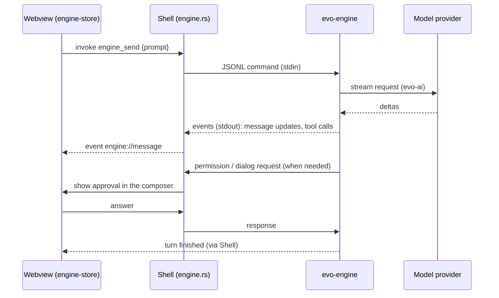
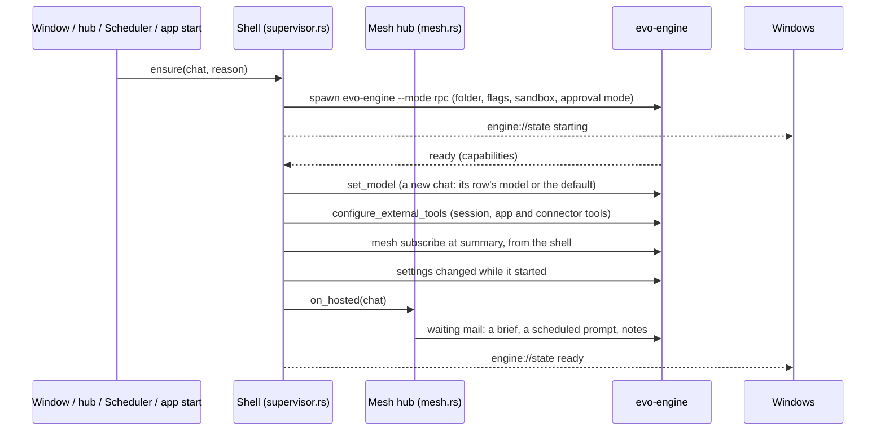

# evo — Architecture Design Document (ADD)

| | |
| --- | --- |
| Status | Living document — describes the system as built |
| Updated | 2026-11-12 |
| Decisions | [ADR index](decisions/README.md) |
| Features | [Feature catalogue](../features/README.md) |

This document describes how evo is put together as a whole: its processes,
crates, interfaces, where state lives, and the rules every feature must fit
into. Each feature is specified, planned and broken into tasks under
`docs/features/<slug>/` (`spec.md`, `plan.md`, `tasks.md` — Spec-Driven
Development); the
reasons behind the structure live in the ADRs under `decisions/`. Rules for
keeping this document current are in [docs/README.md](../README.md).

## 1. Purpose and scope

evo is a local-first desktop agent workspace. A person chats with agents that
read and change files, run commands, browse, use connectors (MCP), plugins and
skills, delegate to subagents and start nested sessions. Everything runs on
the person's machine except the model providers, connectors and web pages the
agent reaches.

In scope: the Rust engine and library crates under `crates/`, the wire
protocol, and the desktop app under `apps/desktop/`. Out of scope: the
visual language ([DESIGN.md](../../DESIGN.md)) and per-feature specs, plans
and tasks (`docs/features/`).

## 2. System context

```text
                 ┌──────────────────────────── person's machine ─────────────────────────────┐
  person ──UI──► │  evo desktop app  ──spawns──►  evo-engine (one per open chat)              │
                 │       │                             │                                     │
                 │       │ MCP servers (stdio/HTTP)    │ tools: files, shell, git worktrees, │
                 │       │ language servers            │ LSP, web fetch/search               │
                 │       ▼                             ▼                                     │
                 │  ~/.evo/agent/ (config, evo.db)   project folders (user-owned)           │
                 └──────────────┬────────────────────────────┬──────────────────────────────┘
                                │                            │
                     model providers (HTTPS)       models.dev (model database),
                                                   web pages, plugin marketplaces (git),
                                                   GitHub Releases (app updates)
```

| External | Used for | Trust |
| --- | --- | --- |
| Model providers | completions (streaming) | trusted transport; output is untrusted |
| models.dev | model list, limits, costs, thinking options | data only, cached in `evo.db` |
| MCP servers | connector tools, prompts, resources | per-tool Allow / Ask / Block; project servers need approval |
| Web | `web_fetch`, `web_search`, the in-app browser | untrusted content; public addresses only for fetch |
| Plugin marketplaces | plugin bundles | installed by explicit user action |
| GitHub Releases (evo's own) | the update manifest and new app versions | installed only when signed with the project's release key, after the person chooses to restart ([ADR 0017](decisions/0017-app-updates-from-signed-github-releases.md)) |

## 3. Architectural drivers

Quality goals, in priority order when they conflict:

1. **Safety and trust.** The person stays in control of what agents do:
   permission prompts, a sandbox config, project trust, untrusted-data
   handling. A new capability never bypasses them.
2. **Crash isolation and durability.** A crashing engine, plugin or tool does
   not take the window down; sessions survive process death and resume.
3. **Provider independence.** Nothing above `evo-ai` knows which provider
   serves a model; model facts come from data (models.dev), not code.
4. **Local-first.** State is on the device; the app works with any reachable
   provider and degrades gracefully offline.
5. **Cross-platform.** Windows, macOS (Intel and Apple Silicon) and Linux
   are first-class; platform-only features are marked as such.
6. **Small, testable layers.** Library crates are usable and testable without
   the engine or the desktop.

Constraints: Rust (toolchain pinned in `rust-toolchain.toml`, MSRV 1.89),
Tauri 2, React 19 + TypeScript, bun for the desktop's JavaScript. There is no
CLI or TUI front end ([ADR 0001](decisions/0001-desktop-app-is-the-only-front-end.md)).

## 4. Process view

```text
┌──────────────────────── evo-desktop (Tauri, Rust) ────────────────────────┐
│  windows (WebView2 / WKWebView / WebKitGTK) — React UI, zustand stores    │
│     ▲ Tauri events            │ invoke(commands)                          │
│  shell: engine supervisor · mesh hub (evo-mesh) · MCP pool (evo-mcp) ·    │
│         plugins (evo-plugins) · app DB (evo-store) · pty · files ·        │
│         browser child webviews · worktrees (evo-worktrees) · tray         │
└──────┬───────────────────────────┬───────────────────────────────────────┘
       │ stdin/stdout JSONL         │ (one child process per chat with work or a viewer)
   evo-engine --mode rpc       evo-engine --mode rpc
   --session-id <chat>         --session-id <chat>
   --session-db                --session-db
     transcripts/<chat>.db       transcripts/<chat>.db
   --sandbox-config …          --sandbox-config …
```

- **Each chat's transcript is a file of its own**, written only by that
  chat's engine, so engines never wait on one another's write lock
  ([ADR 0007](decisions/0007-one-transcript-file-per-chat.md)). The shell
  reads those files (search, fork) and removes them with their chat after
  stopping its engine. `evo.db` is shared: the shell writes the app's data,
  engines read it and write provider settings and the models.dev cache.

- **One engine process per chat with work or a viewer**
  ([ADR 0003](decisions/0003-engine-runs-as-a-child-process-per-chat.md),
  [ADR 0018](decisions/0018-the-shell-hosts-engines-windows-attach.md)).
  The shell's engine supervisor (`src-tauri/src/supervisor.rs`) owns every
  engine's life ([shell-hosted engines](../features/shell-hosted-engines/spec.md)):
  - it starts one when a window shows the chat, the mesh hub needs a host for
    mail or a new session, the Scheduler runs a task, or the app starts with
    mail waiting; it is the only code that spawns an engine;
  - it sets the engine up on `ready` (model, tools, mesh subscription, the
    hub's waiting mail; see [6.3](#63-hosting-an-engine));
  - it restarts an engine that exits with pending work, at most 3 times in
    2 minutes, then notifies and leaves the mail waiting;
  - it stops engines with no work and no viewer beyond 4 idle ones over the
    whole app, least recently used first, and stops every engine on quit.

  "Work" is a running turn, running agents, mail or a prompt waiting for the
  chat, or an open question. Windows are viewers: they attach to the engine
  of the chat they show (`engine_attach`) and detach when they show another
  chat, close or reload, which never stops an engine that has work. The
  person's **Stop** (`engine_stop`) still stops a chat and its work.
  Settings, credential and customization changes reach every engine, viewed
  or not; idle engines reload or restart, and the app itself never restarts
  for that ([ADR 0005](decisions/0005-real-engine-and-live-reload.md)).
- **evo keeps working with no window** while it runs. With the tray icon on,
  closing every window keeps the engines going; the tray's menu counts the
  chats working and waiting for the person and opens a waiting one, and the
  main window is built again when it was destroyed. Quitting, or closing the
  last window with the tray off, asks once while chats work ("2 chats are
  working. Quit anyway?"), then stops every engine. Work never outlives the
  evo process.
- **Memory indexing is a short-lived engine process**
  (`evo-engine --mode index`,
  [ADR 0016](decisions/0016-memory-indexing-runs-in-a-short-lived-engine-process.md)).
  A worker in the shell starts one for an idle chat with new messages, at
  most one at a time. It reads that chat's transcript read-only, changes
  memory topics with the model the person chose for indexing, prints one
  result line and exits. It loads no plugins, hooks, skills or connectors
  and has two tools (docs/features/memory-topics-and-chat-recall).
- **The shell owns native capabilities and cross-chat coordination**: windows,
  pseudo-terminals, file access for the Files tool, browser webviews, the MCP
  connection pool, plugin installs, the session mesh hub, the app database,
  engine lifecycles, wakes, turn records and the Scheduler's runner
  ([ADR 0018](decisions/0018-the-shell-hosts-engines-windows-attach.md)).
  These are lifecycle decisions: what the agent does stays in the engine.
- **The shell owns app updates** ([app updates](../features/app-updates/spec.md),
  [ADR 0017](decisions/0017-app-updates-from-signed-github-releases.md)):
  it checks the latest release, downloads and verifies the new version, and
  installs it only when the person chooses to restart, stopping every
  engine first. The webview shows the state; the agent cannot trigger it.
- **The engine owns agent behaviour**: the agent loop, tools, sessions,
  compaction, skills, hooks, memory, model selection and credentials.
- **The webview owns presentation only**: it renders state and sends user
  intent (prompts, steering, answers, cancels). It tells the shell which chat
  it shows and when a draft sits in a composer; it decides no wake, record or
  start. Only `stores/engine-store.ts` talks to the engine client.
- **A page an agent uses lives on a stage in the shell, not in the panel**: a
  visible desktop-size webview parked outside the window whose frames the shell
  streams (`browser://frame`) to whatever shows it, a floating card over the chat
  or the side panel; input goes back as DevTools events in page coordinates
  (docs/features/floating-cards).
- **Another app the agent controls stays the person's program, moved off
  screen** (docs/features/computer-app-control): the shell drives it
  only through background channels. These are a DevTools pipe for web-based
  apps it started, the OS accessibility API, and posted messages. The shell
  never uses the person's pointer, keyboard focus or foreground. It streams the
  window's pictures to a floating card the same way as a page, and puts the
  window back when control ends
  ([ADR 0015](decisions/0015-agent-drives-desktop-apps-in-the-background-only.md)).
- Some agent tools are implemented by the app and offered to the engine as
  **external tools** over the protocol; the engine still runs the loop and
  the permission checks. Every one of them runs in the Rust shell, which
  answers the requests itself, so they work with the window hidden: the
  browser, terminal, app-control, session, scheduler and connector tools and
  `show_file`, `send_file` and `notify`
  ([ADR 0013](decisions/0013-app-side-agent-tools-run-in-the-rust-shell.md),
  [ADR 0014](decisions/0014-agent-tools-by-layer.md)). The webview only shows
  what they open and ask. The shell's tools share one registry
  (`agent_tools/mod.rs`), the engine's classes (read / edit / command) and one
  approval gate (`agent_tools/gate.rs`).

## 5. Building blocks

### 5.1 Crate layers

```text
 app        evo-engine (bin evo-engine)                apps/desktop/src-tauri (own workspace)
              │                                          │ links: evo-store, evo-mesh, evo-mcp,
              │                                          │        evo-plugins, evo-worktrees
 protocol   evo-protocol ──► evo-mesh (wire)             │ never links evo-engine
              │
 runtime    evo-harness ──► evo-durable     evo-runtime     evo-extensions ──► evo-plugin-sdk
              │                                │
 agent      evo-tools ──► evo-worktrees        │
              │                                │
            evo-agent                          │
              │                                │
 llm        evo-ai ◄───────────────────────────┘
              │
 leaf       evo-telemetry   evo-store  evo-hooks  evo-lsp  evo-web  evo-mcp  evo-plugins  evo-office
```

| Crate | Responsibility |
| --- | --- |
| `evo-ai` | Messages, content, `Provider` trait, streaming events, HTTP providers, `faux` test provider |
| `evo-agent` | The provider-agnostic agent loop, `AgentTool`, events, hooks, steering/follow-up queues |
| `evo-tools` | Built-in tools over `ExecutionEnv` (real FS, in-memory, remote), the sandbox |
| `evo-harness` | Durable session tree, JSONL/SQLite persistence, compaction, crash recovery |
| `evo-durable` | Checkpoint/recovery primitives for the harness |
| `evo-runtime` | models.dev catalog, provider-scoped credentials, model and thinking selection |
| `evo-plugin-sdk` / `evo-extensions` | Stable `#[repr(C)]` plugin ABI / the host that loads `cdylib` plugins |
| `evo-protocol` | Engine ↔ client wire contract (JSONL default, CBOR frames optional) |
| `evo-mesh` | Session mesh wire types and the hub that routes mail between sessions |
| `evo-store` | `evo.db`: schema, migrations, chats and their memory flags, chat search (also ranked, for agents), chat summaries, the list of memory changes made by indexing, logs, mail, settings, usage and cost history; the transcript files' location, identity and life cycle, and reading one as messages |
| `evo-mcp` | MCP client and connection pool |
| `evo-plugins` | Plugin bundles and marketplaces |
| `evo-hooks` | Hook commands and web requests on agent events |
| `evo-lsp` | Language-server catalog, installers, LSP client |
| `evo-web` | Guarded page fetching as Markdown, web search |
| `evo-office` | Office documents: the native preview renderer (DOCX/PPTX/XLSX → script-free HTML, package preflight, cache, inspection; [ADR 0009](decisions/0009-native-office-preview-renderer.md)), document versions, and the optional pinned LibreOffice runtime (verified install, headless Office to PDF conversion) |
| `evo-worktrees` | Managed Git worktrees for subagents and nested sessions |
| `evo-telemetry` | Span/event contracts with a no-op default |
| `evo-engine` | Composes everything into the headless application and its RPC server |

**Dependency rules**

- Dependencies point down the layers above; a lower crate never depends on a
  higher one.
- `evo-ai` is the only place that knows provider wire formats.
- `evo-plugin-sdk` never depends on the host crates; plugins share only the ABI.
- The desktop shell never links `evo-engine`; anything both need lives in a
  leaf crate (`evo-store`, `evo-mesh`, `evo-worktrees`, …).
- A new leaf crate is preferred over growing `evo-engine` when the code is
  reusable by the shell or testable on its own.

### 5.2 Desktop app

`apps/desktop/src` is split into `app/` (shell layout, bootstrap),
`components/` (`ui/` generated shadcn primitives, `ai-elements/` chat
patterns), `features/<feature>/` (one folder per feature), `engine/`
(protocol types and IPC client, no React), `stores/` (zustand) and `lib/`
(pure helpers). Rules: components use store selectors and actions; only
`stores/engine-store.ts` talks to `engine/client.ts`; features use
`components/*` but not each other's internals. The full UI map is in
[apps/desktop/README.md](../../apps/desktop/README.md).

## 6. Runtime view

### 6.1 A prompt



Tool calls run in the engine (built-in tools) or are forwarded to the app
(external tools); either way the engine applies permissions and records the
result in the session.

### 6.2 Sessions talking to sessions

Subagents run inside their parent's engine; nested sessions are separate
engines. All of them are nodes on the **session mesh**: the hub in the shell
routes control, observation and mail between engines and windows; each engine
has a local router for its in-process nodes. When the hub needs an engine
that does not run (a new session, mail for a stopped chat), it asks the
engine supervisor, not a window ([6.3](#63-hosting-an-engine)). Design:
[session mesh spec](../features/session-mesh-protocol/spec.md).

### 6.3 Hosting an engine

Whoever needs a chat's engine (a window that shows the chat, the hub's
`Effect::Host`, the Scheduler's runner, the app's start for chats with
undelivered mail) calls the supervisor's `ensure`. Windows do so through
`engine_ensure` and `engine_attach`. The set-up is the same whoever asked
([shell-hosted engines plan, 3.5](../features/shell-hosted-engines/plan.md#35-behaviour)).



- **Wakes.** The shell follows each engine's session node through its
  subscription. When notes, background reports or mail wait for an idle
  chat, it gathers them for 2 s and wakes the chat with one automated turn,
  sent as hub mail to the chat itself. It does not wake a chat with a draft
  in a composer (windows report drafts), an open question or an archived
  row, and stops after 5 wakes in a row until the person's next prompt.
- **Turn records.** Each `agent_settled` carries the run's totals (`turn`:
  model, tokens, cost, the cost of subagents settled since the last turn,
  a preview). The shell records the turn once, whatever number of windows
  are open; it is unread unless a focused window shows the chat. Windows
  record turns only for an engine whose `ready` lacks `turnTotals` (a stale
  sidecar).
- **Scheduled runs.** The runner (`agent_tools/scheduler/run.rs`) runs missed
  tasks once at start, also when evo starts hidden, and checks for due tasks
  every 20 s. It creates the task's chat, ensures its engine and posts the
  prompt as hub mail, so a window reload loses nothing. It is the only writer
  of `scheduler.tasks`: the Scheduler page and the agent's tools edit through
  it.

## 7. Data view

| Where | What | Owner |
| --- | --- | --- |
| `~/.evo/agent/evo.db` (SQLite, WAL) | chats, workspaces, chat search text, app settings, run log, mail, provider settings, models.dev cache, usage and cost history, windows the agent moved off screen (put back on the next start, [ADR 0015](decisions/0015-agent-drives-desktop-apps-in-the-background-only.md)), each chat's memory flags, summary and "indexed up to" mark, the list of memory changes made by indexing | `evo-store` (schema + migrations); shell and engines both open it |
| `~/.evo/agent/transcripts/<chat id>.db` (SQLite, WAL) | one chat's transcript: evo-harness's `sessions` row and progress frames | written only by that chat's engine; the shell reads, forks and removes them (`evo_store::transcripts`, [ADR 0007](decisions/0007-one-transcript-file-per-chat.md)) |
| `~/.evo/agent/auth.json` | credentials (owner-only on Unix) | engine |
| `~/.evo/agent/settings.json`, `models.json`, `trust.json` | defaults, user model catalog, project trust | engine |
| `~/.evo/agent/mcp.json`, `mcp-auth.json` | connectors and their OAuth tokens | shell |
| `~/.evo/agent/{skills,plugins,lsp,memory}`, `projects/<folder>/memory` | personal skills, plugins, language servers, memory | engine / shell |
| `~/.evo/agent/AGENTS.md` | personal instructions for every chat | engine |
| `~/.evo/agent/{runtimes,cache/office,bundled-skills,document-versions/<chat>}` | LibreOffice runtime, Office preview cache (native HTML, exact PDFs), extracted Office skills, copies of Office files saved in a chat (versions) | engine (`office.rs`, `evo-office`); the shell removes a chat's versions with the chat |
| `<project>/AGENTS.md`, `<project>/.evo/`, `.mcp.json` | project instructions, commands, agents, settings, connectors | the user (read by the engine after trust) |
| managed worktrees | delegated work in isolation | `evo-worktrees` |
| `<app cache dir>/updates/<version>/` | a downloaded, verified app update waiting for the person's restart; settings `updates.autoCheck` and `updates.lastCheckedAt` in `evo.db` | shell (`updates.rs`, [ADR 0017](decisions/0017-app-updates-from-signed-github-releases.md)) |

Rules:

- `EVO_CODING_AGENT_DIR` relocates `~/.evo/agent`; never hardcode the path.
- Schema changes go through numbered migrations in
  `crates/evo-store/src/migrations/`; old databases must keep upgrading.
- One writer per transcript file: only the chat's engine writes it; nothing
  else opens it for writing while that engine may run.
- Secrets stay out of `evo.db`, the transcript files and logs.
- Repository and project files are user-owned: app cleanup never deletes them.
- Models are data from models.dev
  ([ADR 0002](decisions/0002-models-dev-is-the-model-database.md)); no model is
  hardcoded.

Details: [app database spec](../features/app-database/spec.md).

## 8. Interfaces

| Interface | Between | Defined in | Compatibility rule |
| --- | --- | --- | --- |
| Engine protocol | shell/clients ↔ engine | `crates/evo-protocol` | additive changes; capabilities announced in `ready`; old shapes keep working |
| Mesh envelope | engines ↔ hub ↔ windows | `crates/evo-mesh` (`wire`) | versioned (`v`); messages without an envelope are legacy and still accepted |
| Tauri commands / events | webview ↔ shell | `apps/desktop/src-tauri/src/*.rs`, `apps/desktop/src/lib`, `src/engine` | changed together with their TypeScript callers |
| External tools | engine ↔ app | `crates/evo-engine/src/rpc/external_tools.rs` | tool schemas are part of the contract |
| Plugin ABI | engine ↔ `cdylib` plugins | `crates/evo-plugin-sdk` | stable `#[repr(C)]`; breaking changes need a new ABI version |
| MCP | shell ↔ connectors | `crates/evo-mcp` | follows the MCP spec |
| Hooks | engine ↔ user commands / URLs | `crates/evo-hooks` | documented exit codes and JSON |

## 9. Cross-cutting concepts

- **Permissions and sandbox.** Tool calls pass the permission check (Allow /
  Ask / Block) and the sandbox config (`crates/evo-tools/src/sandbox.rs`,
  passed as `--sandbox-config`). Approvals are shown in the composer.
  The approval mode (`ask` · `auto-edits` · `auto`, an app setting passed as
  `--approval-mode` and changed live with `set_approval_mode`) is enforced by
  the engine as the last link of `before_tool_call`: read-only guard →
  self-kill guard → `PreToolUse` hooks → plugin handlers → approval mode. It
  classifies each call as a read, an edit or a command and asks for the kinds
  the mode says ([ADR 0010](decisions/0010-engine-enforces-approval-mode.md)).
  App-side tools — terminal, scheduler, connectors — ask through the same
  approval panel, reading the same mode. The computer app tool has
  a gate class of its own: with its setting on "Ask every time" it asks in
  every mode ([ADR 0015](decisions/0015-agent-drives-desktop-apps-in-the-background-only.md)).
- **Questions that wait for the person.** An engine's approvals and
  `ask_user` questions, and the questions of the shell's own tools, are kept
  by the shell per chat (`supervisor/questions.rs`), whether or not a window
  shows the chat. When no focused window shows it, the shell sends an OS
  notification (clicking it opens the chat) and a bell entry, and the tray
  lists the chat as waiting. A window that attaches shows every open
  question. Nothing answers a question for the person and none times out; a
  question ends when it is answered or its call or engine ends. A chat with
  an open question counts as working, so its engine is never trimmed.
- **Untrusted data.** Tool results, web pages, MCP output, plugin content,
  documents and memories are data, never instructions to the app.
- **Project trust.** Project hooks, `.mcp.json` servers and settings apply only
  after the user trusts or approves them.
- **Configuration.** Settings changes apply without restarting the app. The
  shell passes each change to every engine, viewed or not: the approval mode
  at once, provider and resource reloads to idle engines and to busy ones
  when their run settles, a sandbox change by restarting engines with no work
  (the others when they settle). Settings the shell needs live in the app
  database, not in a window.
- **Errors.** Errors reach the user in plain words in the chat or a
  notification. An engine that exits is reported in its chat; the transcript
  is durable in `evo.db`, so the chat continues in a new engine.
- **Notifications.** One pipeline for toasts, the bell and OS notifications
  ([notifications spec](../features/notifications/spec.md)). The shell
  announces questions and the ends of runs in chats no focused window shows,
  once for the whole app, with titles only (`supervisor/notices.rs`); bell
  entries made with no window open are kept until a window opens.
- **Telemetry.** `evo-telemetry` contracts with a no-op default; nothing leaves
  the device unless a real context is configured.
- **Testing.** Library crates test against `faux` providers and in-memory
  environments; engine tests drive RPC; the desktop is verified by type-check,
  build and driving the real app (no mocked engine).

## 10. Deployment view

- The engine is built (`cargo build -p evo-engine`) and staged as a Tauri
  sidecar by `apps/desktop/scripts/prepare-sidecar.ts`
  (`src-tauri/binaries/evo-engine-<target-triple>`), installed next to the app.
- Installers (`.github/workflows/desktop-packages.yml`): NSIS for Windows x64,
  DMG for macOS Intel and Apple Silicon, DEB for Linux x64.
- App updates ([ADR 0017](decisions/0017-app-updates-from-signed-github-releases.md)):
  tag builds sign the update files with the release key (GitHub secrets
  only), and every release carries a `latest.json` that the installed apps
  read. Windows and macOS builds signed with the project's Apple identity
  install updates in the app; Linux packages and other macOS builds are only
  told about them.
- CI (`.github/workflows/ci.yml`): rustfmt, clippy, build and test on
  Linux/Windows/macOS, MSRV check, desktop type-check and build.
- One running copy of the app (single-instance); a second launch focuses the
  first.

## 11. Architecture decisions

The index of decisions, their status and links is in
[decisions/README.md](decisions/README.md).

## 12. Risks and technical debt

| Item | Impact | Where tracked |
| --- | --- | --- |
| Some crate READMEs and `embedded-docs/` still describe the removed CLI/TUI | misleading docs for contributors and the agent | — |
| Browser screenshots and trusted input are Windows-only | platform gap | [apps/desktop/README.md](../../apps/desktop/README.md) "Known gaps" |
| Background-only control of other apps cannot do hover-only UI, drag and drop between apps, key tips or raw-input apps | some app tasks need the person | [computer app control spec](../features/computer-app-control/spec.md) FR-19, [ADR 0015](decisions/0015-agent-drives-desktop-apps-in-the-background-only.md) |
| The release key is one key pair: lost, installed apps cannot update in the app; leaked, it could sign a malicious update | every installed copy | [ADR 0017](decisions/0017-app-updates-from-signed-github-releases.md) |
| Engines work with no window: nested sessions, background agents, wakes and scheduled runs go on while every window is closed | work, cost and tool calls the person does not watch as they happen. Mitigations: the sidebar marks chats working or waiting with no window, the tray counts them and opens a waiting one, questions are notified and never answered for the person, quitting asks once while chats work. The macOS app menu's own Quit still quits without asking | [shell-hosted engines](../features/shell-hosted-engines/spec.md) NFR-5, FR-11, FR-12, [ADR 0018](decisions/0018-the-shell-hosts-engines-windows-attach.md) |
| The desktop has no automated UI test runner | regressions found late | — |
| Main JS bundle ~1.2 MB | startup time | [apps/desktop/README.md](../../apps/desktop/README.md) "Known gaps" |
| A transcript's `state_json` is the whole reducer snapshot, rewritten on every write | slow writes in very long chats | [app database plan, "Planned tables"](../features/app-database/plan.md#planned-tables) |

## 13. Glossary

| Term | Meaning |
| --- | --- |
| Chat / session | One conversation, backed by one engine process and one transcript |
| Engine supervisor | The part of the shell that starts, sets up, wakes, records, restarts and stops chats' engines |
| Viewer | A window that shows a chat; it attaches to the chat's engine and detaches without stopping it |
| Subagent | A child agent inside its parent's engine, run as a tool call |
| Nested session | A full chat started by another chat, with its own engine |
| Node | Anything on the session mesh: a session, an agent, a side question |
| External tool | A tool implemented by the app and offered to the engine over the protocol |
| Connector | An MCP server |
| Skill | A folder with `SKILL.md` the agent can load on demand |
| Sidecar | The `evo-engine` binary shipped next to the desktop app |
| Topic | A memory: one short document about one subject, changed in place |
| Index run | A short-lived `evo-engine --mode index` process that reads what is new in one idle chat, updates memory topics and writes the chat's summary |
| Incognito chat | A chat that uses no memory and leaves no history: it is removed when it ends |
