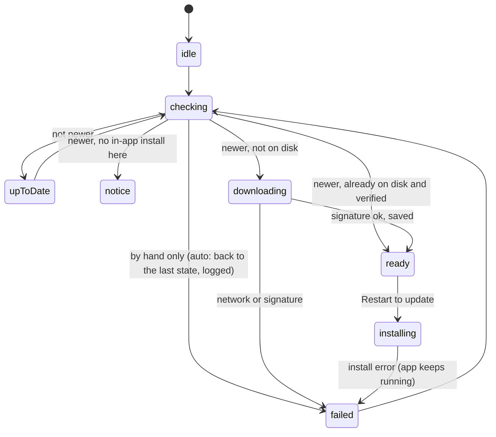
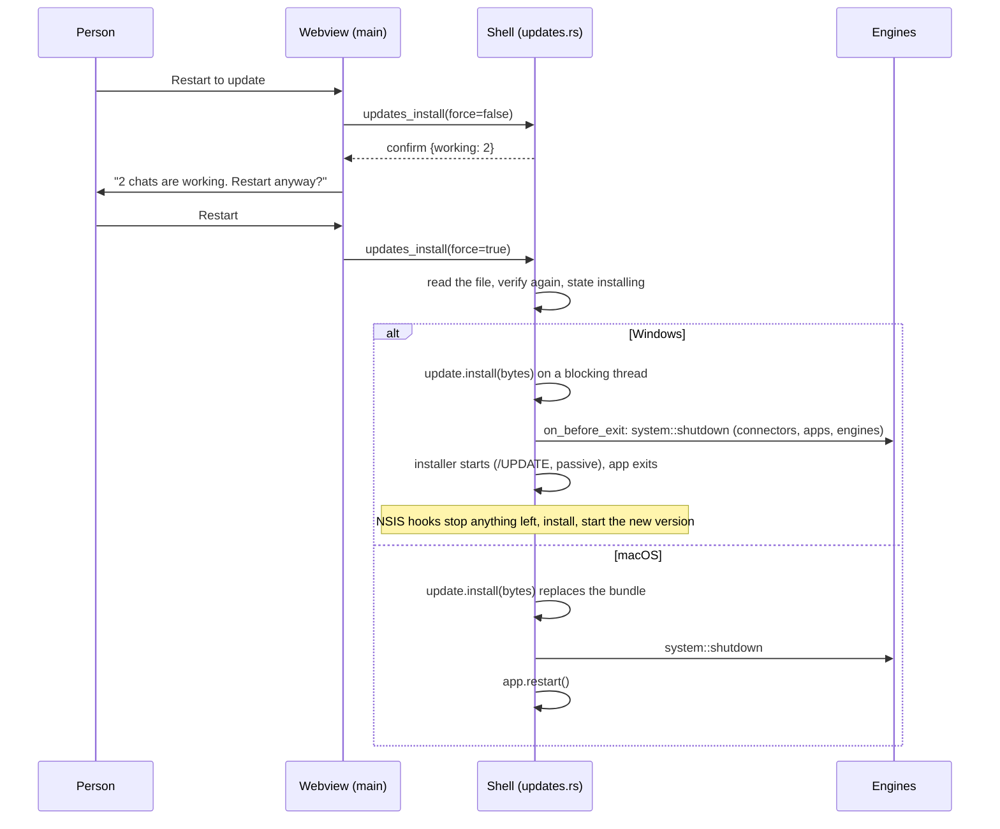

# App updates — Plan

| | |
| --- | --- |
| Spec | [spec.md](spec.md) |
| Tasks | [tasks.md](tasks.md) |
| Updated | 2026-11-10 |
| ADD sections | [2. System context](../../architecture/README.md#2-system-context), [4. Process view](../../architecture/README.md#4-process-view), [7. Data view](../../architecture/README.md#7-data-view), [10. Deployment view](../../architecture/README.md#10-deployment-view), [12. Risks](../../architecture/README.md#12-risks-and-technical-debt) |
| ADRs | [0017 The app updates itself from signed GitHub releases](../../architecture/decisions/0017-app-updates-from-signed-github-releases.md) |

## 1. Context and constraints

What exists today:

- The app's version is set in three files that the release job keeps equal
  to the tag: `apps/desktop/package.json`, `apps/desktop/src-tauri/Cargo.toml`
  and `apps/desktop/src-tauri/tauri.conf.json`. **Settings → About**
  (`apps/desktop/src/features/settings/sections/system-settings.tsx`) shows
  it and nothing else.
- `.github/workflows/desktop-packages.yml` builds on a `v*` tag: NSIS for
  Windows x64, DMG for macOS Intel and Apple Silicon (signed and notarized
  only when the Apple secrets exist, otherwise ad hoc), DEB for Linux x64.
  The release job checks the versions, uploads the files to a draft GitHub
  release and then publishes it as the latest. The releases are public.
- The NSIS installer hooks (`apps/desktop/src-tauri/windows/hooks.nsh`)
  already stop the app and every `evo-engine.exe` started from the install
  folder before files are replaced. The installer is per user, so it needs
  no administrator rights.
- The shell sees every line every engine prints (`engine.rs`, the stdout
  loop that calls `log_message`), including `agent_start` and `agent_end`.
  It knows which engines run (`EngineState::running`) but not yet which are
  working.
- On exit the shell stops the connectors, puts back controlled apps and
  kills every engine (`lib.rs`, `RunEvent::Exit`). On Windows a job object
  also kills the engines when the app ends.
- App settings live in `evo.db` (`evo_store::settings`), read by the shell
  and written from the webview with `settings_set`.
- Notifications go through `notify()`
  ([notifications plan](../notifications/plan.md)). Notifications cannot
  carry buttons yet: that is [notifications](../notifications/spec.md) FR-14,
  open as its task T10.

The updater library: `tauri-plugin-updater` 2.10 (read from its source, not
only its docs):

- `check()` downloads a JSON manifest from fixed endpoints over HTTPS, picks
  the platform entry `{os}-{arch}-{installer}`, then `{os}-{arch}` (for
  example `windows-x86_64-nsis`, `windows-x86_64`, `darwin-aarch64`), and
  returns an `Update` when the remote version is higher.
- A version comparator can be set. It is called with the remote release
  **before** the platform entry is looked up. A missing entry makes
  `check()` fail with `TargetsNotFound`, even when the version is not newer.
- `Update::download()` keeps the whole file in memory and checks its
  minisign signature against the public key in `plugins.updater.pubkey`
  before returning it. Checking the signature cannot be turned off. The
  verifier is the `minisign-verify` crate; the plugin's own verify function
  is private.
- `Update::install(bytes)`:
  - Windows: writes the installer to a temporary folder, runs the
    `on_before_exit` hook, starts the installer with `/UPDATE` and the
    install mode's arguments (`passive`: a progress window and no
    questions), then ends the app with `std::process::exit(0)`. The app's
    own exit handlers do not run.
  - macOS: replaces the `.app` bundle in place. The app keeps running and
    must restart itself.
  - Linux: can install a `.deb` (through a privilege prompt) or an
    AppImage. evo does not use this (spec FR-12).
- Its declared minimum Rust version is 1.77.2, below the shell's 1.89.
- The build creates update files only with `bundle.createUpdaterArtifacts`.
  It then signs them with the key in `TAURI_SIGNING_PRIVATE_KEY` (and
  `TAURI_SIGNING_PRIVATE_KEY_PASSWORD`). The NSIS installer becomes its own
  update file (`*-setup.exe` + `.sig`); the macOS bundle gets an archive
  next to it (`*.app.tar.gz` + `.sig`).

Two facts that shape the rollout:

- **Version 4.2.1 and older have no updater.** People on those versions
  install the first release that has one by hand. Updates work from that
  release on.
- **The key cannot be replaced silently.** Installed apps trust only the
  public key they were built with. If the private key is lost or leaks, a
  new key reaches people only through a release they install by hand.

## 2. Architecture check

| Rule | Result | Notes |
| --- | --- | --- |
| The engine owns agent logic; the shell relays and provides native features | ok | Updating the app is a native feature of the shell. The engine does not change and is not told; it is stopped like at any exit. |
| Layers point down; library crates stay free of engine/desktop concerns | ok | No crate changes. The plugin and `minisign-verify` are dependencies of the shell only. |
| Protocol changes update `evo-protocol`, the engine and the desktop together | n/a | No protocol change. |
| Models come from models.dev; no hardcoded model facts | n/a | No model data. |
| Real engine in the app; settings and credentials reload live | ok | **Check for updates automatically** is read by the shell before every check, so it applies without a restart. |
| Untrusted input stays untrusted; permissions, sandbox and project trust stay in the path | deviation, [ADR 0017](../../architecture/decisions/0017-app-updates-from-signed-github-releases.md) | A new trust boundary: the app downloads code and runs it. It is installed only if it is signed with the project's release key (3.7). The agent has no way to trigger a check or an install. |
| Desktop UI structure and `DESIGN.md` | ok | A store in `stores/` talks to the shell; settings rows use the existing controls; the notification button extends the notifications pipeline instead of building a second one. |
| A new external data source or toolchain changes the ADD | ok | GitHub Releases becomes an external source of code. The ADD's sections 2, 4, 7, 10 and 12 change, with ADR 0017, in the same commit as this plan. |

## 3. Design

### 3.1 Overview

```text
 GitHub release (latest)                     desktop shell (Rust)                      webview (main window)
 ┌────────────────────────┐   HTTPS   ┌─────────────────────────────────────┐  events  ┌──────────────────────────┐
 │ latest.json            │◄──check───│ updates.rs                          │─────────►│ stores/updates-store.ts  │
 │ Evo…-setup.exe (+sig)  │◄─download─│  timer · state machine · cache      │          │  → About row, General    │
 │ evo…aarch64.app.tar.gz │           │  verify (minisign, built-in key)    │◄─invoke──│    switch, notify()      │
 │ evo…x64.app.tar.gz     │           │  install: stop engines → installer  │          │    + "Restart to update" │
 └────────────────────────┘           └─────────────────────────────────────┘          └──────────────────────────┘
          ▲ built, signed and assembled by desktop-packages.yml (release key in GitHub secrets)
```

The shell owns the whole update: when to check, the download, the
verification, the copy on disk and the install. It works while the window
is hidden in the tray. The webview shows the state, the main window raises
the notifications, and the person's clicks come back as commands. The
release pipeline signs the update files and publishes `latest.json` with
the release, so the endpoint
`https://github.com/evoelsewhere/evo-harness/releases/latest/download/latest.json`
always describes the latest published release.

### 3.2 Components

| Layer | Path | Responsibility | Requirements |
| --- | --- | --- | --- |
| desktop shell | `apps/desktop/src-tauri/src/updates.rs` (new) | The updater: the check timer, the state machine and its `updates://state` event, the version comparator, the notice-only decision, the download with progress, the copy on disk, the second signature check before install, the install and restart. Tauri commands `updates_state`, `updates_check`, `updates_install`. | FR-1, FR-2, FR-4, FR-5, FR-6, FR-8, FR-10, FR-12, FR-13, FR-14, NFR-2, NFR-3, NFR-5, NFR-6 |
| desktop shell | `apps/desktop/src-tauri/src/engine.rs` | `EngineState::working()`: chats between `agent_start` and `agent_end`, cleared when an engine stops or exits. | FR-9 |
| desktop shell | `apps/desktop/src-tauri/src/lib.rs` | Register the updater plugin, the commands and `updates::setup`. Move the exit steps (connectors, controlled apps, engines) into one function, `system::shutdown`, used by `RunEvent::Exit` and before an install. | FR-10 |
| desktop shell | `apps/desktop/src-tauri/Cargo.toml` | `tauri-plugin-updater = "~2.10"` (desktop targets only), `minisign-verify = "0.2"`, `base64` (already present). | FR-6 |
| desktop shell | `apps/desktop/src-tauri/tauri.conf.json` | `plugins.updater`: `pubkey`, `endpoints`, `windows.installMode: "passive"`. Not `createUpdaterArtifacts` (NFR-7). | FR-6, FR-15, NFR-2, NFR-4 |
| desktop UI | `apps/desktop/src/stores/updates-store.ts` (new) | Mirrors the shell's state (`updates_state`, then `updates://state`); actions `check()` and `install(force)`; raises the update notifications from the main window only. | FR-3, FR-7, FR-9, FR-13 |
| desktop UI | `apps/desktop/src/features/settings/sections/update-row.tsx` (new) | The **Updates** row in **Settings → About**: state, progress, last check, **Check for updates**, **Restart to update**, **What's new**, and the confirmation dialog when chats are working. | FR-3, FR-9, FR-11, FR-12, FR-14 |
| desktop UI | `apps/desktop/src/features/settings/sections/system-settings.tsx` | Mount the row under the header in **About**. | FR-3 |
| desktop UI | `apps/desktop/src/features/settings/sections/general-settings.tsx` | **Updates** group with **Check for updates automatically** (`updates.autoCheck`). | FR-2 |
| desktop UI | `apps/desktop/src/app/use-app-bootstrap.ts` | Start the updates store in the main window (`chatWindowId === null`), as the scheduler does. | FR-7 |
| desktop UI | `apps/desktop/src/stores/notification-store.ts`, `features/notifications/notify.ts`, `toaster.tsx`, `notification-center.tsx`, `open-target.ts` | Notification actions: buttons on the toast and the bell row, stored as data (`{ label, command }`) and run through a small command registry. This builds [notifications](../notifications/spec.md) FR-14 for toasts and the bell; OS notifications still have no buttons. | FR-7 |
| release pipeline | `.github/workflows/desktop-packages.yml` | Sign the update files on tag builds; describe each platform in a small manifest file; build `latest.json` from them and upload it before the release is published. | FR-15, NFR-2, NFR-7 |
| release pipeline | `.github/scripts/updater_manifest.py` (new) | Builds and checks `latest.json` from the platform files and the release's asset list. | FR-15 |
| docs | `apps/desktop/README.md`, ADD, ADR 0017 | UI map rows; the release key and how to rotate it. | NFR-2 |

### 3.3 Interfaces

**Tauri commands** (main window only; a call from a chat window is refused):

```rust
#[tauri::command] fn updates_state(app: AppHandle) -> UpdateState
#[tauri::command] async fn updates_check(app: AppHandle) -> UpdateState      // by hand: errors are shown
#[tauri::command] async fn updates_install(app: AppHandle, force: bool) -> InstallReply
```

**Event** `updates://state`, payload `UpdateState`, sent on every change
(download progress at most four times a second).

```ts
type UpdateState = {
  current: string;               // installed version
  lastCheckedAt: number | null;  // ms since epoch, last check that reached the server
  status:
    | { kind: "unavailable" }                                    // development build (FR-14)
    | { kind: "idle" }                                           // never checked this run
    | { kind: "upToDate" }
    | { kind: "checking"; manual: boolean }
    | { kind: "downloading"; version: string; received: number; total: number | null }
    | { kind: "ready"; version: string }
    | { kind: "notice"; version: string }                        // FR-12: newer, install by hand
    | { kind: "installing"; version: string }
    | { kind: "failed"; stage: "check" | "download" | "verify" | "install"; message: string; version?: string };
};

type InstallReply =
  | { kind: "started" }                 // the app is about to close or restart
  | { kind: "confirm"; working: number } // chats are working and force was false
  | { kind: "notReady" };
```

The webview builds the links from `REPOSITORY_URL`: release notes at
`/releases/tag/v<version>` (FR-11), the download page at `/releases/latest`
(FR-12, FR-13).

**Update manifest** (`latest.json`, one per release, the format the plugin
reads):

```json
{
  "version": "4.3.0",
  "notes": "https://github.com/evoelsewhere/evo-harness/releases/tag/v4.3.0",
  "pub_date": "2026-11-20T08:00:00Z",
  "platforms": {
    "windows-x86_64": { "url": "https://github.com/…/Evo.Harness_4.3.0_x64-setup.exe", "signature": "<content of the .sig file>" },
    "darwin-aarch64": { "url": "https://github.com/…/evo-harness_4.3.0_aarch64.app.tar.gz", "signature": "…" },
    "darwin-x86_64":  { "url": "https://github.com/…/evo-harness_4.3.0_x64.app.tar.gz", "signature": "…" }
  }
}
```

No `linux-*` entry ever, and no `darwin-*` entry for a release whose macOS
builds were not signed with the Apple identity: those apps get the notice
(3.5).

**Platform file** (written by each build job, an artifact of the build;
consumed only by the release job):

```json
{ "platform": "darwin-aarch64", "eligible": true, "asset": "evo-harness_4.3.0_aarch64.app.tar.gz", "signature": "…" }
```

`eligible` is false (and `asset`/`signature` absent) for Linux and for a
macOS build without the Apple identity.

**Notification actions** (notifications pipeline):

```ts
interface NotificationAction { label: string; command: string } // e.g. { label: "Restart to update", command: "updates.install" }
notify({ …, actions: [action] });
registerNotificationCommand("updates.install", () => …);         // run when the button is clicked
```

Actions are data, so they survive in the persisted bell. A command with no
registered handler (an older or newer app version) hides the button.

Compatibility: all of this is new. Apps up to 4.2.1 never request
`latest.json`. Releases made before this feature have no `latest.json`, so
the endpoint returns 404 until the first release that has one; the app
treats that as "could not check" (3.6).

### 3.4 Data and storage

| What | Where | Lifetime |
| --- | --- | --- |
| `updates.autoCheck` | app settings in `evo.db` | boolean, default `true` (missing = on) |
| `updates.lastCheckedAt` | app settings in `evo.db` | last check that reached the server, ms since epoch |
| Downloaded update | `<app cache dir>/updates/<version>/<file name>` | written after the first signature check; deleted when a newer version replaces it, when it fails a check, and at start for every version not newer than the running one |
| `UpdateState`, the `Update` object of the last check | shell memory (`UpdatesState`, managed by Tauri) | one app run |

No migration: settings are key/value rows. The download is not kept in
memory between the check and the install; it is read back from disk and
verified again just before installing (3.7).

### 3.5 Behaviour

**When the shell checks (FR-1, FR-2, FR-14, NFR-5).** `updates::setup`
does nothing in a debug build (`unavailable`). Otherwise a task waits
until 30 s after setup (the window is shown by then), checks once, then
wakes every 10 minutes and checks when `updates.lastCheckedAt` is 6 hours
old or older. Comparing wall-clock times copes with the computer sleeping.
Before each automatic check it reads `updates.autoCheck`; when it is off,
it does nothing. Turning the setting on from the webview calls
`updates_check` once, so the person sees a result. One check or download
runs at a time; a second request gets the current state.

**One check.**



1. The updater is built with a comparator that records the remote version
   and returns `remote > current` (FR-4).
2. `check()` returns:
   - `Some(update)`: newer, with an entry for this platform. On Linux the
     shell never installs, so the state is `notice` (FR-12). Elsewhere: if
     `<cache>/updates/<version>/` holds the file and it verifies, `ready`;
     if not, `downloading`.
   - `None`: `upToDate`.
   - `TargetsNotFound` with a recorded remote version higher than the
     current one: `notice` (Linux, or macOS for a release without the Apple
     identity). With a version not higher: `upToDate`.
   - Any other error: `failed { stage: "check" }` for a check by hand; for
     an automatic one the state stays as it was and the error goes to the
     run log (FR-13).
3. `lastCheckedAt` is saved after every check that got an answer from the
   server.
4. A newer version found while an older one is `ready` replaces it; the
   older file is deleted.

**Download (FR-5, FR-6, NFR-6).** `Update::download` streams the file
(progress events) and checks the signature. A good file is written to the
cache folder under a temporary name and then renamed, so a half-written
file is never taken as ready. A failed signature check deletes everything
for that version and sets `failed { stage: "verify" }`. A network error
sets `failed { stage: "download" }`. Both are retried at the next check.

**Notifications (FR-7, FR-12).** The main window's store reacts to state
changes. On entering `ready` for a version it has not announced in this
run: `notify({ source: "updates", level: "info", key: "updates",
title: "Evo Harness <version> is ready", target: { type: "settings",
section: "about" }, actions: [{ label: "Restart to update", command:
"updates.install" }] })`. The key keeps one entry in the bell; a newer
version replaces it. On entering `notice`: the same key, title
"Evo Harness <version> is available", target the download page, no
action. `failed` with stage `verify`: a `warning` with the same key. The
other failures only change the About row.

**Install (FR-8, FR-9, FR-10).**



- `updates_install(false)` replies `confirm` when `EngineState::working()`
  is not empty, without changing anything. The webview asks with an in-app
  dialog and calls again with `true`, or does nothing (FR-9).
- `force = true` installs even if chats started working since the
  question; the dialog was the person's decision.
- Everything that can fail runs before the engines stop: the file read,
  the second signature check, and on Windows the extraction (inside
  `install`, before `on_before_exit`). If one fails, the app keeps running
  as it was and the state is `failed { stage: "install" }`.
- After a successful macOS install the old bundle is gone, so an error
  from `restart` is logged and the app exits; the next start runs the new
  version.
- Chats that were working are saved by their engines as after any stop
  (the transcript is durable) and continue in the new version (FR-10).

**At start (FR-10 check, cleanup).** `updates::setup` deletes cache folders
for versions not newer than the running one; a successful update therefore
cleans up after itself.

### 3.6 Errors and edge cases

| Case | What the person sees |
| --- | --- |
| Offline or GitHub unreachable, automatic check | Nothing new; the About row keeps its last state; the run log has the error. |
| Same, check by hand | About row: "Couldn't check for updates: <reason>", with **Check for updates** to retry. |
| No `latest.json` in the latest release (releases before this feature) | Same as unreachable (404). |
| Download cut off or the computer slept | About row: "Download failed", retried at the next check; the installed app is untouched. |
| Signature does not match | About row: "The update could not be verified"; a warning notification; the file is deleted; retried at the next check. |
| Newer release while one is ready | The newer one is downloaded; when it is ready it replaces the older one in the row and the bell. |
| The person quits normally with an update ready | Nothing is installed. At the next start the check finds the file on disk and offers it again without a new download. |
| Several windows open | `system::shutdown` and the exit close all of them; only the main window raises notifications. |
| macOS app on a read-only place (run from the DMG, a locked folder) | Install fails before the engines stop; About row: "Couldn't install the update", with a link to the download page. |
| Install on Windows fails after the app exited | The installer shows its own error; the old version is still installed and starts normally. |
| Development build, browser preview | About row: "Updates aren't available in this build"; no request is made. |
| A chat window calls an update command | Refused; only the main window drives updates. |

### 3.7 Security and trust

- **What is trusted:** a file is installed only if its minisign signature
  matches the public key built into the running app
  (`plugins.updater.pubkey`). The check runs twice: after the download
  (by the plugin) and again on the file read back from disk just before
  install (by the shell, with `minisign-verify`), so a file changed on disk
  in between is refused. HTTPS protects the transfer, but the signature is
  what makes the file trusted, not GitHub or the connection.
- **The private key** exists only as the GitHub secrets
  `TAURI_SIGNING_PRIVATE_KEY` and `TAURI_SIGNING_PRIVATE_KEY_PASSWORD`, set
  by the owner, plus the owner's offline backup. It is never in the
  repository, a build log or the app. Tag builds fail if it is missing, so
  every published release can be updated to (FR-15). Rotating it:
  [ADR 0017](../../architecture/decisions/0017-app-updates-from-signed-github-releases.md).
- **Endpoints are fixed** in the app's configuration. Release builds have
  no setting, environment variable or command that changes the endpoint
  or the key. Debug builds may read `EVO_UPDATES_ENDPOINT` and
  `EVO_UPDATES_PUBKEY` to test against a fork's release; release builds
  ignore both.
- **No downgrade:** the comparator accepts only a higher version, so a
  replayed old manifest cannot install an older, vulnerable version.
- **The agent cannot update the app:** there is no agent tool for updates,
  the commands are refused outside the main window, and the webview gets no
  updater plugin permission (`updater:default` is not granted; the shell
  calls the plugin from Rust).
- **Release notes are not rendered:** the app only links to them, so no
  release text reaches the webview as markup.
- **Privacy (NFR-3):** a check is one GET of a public file with the
  plugin's user agent (`tauri-plugin-updater/<version>`); nothing else is
  sent.
- **macOS:** update archives are created only for builds signed and
  notarized with the project's Apple identity; others are never offered
  for in-app install.

### 3.8 Configuration

| Setting | Type | Default | Stored | Applies | Edited in |
| --- | --- | --- | --- | --- | --- |
| `updates.autoCheck` | boolean | `true` | app settings (`evo.db`) | live: read before every automatic check; turning it on starts a check | **Settings → General → Updates** |
| `updates.lastCheckedAt` | number (ms) | none | app settings (`evo.db`) | internal | — |
| `plugins.updater.pubkey` | string | the project's public key | `tauri.conf.json` | build time | — |
| `plugins.updater.endpoints` | string list | the `latest.json` URL above | `tauri.conf.json` | build time | — |
| `plugins.updater.windows.installMode` | string | `passive` | `tauri.conf.json` | build time | — |
| `bundle.createUpdaterArtifacts` | boolean | absent (off) | CI's bundle override, tag builds | build time | — |

Owner setup, once, before the first release with the updater:

1. Generate the key pair on a trusted machine: `bunx tauri signer generate
   -w <path outside the repository>/evo-updater.key`, with a password.
2. Add the GitHub secrets `TAURI_SIGNING_PRIVATE_KEY` (the content of the
   key file) and `TAURI_SIGNING_PRIVATE_KEY_PASSWORD`.
3. Keep an offline backup of the key file and its password.
4. Hand over the public key (`evo-updater.key.pub` content) for
   `plugins.updater.pubkey`; it is public and goes in the repository.

## 4. Alternatives considered

| Option | Why not |
| --- | --- |
| Only tell people that a new version exists, everywhere | The spec asks for in-app install (6.2); this stays as the fallback for Linux and unsigned macOS builds. |
| Write our own updater (download, verify, run the installer) | Repeats what the plugin already does on three platforms, including the macOS bundle swap and Windows installer modes; more code to secure. |
| Let the webview call the plugin (`updater:default`, the JS API) | Every window, and any script in it, could trigger an install; checks would stop when the webview is busy or reloads. The shell is the native owner and works while hidden. |
| Install `.deb` updates in the app | Needs a privilege prompt from a GUI app and fights the system package manager (spec FR-12, decided). |
| A custom update server returning one platform's entry | A service to run and secure. A static `latest.json` on the release is enough for one channel. |
| Keep the downloaded update in memory until install | Holds the whole installer in memory for as long as the person waits, possibly days, and loses it on quit. On disk with a second check costs a few lines. |
| `createUpdaterArtifacts` in `tauri.conf.json` | Every local `tauri build` would then need the private key (NFR-7). It is set only in CI's override for tag builds. |
| Fetch `latest.json` ourselves for the notice-only platforms | A second HTTP client and parser in the shell. The comparator already sees the remote version; this relies on the plugin calling it before the platform lookup, which is pinned (`~2.10`) and checked again on each plugin upgrade (tasks). |
| Check for updates in the engine | The engine is per chat and has no business replacing the app (ADD 4). |

## 5. As-built notes

- **The row lives in the settings feature**
  (`features/settings/sections/update-row.tsx`), not in a
  `features/updates/` folder: it is built from the settings controls, and
  features do not use each other's internals. It is the **Status** row of
  an **Updates** group, so the page does not say "Updates" twice.
- **Turning automatic checks on starts a check from the shell**:
  `settings_set` calls `updates::settings_changed` for `updates.autoCheck`,
  instead of the webview calling `updates_check`. Same result, one path.
- **The notification's button opens Settings → About** and asks for the
  install there, so the question about working chats shows in the About
  row's dialog wherever the click came from.
- **No key, no checks:** with an empty `plugins.updater.pubkey` the shell
  reports `unavailable` and makes no request. The owner's public key
  (minisign key id `11031F164B20DAF6`) is in the config since 2026-11-10; a
  test (`the_app_is_built_with_a_valid_release_key_and_endpoint`) checks
  that it decodes and that the endpoint and install mode are as planned.
- `system::shutdown` blocks (the connectors' shutdown uses `block_on`), so
  it runs on the main thread at exit and on a blocking thread before an
  install, never on an async worker.
- The signature tests use a throwaway key made with `tauri signer
  generate`: only its public half and one signature are in the test.
- **Release pipeline:** the macOS update archive is moved out of the
  `bundle/macos` folder before the DMG is made, so it does not end up
  inside the DMG. Platform files are uploaded with the build artifacts but
  not published as release assets.
- While building, the shell's test build failed at HEAD on a test defined
  twice in `agent_tools/mod.rs` (a merge leftover; the second copy checked
  a subset of the first). The second copy was removed.
- **Not verified end to end.** The owner closed the feature on
  2026-11-10 without the remaining checks (tasks T4, T9, T14, T18–T20,
  T22–T25). Unit tests, the manifest tests, clippy, the type-check and
  the screenshot harness ran; a real update, the signing in CI and the
  release's `latest.json` have not been seen working yet.
