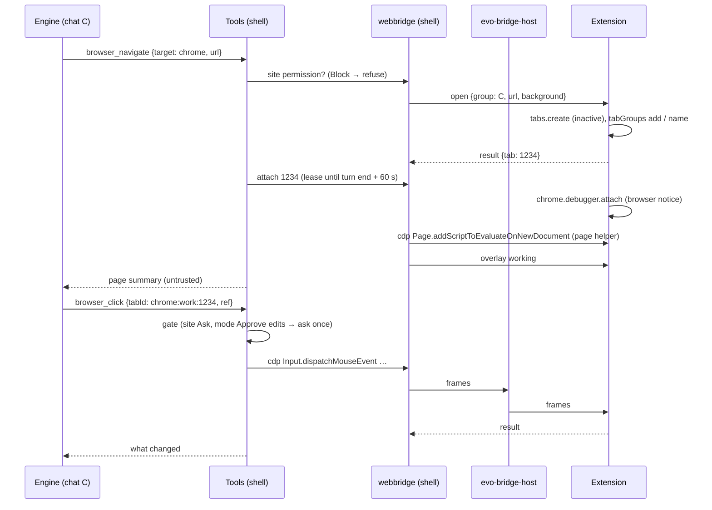

# Evo Webbridge: Evo in the person's own Chrome or Edge — Plan

| | |
| --- | --- |
| Spec | [spec.md](spec.md) |
| Tasks | [tasks.md](tasks.md) |
| Updated | 2026-11-18 |
| ADD sections | [4. Process view](../../architecture/README.md#4-process-view), [5. Building blocks](../../architecture/README.md#5-building-blocks), [6.3 Hosting an engine](../../architecture/README.md#63-hosting-an-engine), [7. Data view](../../architecture/README.md#7-data-view), [8. Interfaces](../../architecture/README.md#8-interfaces), [9. Cross-cutting concepts](../../architecture/README.md#9-cross-cutting-concepts) |
| ADRs | [0012 A native messaging bridge to the person's own browser](../../architecture/decisions/0012-native-messaging-bridge-to-the-persons-browser.md); [0013 App-side agent tools run in the Rust shell](../../architecture/decisions/0013-app-side-agent-tools-run-in-the-rust-shell.md); [0018 The shell hosts engines, windows attach](../../architecture/decisions/0018-the-shell-hosts-engines-windows-attach.md) |

## 1. Context and constraints

What exists:

- **Browser tools run in the shell** ([ADR 0013](../../architecture/decisions/0013-app-side-agent-tools-run-in-the-rust-shell.md)).
  The 29 `browser_*` tools live in `apps/desktop/src-tauri/src/agent_tools/browser/`.
  Each goes through the page driver `driver.rs`: a `Page` whose `eval` and
  `cdp` call `crate::browser::{eval, cdp}`, plus about 25 other functions of
  `crate::browser` (`tab_record`, `dialog_pending`, `cdp_subscribe`,
  `cdp_events`, `navigate_tab`, `chat_tabs`, `resolve_tab`, …). Those are
  bound to WebView2 today (`browser.rs`, `browser/tabs.rs`,
  `browser/dialog.rs`, `browser_page.js`). The earlier draft of this plan put
  the bridge transport in TypeScript; that driver was ported to Rust and the
  seam is now `Page` and `crate::browser`.
- **The approval gate** (`agent_tools/gate.rs`, `ToolCtx::gate`) asks by
  class: reads never, edits only in "Ask every time" on non-local sites, once
  per site and chat; commands in "Ask every time" and "Approve edits".
- **The shell hosts engines and keeps open questions** ([ADR 0018](../../architecture/decisions/0018-the-shell-hosts-engines-windows-attach.md)):
  `supervisor.rs` (`ensure`, `attach`), `supervisor/questions.rs`; windows
  attach and receive `engine://message`. A side panel can be one more
  attached client.
- **The app can start hidden** in the tray (`system.rs`, `--hidden`) and is
  single-instance (`tauri-plugin-single-instance`).
- **The engine sidecar** ships as a Tauri `externalBin`
  (`tauri.conf.json`); the host binary ships the same way.
- **The app's composer** (`apps/desktop/src/features/chat/chat-composer.tsx`,
  `stores/engine-store.ts`) changes a chat with the engine commands
  `set_model {provider, modelId}`, `set_thinking_level {level}` and
  `set_approval_mode {mode}`, and saves pasted files with `fs_save_paste`
  (`src-tauri/src/files.rs`) before sending them as attachments
  (`kind: file | image | text`). The side panel's controls go through the
  shell to the same commands and the same save.

Browser facts the design relies on:

- `chrome.debugger` speaks the DevTools protocol to one tab (and its child
  frames through sessions, Chrome and Edge 125+). The browser shows a
  "started debugging this browser" notice while attached; it cannot be hidden.
  Policy `DeveloperToolsAvailability = 2` turns the API off.
- Native messaging: the browser starts the host named in a per-user manifest
  (Windows: `HKCU\Software\Google\Chrome\NativeMessagingHosts\<name>`,
  `HKCU\Software\Microsoft\Edge\NativeMessagingHosts\<name>`; macOS and Linux:
  a JSON file in the browser's per-user folder). Only extension ids in the
  manifest's `allowed_origins` can start it; the caller's origin is passed to
  the host as its first argument. Frames are a 4-byte length plus UTF-8 JSON;
  a frame from the host to the browser is at most 1 MB. One host process runs
  per `connectNative` port, so one per browser profile here.
- An open `connectNative` port keeps an MV3 service worker alive (Chrome and
  Edge 105+). The worker still restarts on extension update or crash.
- `chrome.tabGroups` and `chrome.sidePanel` exist in Chrome and Edge 114+.
- `chrome.tabs.captureVisibleTab` works on the current tab with `activeTab`,
  which the browser grants when the person opens the side panel from the
  extension's button; no debugger attach is needed for a screenshot the
  person attaches.
- A side panel cannot show the browser's microphone prompt itself; the
  extension opens one of its own pages once to ask, then the panel can record.
  The browser's speech recognition (`webkitSpeechRecognition`) sends audio to
  the browser maker's service (spec clarification 7).

To check before tasks (spike, phase 0): `Page.captureScreenshot` on a
background tab in a normal window, in Chrome and Edge (spec clarification 2).

## 2. Architecture check

| Rule | Result | Notes |
| --- | --- | --- |
| The engine owns agent logic; the shell relays and provides native features | ok | The extension has no model and no agent loop. The side panel is a client attached to a shell-hosted engine, like a window. Tools stay in the shell. |
| Layers point down; library crates stay free of engine/desktop concerns | ok | `evo-bridge-host` depends on no Evo crate; it frames and relays. |
| Protocol changes update `evo-protocol`, the engine and the desktop together | n/a | The engine protocol is unchanged. The bridge has its own wire (3.3), versioned on its own. |
| Models come from models.dev; no hardcoded model facts | n/a | |
| Real engine in the app; settings and credentials reload live | ok | Webbridge settings and site permissions apply to running chats at once. |
| Untrusted input stays untrusted; permissions, sandbox and project trust stay in the path | ok | New trust boundary, ADR 0012 (revised). Site permissions add to the gate, never bypass it. Page content is marked untrusted. |
| Desktop UI structure and `DESIGN.md` | ok | A Settings section and Browser panel rows with existing components. The side panel follows `DESIGN.md` with its own small stylesheet. |

Architecture changes: a new process (the host), a new transport into the
shell, a new client of hosted engines (the side panel) and a new store (site
permissions). ADR 0012 records the decision; the ADD's sections 4, 5, 7, 8
and 9 get the host, the extension, the pipe and `webbridge/sites.json` in the
commit that accepts this plan (Gate B).

## 3. Design

### 3.1 Overview

```text
 Chrome / Edge (one instance per profile)

┌───────────────────────────────────────┐
│ Evo Webbridge extension (MV3)         │
│  service worker                       │
│   ├ port to the host, reconnect       │
│   ├ CDP relay (chrome.debugger)       │
│   ├ tab groups, menus, takeover       │
│   └ overlay injected through CDP      │
│  side panel   chat client (toolbar)   │
└──────────────────┬────────────────────┘
                   │ native messaging (stdio, framed)
┌──────────────────┴────────────────────┐
│ evo-bridge-host                       │  started by the browser, one per profile
└──────────────────┬────────────────────┘
                   │ named pipe / 0600 socket, process checks
┌──────────────────┴────────────────────────────────────────────┐
│ Evo app shell (src-tauri)                                      │
│  webbridge/  server · setup · groups · sites · panel           │
│  browser.rs   page functions dispatch by tab id                │
│    ├ built-in tab  WebView2 (today's code)                     │
│    └ chrome:/edge: webbridge/page.rs (CDP over the pipe)       │
│  agent_tools/browser   29 browser tools, one page driver       │
│  supervisor            hosted engines, open questions          │
└──────────────────┬────────────────────────────────────────────┘
                   │ external tool requests · engine://message
              evo-engine (one per chat)
```

The extension is a thin native client in the browser: it relays DevTools
commands for tabs in Evo's groups, keeps the groups, draws the in-page
indicator and hosts the side panel. Every decision stays in the shell: which
chat owns which tab, what the gate allows, which engine runs. The browser
tools see a `Page` and do not know which browser serves it.

### 3.2 Components

| Layer | Path | Responsibility | Requirements |
| --- | --- | --- | --- |
| extension | `extensions/evo-webbridge/manifest.json` | MV3 manifest, permissions `debugger tabs tabGroups sidePanel nativeMessaging storage contextMenus activeTab`, fixed `key` for the unpacked id. | FR-1 |
| extension | `extensions/evo-webbridge/background/port.js` | `connectNative`, `hello`, reconnect with backoff, chunk reassembly, fail pending work on disconnect; keeps only the profile id and label in storage. | FR-4, FR-19, FR-20, NFR-5, NFR-6 |
| extension | `extensions/evo-webbridge/background/cdp.js` | Attach / detach `chrome.debugger`, relay commands and events, child-frame sessions, map browser errors to codes. | FR-5, FR-20, FR-22 |
| extension | `extensions/evo-webbridge/background/groups.js` | Create and name groups, add tabs the agent opens and tabs opened from group tabs, report tabs dragged in or out, closed groups. | FR-6 – FR-8, FR-20 |
| extension | `extensions/evo-webbridge/background/control.js` | Takeover state, Stop, Stop all, context menu items, the overlay's messages. | FR-15 – FR-18 |
| desktop shell | `apps/desktop/src-tauri/src/webbridge/overlay.js` | In-page indicator (closed shadow root) with **Stop** / **Take over** / **Hand back**, added to each document through CDP by the shell (which owns its state); its buttons call the `__evoWebbridge` binding. | FR-15 – FR-17 |
| extension | `extensions/evo-webbridge/sidepanel/` | Chat client: header (title, **History**, **New chat**, **⋯**, **Close**), empty state, streamed reply and tool activity, questions, Stop. | FR-10, FR-11, FR-14, FR-25 |
| extension | `extensions/evo-webbridge/sidepanel/composer.js` | Field with **Include this tab**; model and effort picker; approval mode switch; **+** menu (page screenshot through `captureVisibleTab`, file picker, paste and drop, another tab); attachment chips; microphone. | FR-26 – FR-29 |
| extension | `extensions/evo-webbridge/permission/` | One-time page that asks for the microphone, opened from the panel when voice input is first used. | FR-29 |
| extension | `extensions/evo-webbridge/` (whole folder), `scripts/pack-webbridge.ts` | Plain ES modules and CSS with no build step: the folder loads unpacked as it is; the script zips it for the stores. | FR-1 |
| crate | `crates/evo-bridge-host/` (binary) | stdio framing ↔ pipe; passes the caller origin; checks the pipe server is Evo; starts `evo --hidden` when no pipe answers; splits frames over 1 MB toward the browser. | FR-3, FR-19, NFR-1, NFR-6 |
| desktop shell | `apps/desktop/src-tauri/src/webbridge/server.rs` | Pipe server (current-user ACL), client process check, `hello`, origin allow-list, protocol version, instance table, log lines. | FR-3, FR-4, FR-23, FR-24, NFR-3 |
| desktop shell | `apps/desktop/src-tauri/src/webbridge/setup.rs` | Register / remove the host per browser (registry on Windows, manifest files elsewhere), extension install link, status. | FR-2, NFR-4 |
| desktop shell | `apps/desktop/src-tauri/src/webbridge/groups.rs` | chat ↔ (profile, group) ↔ tabs; tab ids; attach lease (60 s after the turn); takeover; tab gone. | FR-6 – FR-9, FR-17, FR-20 |
| desktop shell | `apps/desktop/src-tauri/src/webbridge/sites.rs` | Site permissions: load, save, change events; `Block` checks. | FR-12, FR-13, FR-22 |
| desktop shell | `apps/desktop/src-tauri/src/webbridge/panel.rs` | Side panel sessions: list and search chats, ensure / attach engines through the supervisor, send prompts with attachments, forward a reduced event stream, serve and answer open questions; model, effort and mode changes sent to the engine as the app sends them; **Open in Evo**. | FR-10, FR-11, FR-14, FR-16, FR-25 – FR-27 |
| desktop shell | `apps/desktop/src-tauri/src/files.rs` | Attachments from the panel saved with the same code as `fs_save_paste`, with the app's size limits. | FR-28 |
| desktop shell | `apps/desktop/src-tauri/src/browser.rs`, `browser/tabs.rs` | The page functions the tools call (`eval`, `cdp`, event subscriptions, dialogs, navigate, history, close, address, status) send a Webbridge tab (id `chrome:…` / `edge:…`) to `webbridge/page.rs` and keep the WebView2 path for built-in tabs. Webbridge tabs live in the same registry, so ownership, resolution and listing stay one code path. | FR-5, FR-7 |
| desktop shell | `apps/desktop/src-tauri/src/webbridge/page.rs` | Webbridge pages: `cdp` relayed with id and timeout; `eval` as `Runtime.evaluate` (awaiting promises); the page helper from `browser_page.js` added on attach and on new documents, in the page's own world as in the built-in browser; dialogs from `Page.javascriptDialogOpening` into the shared dialog table; subscribed events into the shared event ring; load state from tab updates. | FR-5, FR-20, NFR-2 |
| desktop shell | `apps/desktop/src-tauri/src/agent_tools/browser/driver.rs`, `tabs.rs`, `core.rs` | `target` argument; panel-only steps (showing the browser panel, the floating picture, the virtual cursor) skip Webbridge tabs; `browser_tabs` `choose`; built-in-only tools refuse Webbridge tabs with a reason; untrusted-content wording kept. | FR-5, FR-9, FR-21 |
| desktop shell | `apps/desktop/src-tauri/src/agent_tools/gate.rs`, `agent_tools/mod.rs` | Webbridge rule: acts ask in "Ask every time" and "Approve edits" unless the site is Allow; Block refuses in every mode; "Allow for this site" option writes Allow. | FR-13, FR-22 |
| desktop shell | `apps/desktop/src-tauri/src/supervisor/questions.rs` | Questions of a chat also go to its side panel sessions; first answer wins, the other side is told it is settled. | FR-14 |
| desktop shell | `apps/desktop/src-tauri/tauri.conf.json`, `scripts/` | Ship `evo-bridge-host` as an `externalBin` next to the engine sidecar. | FR-2 |
| desktop UI | `apps/desktop/src/features/settings/sections/webbridge-settings.tsx` | Set up / remove per browser, connected profiles (rename), policy state, site permissions list, new-chat workspace, voice input switch with its notice, Stop all. | FR-2, FR-4, FR-12, FR-18, FR-23, FR-29 |
| desktop UI | `apps/desktop/src/stores/webbridge-store.ts`, `stores/browser-store.ts`, `features/browser/browser-panel.tsx` | Webbridge state from shell events; a chat's Webbridge tabs listed beside its built-in pages, marked with the browser, with **Take back** and **Stop**. | FR-7, FR-8, FR-16 |
| docs | `docs/architecture/README.md` | Process view, building blocks, data view, interfaces, trust (at Gate B). | ADR 0012 |

### 3.3 Interfaces

**Wire: extension ↔ host ↔ app.** JSON objects, one per frame: on stdio the
native messaging frame (4-byte little-endian length, then UTF-8 JSON); on the
pipe the same framing. Every message has `t`. Requests carry `id`; their
answer has the same `id`.

```jsonc
// extension → app
{ "t": "hello", "v": 1, "browser": "chrome" | "edge", "profile": "p4f2a…", "label": "Work",
  "version": "1.0.0", "debugger": true, "launch": false }     // debugger=false: policy turned it off;
                                                              // launch=true only when the browser just started
{ "t": "result", "id": 7, "ok": true, "value": { … } }
{ "t": "result", "id": 7, "ok": false, "code": "gone" | "refused" | "restricted" | "busy" | "failed", "message": "…" }
{ "t": "event", "tab": 1234, "session": "…"?, "method": "Page.loadEventFired", "params": { … } }
{ "t": "tab", "tab": 1234, "change": "joined" | "left" | "closed" | "updated", "group": 88, "url": "…", "title": "…", "opener": 1200? }
{ "t": "group", "group": 88, "change": "closed" }
{ "t": "control", "tab": 1234, "action": "stop" | "takeover" | "handback" }
{ "t": "control", "action": "stop_all" }
{ "t": "panel", "session": "s1", "body": { … } }               // side panel → app (below)
{ "t": "chunk", "id": 7, "seq": 0, "last": false, "data": "…" } // only app → extension, see below

// app → extension
{ "t": "welcome", "v": 1, "app": "4.8.0" }                     // or { "t": "bye", "reason": "…" }
{ "t": "open", "id": 1, "group": { "chat": "c_…", "title": "Fix invoices", "color": "blue" }, "url": "https://…", "background": true }
{ "t": "adopt", "id": 2, "tab": 1234, "chat": "c_…", "title": "…" }   // a tab the person picked or handed over
{ "t": "release", "id": 3, "tab": 1234 }
{ "t": "list", "id": 4 }                                       // titles and sites of tabs outside groups
{ "t": "attach", "id": 5, "tab": 1234 }  { "t": "detach", "id": 6, "tab": 1234 }
{ "t": "cdp", "id": 7, "tab": 1234, "session": "…"?, "method": "Input.dispatchMouseEvent", "params": { … } }
{ "t": "overlay", "tab": 1234, "state": "working" | "waiting" | "taken" | "off", "chat": "Fix invoices" }
{ "t": "panel", "session": "s1", "body": { … } }               // app → side panel
```

Large messages from the app (over 900 KB) go as `chunk` frames with the
original `id`; the extension joins them before handling. The host never reads
message bodies beyond framing.

**Side panel bodies** (`panel.body`):

```jsonc
// panel → app
{ "op": "chats", "query": "…"? }                  // → { "op": "chats", "items": [{ "chat", "title", "workspace", "updated", "running" }] }
{ "op": "open", "chat": "c_…" } | { "op": "new", "workspace": "w_…"? }
{ "op": "send", "chat": "c_…", "text": "…", "tab": 1234?, "attachments": ["a_…"] }
{ "op": "stop", "chat": "c_…" }
{ "op": "answer", "chat": "c_…", "question": "q_…", "choice": 1, "text": "…"? }
{ "op": "models", "chat": "c_…" }                 // → { "op": "models", "items": [{ "provider", "id", "name", "efforts": ["…"] }] }
{ "op": "set_model", "chat": "c_…", "provider": "…", "modelId": "…" }
{ "op": "set_effort", "chat": "c_…", "level": "…" }
{ "op": "set_mode", "chat": "c_…", "mode": "…" }  // the app's approval modes
{ "op": "attach", "chat": "c_…", "name": "page.png", "kind": "image" | "file" | "text", "data": "<base64>" }
                                                  // → { "op": "attached", "id": "a_…", "name", "kind", "bytes" }
{ "op": "detach", "chat": "c_…", "id": "a_…" }
{ "op": "open_in_app", "chat": "c_…" }
// app → panel
{ "op": "chat", "chat": "c_…", "title": "…", "model": { "provider", "id", "name" }, "effort": "…", "mode": "…", "site": "ask" | "allow" | "block" }
{ "op": "event", "chat": "c_…", "kind": "user" | "text" | "thinking" | "tool" | "settled" | "error", "data": { … } }
{ "op": "question", "chat": "c_…", "question": "q_…", "title": "…", "description": "…", "options": ["…"] }
{ "op": "settled_question", "chat": "c_…", "question": "q_…" }
```

The shell builds `event` from the engine lines it already reads; the panel
never sees raw engine messages. `chat` is sent on open and whenever the
model, effort, mode or the current site's permission changes, from the panel
or the app. The model list comes from the same source as the app's picker
(models.dev through `evo-runtime`). `set_model`, `set_effort` and `set_mode`
become the engine's `set_model`, `set_thinking_level` and `set_approval_mode`.
`attach` data travels in the extension → app direction, so it has no 1 MB
limit; the shell saves it as `fs_save_paste` does and refuses files over the
app's limit. Dictated text is plain text in the field: no audio reaches Evo.

**Pipe and process checks.** Pipe `\\.\pipe\evo-webbridge-<user SID>` with a
DACL for the current user only; on macOS and Linux a socket in the user's
runtime folder, mode 0600. The host checks the server's process image (via
`GetNamedPipeServerProcessId`) is Evo's; the app checks the client's image is
`evo-bridge-host` from its install folder and that the origin it reports is in
the allow-list (`chrome-extension://<unpacked id>/`, the Chrome Web Store id,
the Edge Add-ons id).

**Host manifest** (written by Setup, name `dev.evo.webbridge`):

```json
{ "name": "dev.evo.webbridge", "description": "Evo Webbridge", "path": "<install folder>/evo-bridge-host.exe",
  "type": "stdio", "allowed_origins": ["chrome-extension://<id>/", "…"] }
```

**Tools.** Every `browser_*` tool takes `target`:
`"builtin"` (default) `| "chrome" | "edge" | "chrome:<profile>" | "edge:<profile>"`.
Tab ids of Webbridge tabs read `chrome:<profile>:<tab>` (for example
`chrome:work:1234`); a `tabId` alone picks the browser, so `target` is only
needed to open a page. `browser_tabs` gains `action: "choose"` (FR-9).
`browser_download_folder` and `browser_downloads` answer "not available in
Webbridge tabs". Older engines are unaffected: the tools are the shell's.

**Tauri commands and events** (UI ↔ shell): `webbridge_status`,
`webbridge_setup {browser}`, `webbridge_remove {browser}`,
`webbridge_rename {profile, label}`, `webbridge_sites`,
`webbridge_set_site {site, permission}`, `webbridge_stop_all {profile?}`,
`webbridge_release {tab}`; event `webbridge://changed` with the full status.

### 3.4 Data and storage

- `~/.evo/agent/webbridge/sites.json` — `{ "version": 1, "sites": { "https://example.com": "allow" | "block" } }`;
  sites not listed are Ask. Written by the shell only.
- `~/.evo/agent/webbridge/profiles.json` — known profiles: id, browser,
  label, last seen. No secrets.
- Host manifests and registry keys written by Setup, removed by Remove.
- Attachments from the panel: in the app's pasted-files cache, as pasted
  files from the app's composer are, with the same clean-up.
- Extension `chrome.storage.local`: its profile id and label only (NFR-5).
- In memory in the shell: instances, groups, tab records, attach leases,
  takeover state, panel sessions. They end with the app or the browser.

### 3.5 Behaviour

**Connect.** The browser starts the extension → `connectNative` → the
browser starts `evo-bridge-host <origin>` → the extension sends `hello` →
the host opens the pipe (when nobody answers and `hello` has `launch: true`,
it starts Evo with `--hidden` and retries for 10 s) → the host sends its
introduction (`{"t":"host","origin":…}`), then the `hello` → `welcome` → the
shell records the profile and emits `webbridge://changed`. The extension asks
for `launch` only when the browser itself just started, so reconnecting never
reopens an Evo the person quit.

**The agent opens a page and acts.**



**Takeover.** Overlay or panel → `control takeover` → the shell marks the tab
taken; `Page` calls on it return "the person has control of this tab; wait
for them to hand it back" and `browser_wait` waits for `handback` (or the
call's own timeout); overlay shows **Hand back**.

**Stop.** `control stop` → the shell stops the chat's turn through the
supervisor (as the app's Stop does) → cancellation tokens end pending calls →
overlay off. Stop all also detaches every tab of the profile.

**Side panel.** `open` → `supervisor.ensure(chat)` and an attach for the
panel session (it counts as a viewer, so the engine is not stopped as idle) →
the panel gets the chat's recent messages and then `event`s. `send` with `tab`
first adopts the tab into the chat's group, then sends the prompt with a line
naming the tab's title and address. Questions come from
`supervisor/questions.rs` to every viewer of the chat.

**Leases.** A tab is attached from its first call while the chat's turn runs;
the shell detaches it 60 s after `agent_settled` with no new call, and
attaches again on the next call (spec clarification 1).

### 3.6 Errors and edge cases

| Case | Agent sees | Person sees |
| --- | --- | --- |
| Nothing set up / no profile connected | "No browser is connected to Evo; set one up in Settings → Browser." | Settings shows Set up |
| Evo not running when the browser starts | — | Evo starts in the tray; if it fails: extension says "Evo is not running" |
| Policy turned the debugging API off | "This browser's administrator turned off the debugging API; Webbridge cannot work there." | Extension and Settings say the same |
| Tab, group or browser closed; extension reloaded | "The tab is gone (closed)." | Browser panel row goes |
| Tab dragged out of the group | "The person took this tab back." | — |
| Another debugger attached | "The browser refused: another debugger is attached to this tab." | The browser's message in the overlay or panel |
| Page the browser forbids (`chrome://`, the store) | "The browser does not let extensions use this page." | — |
| Block site | "The person blocked example.com for Evo." | — |
| Taken over | "The person has control of this tab." | Overlay shows Hand back |
| Page dialog open | As in the built-in browser: names it; answer with `browser_dialog` | The dialog |
| Pipe check or origin check fails | — | Settings: "A connection was refused" with the reason; logged |
| Host or app version mismatch (`v`) | "Update the Evo Webbridge extension." | Extension asks to update |
| Command times out (30 s default, tool timeouts win) | "The browser did not answer." | — |

### 3.7 Security and trust

- **Threat model.** Web pages, other extensions, other users of the machine
  and the network must not reach the bridge. Code already running as the same
  user is out of scope: it can read the browser's profile anyway.
- **Reach.** Only listed extension ids can start the host (browser-enforced
  `allowed_origins`); the host only talks to an evo-owned pipe; the shell only
  accepts the host from its own install folder with an allowed origin. No
  port (NFR-1).
- **Least privilege.** No host permissions and no declared content scripts:
  the extension sees page content only through the debugging API, and only on
  tabs in Evo's groups. Listing other tabs returns titles and sites only.
- **Ownership.** A tab belongs to one chat through its group; the shell
  checks the chat on every call (same rule as built-in pages).
- **Approvals.** Site permissions sit inside the gate: Block always refuses;
  Allow skips the act question only; commands keep the mode's rule; "Approve
  for me" never overrides Block. The engine's own approval mode still applies
  to its tools ([ADR 0010](../../architecture/decisions/0010-engine-enforces-approval-mode.md)).
- **Visibility.** The browser's debugging notice, the group, and the overlay
  together make agent work visible. A page could hide the overlay or call
  Evo's page helper (it runs in the page's world, as in the built-in browser);
  the notice and the group still show, and the helper only reads the page or
  acts in it.
- **Untrusted content.** Page text, titles, addresses and dialog messages are
  data in results (FR-21); the side panel renders chat text as Markdown
  without HTML.
- **Panel controls.** Changing the mode from the panel is the person's own
  act in a page only the extension renders; page scripts cannot reach the
  panel. "Approve for me" never lifts **Block**.
- **Screenshots and voice.** A page screenshot is taken only when the person
  picks it in **+** (`activeTab`, no debugger). Voice input is off by default;
  when on, audio goes to the browser maker's speech service, as the switch in
  Settings says, and only the resulting text reaches Evo.
- **No secrets.** The extension keeps no token or transcript. Typed text and
  page content are never logged (FR-24).

### 3.8 Configuration

| Key | Type | Default | Where | Applies |
| --- | --- | --- | --- | --- |
| `webbridge.enabled` | boolean | `false` | app database settings | live: the pipe server starts or stops |
| `webbridge.newChatWorkspace` | string \| null | `null` (last used) | app database settings | live |
| `webbridge.leaseSeconds` | number | `60` | app database settings | live |
| `webbridge.voiceInput` | boolean | `false` | app database settings | live: the panel shows or hides the microphone |
| site permissions | `sites.json` | empty (all Ask) | `~/.evo/agent/webbridge/` | live |

Edited in **Settings → Browser**; site permissions also in the side panel's
**⋯** menu.

## 4. Alternatives considered

| Option | Why not |
| --- | --- |
| Share one tab at a time, the extension only relays (the earlier draft) | Every task starts with a prompt, the agent cannot open the pages it needs, and the person cannot talk to Evo from the browser. |
| Content scripts on all sites instead of the debugging API | Needs host permissions for every site; cannot send trusted input, set file inputs or mock requests; every page carries Evo's script even when no agent works. |
| A local WebSocket the extension connects to | A port is open, and any web page can try it; ADR 0012. |
| The browser's remote debugging port | A browser restart with a flag, every tab and profile exposed. |
| A separate automated browser profile | No signed-in sessions, which is the point. |
| The side panel talks to the engine directly | The engine is the shell's child and has no listener; the shell owns engine lifecycles ([ADR 0018](../../architecture/decisions/0018-the-shell-hosts-engines-windows-attach.md)). |
| The side panel calls a model itself | Agent logic belongs to the engine; it would split chats, credentials and approvals. |
| A token file to authenticate the host | Readable by any process of the user, so it adds nothing over the pipe's ACL and the process checks. |

## 5. As-built notes

- 2026-11-18 — Spike (T2) on Windows 11 with Edge 157 and Chrome 157:
  - Edge loads the unpacked extension with `--load-extension` in a scratch
    profile; its id is the one the manifest key gives (`ids.rs`). Branded
    Chrome no longer honours that flag, so it is loaded by hand there.
  - Extension → host → pipe → a stand-in server
    (`crates/evo-bridge-host/examples/spike_server.rs`) works: the host's
    introduction names the extension's origin, the pipe sees the host as the
    app's sibling, `hello` / `welcome`, `open` puts a background tab in the
    chat's group.
  - `Page.captureScreenshot` through `chrome.debugger` on a background tab
    returns the page (921 × 1040 PNG) without bringing it forward: agent tabs
    stay background tabs in the person's window (spec clarification 2).
  - `DeveloperToolsAvailability = 2` was not tried: it needs an administrator
    policy on the machine. The extension reports `debugger` in `hello`; attach
    errors that name the policy come back as `refused`.
- The host reads the extension's `hello` before reaching the pipe, so it can
  honour `launch` (above); it gives up after 10 s when the pipe stays busy.
- Webbridge tabs are dispatched by tab id inside `browser.rs` instead of a
  `TabHost` trait (3.2), and the page helper runs in the page's world as in
  the built-in browser.
- 2026-11-18 — End-to-end on Edge 157 through the app (T19):
  - A background tab is hidden, and a hidden page takes no input: every
    `Input.dispatchMouseEvent` waited ~5 s and did nothing.
    `Emulation.setFocusEmulationEnabled` on attach makes it the focused,
    visible page; a click or typing then takes 10–20 ms.
  - A hidden tab draws a new frame only when something changes, so
    `Page.captureScreenshot` waited for one about half the time and
    `captureBeyondViewport` never returned. Every capture runs inside a tiny
    screencast (start, capture, stop), and a full-page shot lays the page out
    at its full height for the picture, then puts the viewport (and any
    `browser_viewport` emulation) back.
  - A new Webbridge tab opens on `about:blank`, gets the page helper and the
    network recording, then navigates: console messages and requests are kept
    from the page's first script, as in the built-in browser.
  - Chrome and Edge refuse `Emulation.setLocaleOverride` and
    `setTimezoneOverride` from extensions ("only available to trusted
    clients"): `browser_viewport` skips them and says so.
  - Tabs a page opens can land in the group at creation (no group change
    event): the extension reports them as joined from `onCreated`.
  - Development builds have `webbridge_debug_tool`, which runs a browser tool
    for a chat without an engine; it answers an error in release builds.
- The in-page indicator lives in the shell (`webbridge/overlay.js`), which
  injects it and sets its state; the binding needs the Runtime domain on to
  reach new documents.
- The approval mode is the app's, not a chat's: the side panel's mode switch
  sets the app setting (every chat follows), as Settings does.
- The side panel is `sidepanel/sidepanel.js` with the composer in
  `sidepanel/composer.js`; the extension packs with
  `apps/desktop/scripts/pack-webbridge.ts` (`bun run webbridge:pack`), which
  leaves `key` out for the stores.

