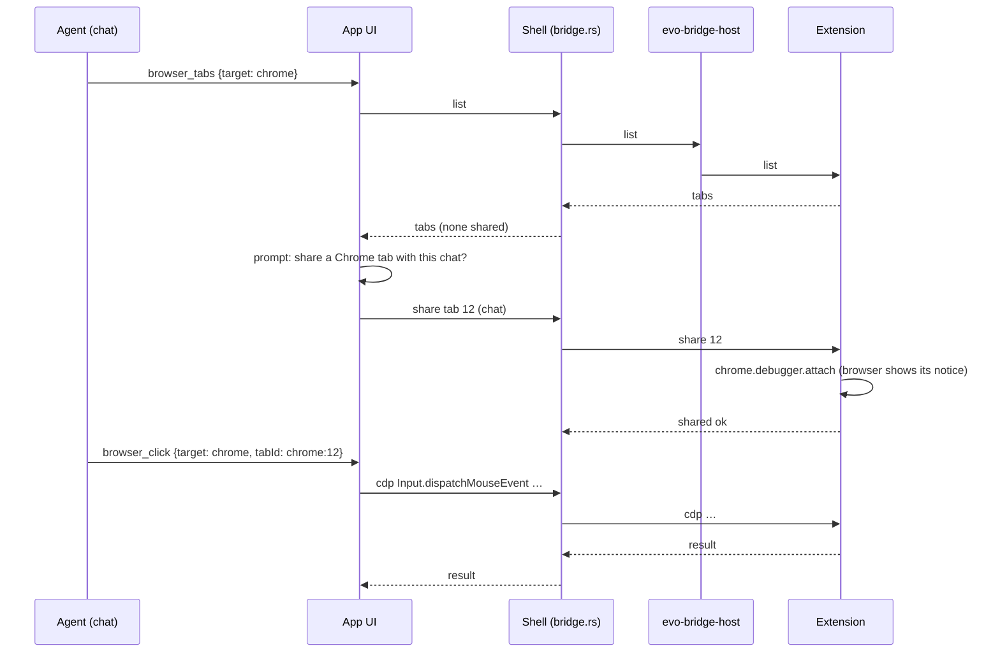

# Browser bridge: let an agent work in the person's own Chrome or Edge — Plan

| | |
| --- | --- |
| Spec | [spec.md](spec.md) |
| Tasks | not yet (after Gate B) |
| Updated | 2026-11-07 |
| ADD sections | [4. Process view](../../architecture/README.md#4-process-view), [5. Building blocks](../../architecture/README.md#5-building-blocks), [8. Interfaces](../../architecture/README.md#8-interfaces), [9. Cross-cutting concepts](../../architecture/README.md#9-cross-cutting-concepts) |
| ADRs | [0012 A native messaging bridge to the person's own browser](../../architecture/decisions/0012-native-messaging-bridge-to-the-persons-browser.md) |

## 1. Context and constraints

- The agent browser plan puts every tool behind a transport-neutral page
  driver; the bridge is a second transport (`BridgeTransport`) that carries
  DevTools commands to a shared tab and events back.
- The shell already owns native capabilities and cross-chat coordination
  (mesh hub); a local channel server fits there (`src-tauri/src/bridge.rs`).
- A browser starts a native messaging host from a manifest it finds in a
  fixed place per user (Windows: a registry key under `Software\Google\Chrome\
  NativeMessagingHosts` / `Software\Microsoft\Edge\NativeMessagingHosts`;
  macOS and Linux: files under the browser's per-user folder).
- The extension's debugging API (`chrome.debugger`) speaks DevTools commands
  for one tab at a time and shows the browser's own "debugging" notice.

## 2. Architecture check

| Rule | Result | Notes |
| --- | --- | --- |
| The engine owns agent logic; the shell relays and provides native features | ok | The shell owns the channel and registration; the agent loop is untouched. |
| Layers point down; library crates stay free of engine/desktop concerns | ok | `evo-bridge-host` depends on nothing of the engine; it only relays framed messages. |
| Protocol changes update `evo-protocol`, the engine and the desktop together | n/a | The engine protocol is unchanged; the bridge has its own small wire (3.3). |
| Models come from models.dev; no hardcoded model facts | n/a | |
| Real engine in the app; settings and credentials reload live | ok | |
| Untrusted input stays untrusted; permissions, sandbox and project trust stay in the path | ok | New trust boundary: ADR 0012; sharing is per tab and chat, approvals by class, page content marked untrusted. |
| Desktop UI structure and `DESIGN.md` | ok | A Settings section and a chat prompt use existing components. |

New crate and process: ADD sections 4 and 5 get the host and the extension; ADR
0012 is the decision record.

## 3. Design

### 3.1 Overview

```text
 Chrome / Edge                                         Evo app
┌────────────────────┐   native messaging   ┌─────────────────┐  pipe / socket + token  ┌───────────────┐
│ evo-bridge extension│◀───────────────────▶│ evo-bridge-host │◀───────────────────────▶│ src-tauri      │
│  chrome.debugger    │   (stdio, framed)    │  (browser starts │                         │  bridge.rs     │
│  per shared tab     │                      │   it)            │                         │  → webview     │
└────────────────────┘                      └─────────────────┘                         │  → BridgeTransport
                                                                                          └───────────────┘
```

### 3.2 Components

| Layer | Path | Responsibility | Requirements |
| --- | --- | --- | --- |
| extension | `extensions/evo-bridge/` (new: `manifest.json`, `background.js`, `popup.html`, `popup.js`) | Share / stop a tab, relay DevTools commands and events, list tabs for the picker, show state. | FR-1, FR-5, FR-8, FR-11 |
| crate | `crates/evo-bridge-host/` (new, binary) | Native messaging framing on stdio ↔ the app's channel; checks the token; exits when either side closes. | FR-2, FR-4, NFR-1 |
| desktop shell | `apps/desktop/src-tauri/src/bridge.rs` (new) | The channel server (pipe / socket, token file), per-browser connection state, share table (tab → chat), message routing to the webview, registration commands. | FR-2 – FR-6, FR-8, FR-10, NFR-3 |
| desktop UI | `apps/desktop/src/features/browser/driver/bridge-transport.ts` (new) | `BridgeTransport`: `send(method, params)` and events for a shared tab. | FR-7 |
| desktop UI | `apps/desktop/src/features/settings/sections/bridge-settings.tsx` (new) | Setup, connection state, shared tabs, stop. | FR-3, FR-11 |
| desktop UI | `apps/desktop/src/features/chat/` (approval panel) | The share picker prompt. | FR-5, US-2 |
| desktop UI | `apps/desktop/src/stores/browser-store.ts` | Shared tabs listed under the chat, marked. | FR-6 |
| docs | `docs/architecture/README.md` | Process view, building blocks, interfaces, trust. | ADR 0012 |

### 3.3 Interfaces

**Extension ↔ host ↔ app** (JSON, one message per frame; native messaging's
4-byte length prefix on stdio, the same frames on the pipe):

```jsonc
// extension → app
{ "t": "hello", "browser": "chrome", "version": "1.0.0", "extension": "<id>" }
{ "t": "tabs", "tabs": [{ "id": 12, "title": "…", "url": "https://…", "shared": false }] }
{ "t": "shared", "tab": 12, "ok": true }            // after the person's choice
{ "t": "result", "id": 7, "ok": true, "value": {…} } // DevTools command result
{ "t": "event", "tab": 12, "method": "Page.…", "params": {…} }
{ "t": "gone", "tab": 12, "reason": "closed" | "detached" | "stopped" }
// app → extension
{ "t": "list" }
{ "t": "share", "tab": 12 }                         // attach the debugger
{ "t": "stop", "tab": 12 }
{ "t": "cdp", "id": 7, "tab": 12, "method": "Page.captureScreenshot", "params": {…} }
```

The token travels in the host's first frame to the app (`{"t":"auth","token":…}`);
the app answers `ok` or closes the channel.

**Tools:** the `target` argument of the `browser_*` tools (agent browser spec
FR-25); `browser_tabs {target:"chrome"}` lists shared tabs of the chat and asks
the person to share one when there is none.

### 3.4 Data and storage

- Token: `<app data>/bridge/token`, mode 0600 (Windows: a file ACL for the
  person only), created at first setup, replaced by "Reset".
- Host manifest and registry keys written by Setup; removed by "Remove".
- Share table (tab → chat) in memory in the shell; shares end with the app.

### 3.5 Behaviour



### 3.6 Errors and edge cases

| Case | Agent sees | Person sees |
| --- | --- | --- |
| No host registered / extension missing | "No browser is connected; set one up in Settings → Browser bridge." | Settings shows setup |
| App not running when the extension starts | — | Extension popup: "Evo is not running" |
| Tab closed or share stopped | "The shared tab is gone." | List updates |
| Another debugger attached | "The browser refused: …" | The browser's message in the prompt |
| Token wrong | — | Host exits; Settings shows "connection refused" |

### 3.7 Security and trust

- Only the extension (id in `allowed_origins`) can start the host; the host only
  speaks to the app with the token; the channel is a pipe / 0600 socket, not a
  network port.
- The extension has `debugger`, `tabs`, `nativeMessaging` only; it attaches only
  to a tab the person shared and detaches on stop.
- A shared tab belongs to one chat; other chats cannot name it.
- Acts and changes ask by class as in the agent browser plan; on a shared tab
  acts ask even for sites that would count as local.
- Everything from the page is untrusted data.

### 3.8 Configuration

| Key | Type | Default | Where | Applies |
| --- | --- | --- | --- | --- |
| `bridge.enabled` | boolean | `false` | app settings | channel server starts when set up |

## 4. Alternatives considered

See [ADR 0012](../../architecture/decisions/0012-native-messaging-bridge-to-the-persons-browser.md).

## 5. Phases (to become tasks)

1. Protocol and the host: framing, token, channel, unit tests; `evo-bridge-host`.
2. Shell channel server, share table, registration commands, settings section.
3. Extension: share / stop, relay, popup; load unpacked; Windows check with
   Chrome and Edge.
4. `BridgeTransport` and the `target` argument; the share prompt in the chat.
5. Approvals for shared tabs; stop all; edge cases; ADD update; macOS and Linux
   registration code (checked later).

## 6. As-built notes

n/a — empty until the status is `In progress`.
