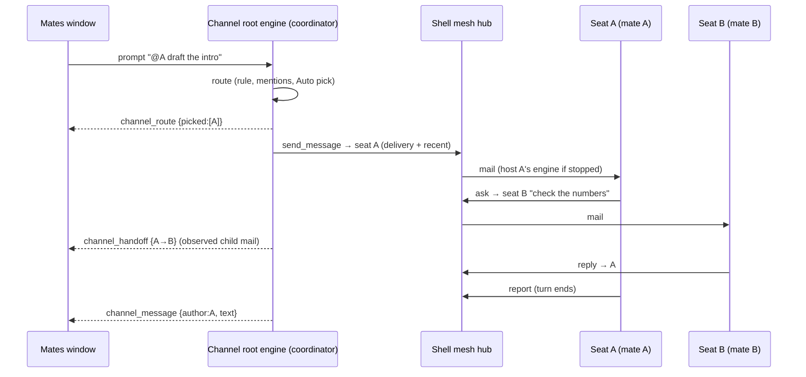

# Evo Mates: AI teammates in a second app on the same core — Plan

| | |
| --- | --- |
| Spec | [spec.md](spec.md) · UX: [ux.md](ux.md) · Behaviour: [behaviour.md](behaviour.md) |
| Tasks | [tasks.md](tasks.md) |
| Updated | 2026-11-25 |
| ADD sections | [4. Process view](../../architecture/README.md#4-process-view), [5.2 Desktop app](../../architecture/README.md#52-desktop-app), [6.2 Sessions talking to sessions](../../architecture/README.md#62-sessions-talking-to-sessions), [7. Data view](../../architecture/README.md#7-data-view), [10. Deployment view](../../architecture/README.md#10-deployment-view) |
| ADRs | [0028 Evo Harness and Evo Mates are two front ends in one app process](../../architecture/decisions/0028-two-front-ends-in-one-app-process.md), [0018 The shell hosts engines](../../architecture/decisions/0018-the-shell-hosts-engines-windows-attach.md), [0010 The engine enforces the approval mode](../../architecture/decisions/0010-engine-enforces-approval-mode.md), [0007 One transcript file per chat](../../architecture/decisions/0007-one-transcript-file-per-chat.md) |

## 1. Context and constraints

What Evo Mates builds on, all of it already in the repository:

- **One app process, several pages.** The desktop builds `index.html` and
  `quick-entry.html` as Vite inputs (`apps/desktop/vite.config.ts`).
  Chat windows (`window.rs::chat_window_open`, `src/lib/windows.ts`) run
  the whole app page as a viewer of one chat; about fifteen guards read
  `chatWindowId` to skip what only the main window does.
- **Single instance.** `tauri_plugin_single_instance` in
  `apps/desktop/src-tauri/src/lib.rs` hands a second launch's arguments to
  the running app, which today always calls `system::show_main`.
- **The shell hosts engines** (`supervisor.rs`, ADR 0018): it starts an
  engine per chat, sets up its model and tools at `ready`, keeps it running
  while the chat has work, follows its mesh events, records turns, sends
  notices and keeps open questions (`supervisor/questions.rs`) that any
  window can answer.
- **Roles.** A chat row's `role` column (migration `0013_chat_roles.sql`)
  holds a resolved `SessionRole` (`crates/evo-mesh/src/wire.rs`): name,
  instructions, tools, access, provider, model, thinking. The shell writes it
  to `--role-file` at every start (`engine.rs::role_args`) and the engine
  applies it (`crates/evo-engine/src/session_roles.rs`): narrowed tools and
  an instructions block in the system prompt.
- **Nested sessions and mail.** A session starts nested sessions with a
  role; mail (`send_message`, `ask`, `reply`) flows between parent,
  children and siblings across engines through the shell's hub
  (`crates/evo-mesh/src/hub.rs`, `mesh.rs`). Mail never crosses root trees
  (session mesh spec 2.2), and pub/sub topics do not exist.
- **Memory** (`crates/evo-engine/src/memory.rs`): `personal` topics in
  `<agent dir>/memory/`, `project` topics in
  `<agent dir>/projects/<folder slug>/memory/`. The scope comes from the
  chat's folder.
- **Approval mode** is one app setting (`approvalMode`, `engine.rs`) that
  the shell passes to every engine (`set_approval_mode`) and that its own
  app tools read (`agent_tools/mod.rs::approval_mode`). The engine enforces
  it (ADR 0010).
- **Usage** rows (`usage_events`) carry a `chat_id` and a `source`
  (`chat`, `subagent`, `plugin`, `side`, `memory`; rebuilt in migration
  `0012`). Migration `0014_plugin_ai.sql` is the last one.
- **Needs you** and the sidebar (`features/shell/app-sidebar.tsx`,
  `sidebar-chats.tsx`) list chats from `session-store`, with state from the
  supervisor's `work`.
- **models.dev** entries carry `tool_call` and `cost`
  (`crates/evo-runtime/src/models_dev.rs`).
- **Packaging.** `tauri.conf.json` builds one product, "Evo Harness"
  (`com.evoelsewhere.evo`), with NSIS on Windows, a `.app`/`.dmg` on macOS and
  `.deb`/`.rpm`/AppImage on Linux (`.github/workflows/desktop-packages.yml`).

External constraints:

- **Windows taskbar identity** is per window through the window's
  `System.AppUserModel.ID` property (`SHGetPropertyStoreForWindow`), and a
  Start menu shortcut groups with the window only when the shortcut carries
  the same ID. NSIS can create the shortcut; setting its ID needs a small
  call from the app itself.
- **macOS** shows one Dock icon per process. A second entry in Applications
  is a separate, tiny bundle that opens the main app.
- **Linux AppImage** carries one desktop entry; `.deb` and `.rpm` can ship
  two.

## 2. Architecture check

| Rule | Result | Notes |
| --- | --- | --- |
| The engine owns agent logic; the shell relays and provides native features | ok | Routing, the reply rules, hand-off limits and the Auto pick run in the channel's engine (3.5). The shell stores mates and channels, writes roles, opens windows and imports or exports team files; it decides nothing about what an agent does. |
| Layers point down; library crates stay free of engine/desktop concerns | ok | `evo-mesh` gains optional role fields (data only). The team file format lives in the shell. No library crate learns about windows. |
| Protocol changes update `evo-protocol`, the engine and the desktop together | ok | `SessionRole` gains optional `mate`, `memoryDir` and `channel` (3.3); the shell, engine and UI change in the same phase. Older engines ignore the fields; an older shell never writes them. |
| Models come from models.dev; no hardcoded model facts | ok | A mate stores a model the person picked from the catalogue; the team file stores a need (`fast`, `capable`), resolved against models.dev on import; the router's default is computed from `tool_call` and `cost` (FR-28). |
| Real engine in the app; settings and credentials reload live | ok | Mates are real engine sessions. A profile change rewrites the role and the shell reconfigures the engine at its next idle point, as for connector changes (FR-10). |
| Untrusted input stays untrusted; permissions, sandbox and project trust stay in the path | ok | See 3.7: other mates' messages reach a mate as marked channel data; team files are previewed and create nothing until confirmed; approvals stay enforced by the engine per mate; project folders go through project trust (FR-23). |
| Desktop UI structure and `DESIGN.md` | ok | A third page reuses `engine-store`, `session-store` and shared components; `features/mates/*` holds Mates-only UI and imports no other feature's internals. Avatars are the only added colour (NFR-7). |
| ADD: one app process, one database, the shell owns engine lifecycles | ok | Kept by ADR 0028. The ADD's process, desktop, data and deployment views are updated with this plan. |
| ADD: mail never crosses root trees | ok | A channel is one root tree: its members are nested sessions of the channel's root (3.5). A mate's direct conversation and its channel seats are different sessions that share only the mate's memory and profile. |

## 3. Design

### 3.1 Overview

```text
                      evo-desktop (one process)
 ┌───────────────────────────────────────────────────────────────────────┐
 │ window "main"  (index.html)     window "mates"  (mates.html)          │
 │   Evo Harness                     Evo Mates: roster, DM, channels     │
 │        └─────────── engine-store · session-store · mates-store ───────┤
 │ shell: supervisor · mesh hub · mates.rs (mates, channels, team files) │
 │        app_identity.rs (launch target, taskbar ID)  · evo.db          │
 └───────┬──────────────────────┬───────────────────────────┬────────────┘
         │                      │                           │
  engine: mate DM          engine: channel root        engines: channel seats
  role {mate, memoryDir}   role {channel: rule,        (nested sessions of the
  cwd = mate folder        members, lead, limit}       root) role {mate, memoryDir}
                           coordinator, no tools       cwd = channel or mate folder
```

A **mate** is a row in `mates` plus one root chat of kind `mate`: its
direct conversation. A **channel** is a row in `channels` plus one root
chat of kind `channel`, whose engine runs the channel coordinator instead
of a model loop. Each member has a **seat**: a nested session of the
channel's root, running as the mate's role. The coordinator delivers the
person's messages to seats by mail, watches seats' replies and mail between
them, writes them into the channel's transcript, and enforces the reply
rule and the hand-off limit. All mates' sessions read and write the mate's
own memory folder, wherever they run.

### 3.2 Components

| Layer | Path | Responsibility | Requirements |
| --- | --- | --- | --- |
| desktop shell | `apps/desktop/src-tauri/src/app_identity.rs` (new) | Launch target from arguments (`--app mates`); single-instance routing to the right window; Windows AppUserModelID per window and the Start menu shortcut's ID; the macOS reopen event | FR-1, FR-2, FR-3, NFR-4 |
| desktop shell | `apps/desktop/src-tauri/src/window.rs`, `system.rs` | Build, show and focus the `mates` window; tray menu entries for both apps; app keeps running while any window or the tray is on | FR-3, FR-4, FR-5, NFR-1 |
| desktop shell | `apps/desktop/src-tauri/src/mates/mod.rs` (new) | Tauri commands for mates and channels: list, create, update, delete, pin, hide, duplicate; writes chat rows and roles; creates mate folders | FR-6, FR-7, FR-10, FR-13, FR-14, FR-25 |
| desktop shell | `apps/desktop/src-tauri/src/mates/team_file.rs` (new) | Team file parse, validate, preview and write; model needs resolved against models.dev | FR-20, FR-21, FR-27 |
| desktop shell | `apps/desktop/src-tauri/src/mates/templates/*.md` (new) | Built-in role templates, in the team file format | FR-8 |
| desktop shell | `apps/desktop/src-tauri/src/supervisor.rs`, `supervisor/settings.rs` | Per-chat approval mode for mate chats; the limit on running mate engines with a queue; reconfigure on profile change | FR-10, NFR-5, NFR-6 |
| desktop shell | `apps/desktop/src-tauri/src/agent_tools/mod.rs` | App tools read the chat's approval mode, not only the app's | NFR-5 |
| desktop shell | `apps/desktop/src-tauri/src/supervisor/notices.rs` | Notices of mate and channel chats open the Mates window | FR-12 |
| crate | `crates/evo-mesh/src/wire.rs` | `SessionRole` gains optional `mate`, `memory_dir`, `channel` | FR-9 – FR-11, FR-14 – FR-18 |
| crate | `crates/evo-store/src/migrations/0015_mates.sql`, `src/mates.rs` (new), `src/chats.rs`, `src/usage.rs` | `mates`, `channels`, `channel_members`; `chats.kind`, `chats.mate_id`; usage source `mates`; queries that exclude mate chats from Harness lists | FR-6, FR-13, FR-14, FR-22, FR-24, NFR-8 |
| engine | `crates/evo-engine/src/memory.rs`, `session_roles.rs` | With a role's `memory_dir`, the `project` scope resolves to it and the system prompt names it the mate's memory; personal topics stay | FR-11, FR-26 |
| engine | `crates/evo-engine/src/channel/` (new) | The channel coordinator: deliver, route, Auto pick, hand-off counting and stop, channel transcript entries | FR-15 – FR-19, FR-28 |
| engine | `crates/evo-engine/src/host.rs` | Run the coordinator instead of the agent loop when the role has `channel` | FR-14 |
| desktop UI | `apps/desktop/mates.html`, `src/mates/main.tsx` (new), `vite.config.ts` | The third page and its bootstrap (`appKind = "mates"`) | FR-1, FR-3 |
| desktop UI | `apps/desktop/src/stores/mates-store.ts` (new) | Mates and channels from the shell; roster state from `session-store` and supervisor work | FR-6, FR-13 |
| desktop UI | `apps/desktop/src/features/mates/*` (new) | Roster, gallery, profile, direct conversation, channel view, channel settings, import preview, memory list | FR-6 – FR-21, FR-25, FR-26 |
| desktop UI | `apps/desktop/src/components/mate-face/` (new): `mate-face.tsx`, `definitions/*.json`, `palette.ts` | Mate faces drawn by the `open-bot-avatar` package (MIT, pinned to an exact version, no dependencies): `mountAvatar` for live faces, `renderAvatarSvg` for lists; Evo's own definitions; state, mood, gaze and `still` mapped as ux.md 6; hue from an `agentHue`-style palette; `reducedMotion` honoured | FR-33, NFR-7 |
| packaging | `NOTICE`, `apps/desktop/package.json`, `bun.lock` | The `open-bot-avatar` dependency and its MIT notice (copyright Dominik Scholz) | FR-33 |
| desktop UI | `apps/desktop/src/features/mates/{sidebar,roster-row,pinned-tiles,header-pill,mate-panel}.tsx` | The messaging layout of ux.md 2 with its folding rules | FR-29, FR-32 |
| desktop UI | `apps/desktop/src/features/mates/{bubbles,activity-chips,memory-chip,route-line,handoff-line,mention-menu}.tsx` | Bubbles with joined runs and tint; plain-word step chips built from the chat's step groups (`features/chat/turn-view.ts`); Saved to memory chip from the `memory` tool's result; channel lines; `@` list | FR-30, FR-31, FR-35, FR-36 |
| desktop UI | `apps/desktop/src/features/mates/{gallery,shortcuts}.tsx` | Role gallery with categories and search; keyboard shortcuts | FR-37, FR-38 |
| engine | role instructions written by the shell (`mates/mod.rs`) | A new mate's first-turn block: greet, say what it can do, ask setup questions, save answers with a `mate_profile` app tool (name, focus, apps) behind the same approval as other profile changes | FR-34 |
| desktop shell | `apps/desktop/src-tauri/src/supervisor.rs` (tool set-up) | A mate's **Apps** narrow the connector and plugin tools sent to its engines; the chosen account per service | FR-39 |
| desktop shell | `apps/desktop/src-tauri/src/agent_tools/mates.rs` (new) | App tools for mates: `connect_app` (Connect / Reconnect card, waits), `request_secret` (secure card, keychain, returns a reference), `mate_profile` (setup answers) | FR-34, FR-40, FR-43, FR-46 |
| desktop shell | `apps/desktop/src-tauri/src/mates/grants.rs` (new), `agent_tools/mod.rs` | Per-mate **Always allow** rules for read-only tools; the **Sending on your behalf** gate for tools classed as sending; tool classes from MCP annotations (`readOnlyHint`, `destructiveHint`, `openWorldHint`) and the connector catalogue | FR-41, FR-42 |
| desktop shell | `apps/desktop/src-tauri/src/mates/mod.rs`, `supervisor.rs` | **Pause** / **Resume** a mate and **Pause all** (the supervisor holds its engines and parks mail); per-mate notification switch | FR-45, FR-52 |
| crate | `crates/evo-vault` | A vault per mate for secrets from the secure card, sealed with a keychain key as plugin vaults are | FR-43 |
| engine | `crates/evo-engine/src/mates/brief.rs` (new) | The recent-work brief: the mate's other chats' last summaries and turns of two days, up to ten lines, added at each turn; search limited to the mate's own chats | FR-50 |
| engine | `crates/evo-engine/src/session_roles.rs` (prompt block) | Mate conduct in the role prompt: setup in one card (four questions at most), ask before ambiguous long work, result-first final reply, memory rules (person's facts and own lessons only), provenance rules for channel text | FR-46 – FR-48, FR-51, FR-54 |
| engine | `crates/evo-engine/src/channel/` | Router thresholds and time budget; hand-off kinds and labels; lead assignments and wrap-up; per-seat queue and steering; seat delivery contents; per-pair hourly limit | FR-15, FR-16, FR-18, FR-53 – FR-57 |
| desktop UI | `apps/desktop/src/features/mates/{apps-tab,skills-tab,secrets-list,connect-card,secret-card,pause}.tsx` | Apps, skills and secrets in the mate panel; the Connect and secret cards; pause states; **Send as next** in the composer | FR-39 – FR-45, FR-49 |
| docs | `DESIGN.md` | A "Evo Mates layer" section: bubbles, one hue per mate on face plate, bubble tint and mention chip only | NFR-7 |
| desktop UI | `apps/desktop/src/features/shell/*`, `stores/session-store.ts` | **Switch to Evo Mates** button; sidebar and search skip mate chats; Needs you lists waiting mates and opens them in Mates | FR-3, FR-12, FR-24 |
| desktop UI | `apps/desktop/src/features/usage/*` | Group by mate and show the router's cost under Evo Mates | FR-22, FR-28 |
| desktop UI | `apps/desktop/src/features/settings/*` | Evo Mates section: running limit, hand-off limit, router model | NFR-6, FR-18, FR-28 |
| packaging | `apps/desktop/src-tauri/tauri.conf.json`, `tauri.linux.conf.json`, `windows/` NSIS hooks, `scripts/mates-launcher/` (new), `.github/workflows/desktop-packages.yml` | Second Start menu entry with its ID, macOS launcher bundle, second Linux desktop entry, Mates icons | FR-1, NFR-4 |

### 3.3 Interfaces

**Launch target.** Every launch path reads one argument:

```text
evo-harness --app harness | --app mates      (default: harness)
```

The single-instance callback receives it and calls
`app_identity::open(app, target)`, which shows (or builds) the `main` or
`mates` window. A cold start with `--app mates` builds only the `mates`
window; the main window is built hidden on first need (a switch, a notice
for a Harness chat). Autostart keeps `system::HIDDEN_ARG` and opens no
window.

**Tauri commands** (shell → window, typed in `src/lib/mates.ts`):

```ts
type Mate = {
  id: string; name: string; avatar: string; role: string;          // role: one-line title
  instructions: string;
  provider?: string; model?: string; thinking?: string;
  tools?: string[]; connectors?: string[]; skills?: string[];
  approvalMode: "ask" | "auto-edits" | "auto";
  folder: string; projectFolder?: string;
  chatId: string;                                                  // the direct conversation
  pinned: boolean; hidden: boolean; template?: string;
};
type Channel = {
  id: string; name: string; instructions: string;
  replyRule: "auto" | "lead" | "everyone" | "mentioned";
  lead?: string; members: string[]; folder?: string;
  chatId: string; pinned: boolean; hidden: boolean;
};
mates_list(): { mates: Mate[]; channels: Channel[] }
mates_create(input: Partial<Mate> & { template?: string }): Mate
mates_update(id: string, patch: Partial<Mate>): Mate
mates_delete(id: string): void            // stops its sessions first
mates_duplicate(id: string): Mate
channels_create(input: Omit<Channel, "id" | "chatId" | "pinned" | "hidden">): Channel
channels_update(id: string, patch: Partial<Channel>): Channel
channels_delete(id: string): void
mates_templates(): TemplateSummary[]
team_export(target: { mate: string } | { channel: string }, path: string): void
team_preview(path: string): TeamPreview    // creates nothing
team_import(path: string, accept: { skip: string[] }): { mates: Mate[]; channels: Channel[] }
app_open(target: "harness" | "mates", chat?: string, at?: string): void
```

Events: `mates://changed` (any row), so every window refreshes.

**Session role** (`crates/evo-mesh/src/wire.rs`), new optional fields; all
default to absent, so an older engine reads the file as before:

```rust
pub struct SessionRole {
    // … existing fields …
    /// This session speaks as a mate.
    pub mate: Option<MateIdentity>,          // { id, name, avatar }
    /// The memory folder the `project` scope uses instead of the folder's.
    pub memory_dir: Option<String>,
    /// This session is a channel's coordinator.
    pub channel: Option<ChannelRole>,
}
pub struct ChannelRole {
    pub channel_id: String,
    pub rule: String,                        // "auto" | "lead" | "everyone" | "mentioned"
    pub lead: Option<String>,                // mate id
    pub members: Vec<ChannelMember>,         // { mate_id, name, role, seat_chat: Option<String> }
    pub instructions: String,
    pub handoff_limit: u32,
    pub router: Option<RouterModel>,         // { provider, model } or None: no Auto
}
```

**Coordinator ↔ seats** use the existing mesh: `start_session` with the
mate's role (once per member, reused afterwards), `send_message` to a seat
for a delivery, and the seats' reports and sibling mail, which the
coordinator observes as its own children's events. A delivery's body is:

```text
<channel name="…" message="m-42">
  <from person="true">…the person's text…</from>
  <recent>…messages since this seat's last turn, each with its author…</recent>
</channel>
```

**Channel transcript entries** (the root's transcript, read by the UI):
`channel_message { author: "person" | mate_id, text, at, reply_to? }`,
`channel_route { message, picked: [mate_id], rule, reason }`,
`channel_handoff { from, to, text }`, `channel_notice { kind: "limit" |
"stopped" | "no_lead" | "member_gone", text }`. They ride on the engine's
existing custom-entry stream, so older clients skip them.

**Engine RPC.** `set_approval_mode` already exists per engine; the shell
now sends the mate's mode to mate and seat engines instead of the app's.

### 3.4 Data and storage

Migration `0015_mates.sql` (new; never edit an applied one):

```sql
ALTER TABLE chats ADD COLUMN kind TEXT NOT NULL DEFAULT 'chat'
  CHECK (kind IN ('chat', 'mate', 'channel', 'seat'));
ALTER TABLE chats ADD COLUMN mate_id TEXT;          -- mate and seat chats

CREATE TABLE mates (
  id TEXT PRIMARY KEY NOT NULL,
  name TEXT NOT NULL, avatar TEXT NOT NULL, role TEXT NOT NULL,  -- avatar: JSON {definition, hue, material} or a picture path
  instructions TEXT NOT NULL,
  provider TEXT, model TEXT, thinking TEXT,
  tools TEXT, connectors TEXT, skills TEXT,           -- JSON arrays or NULL
  approval_mode TEXT NOT NULL CHECK (approval_mode IN ('ask', 'auto-edits', 'auto')),
  apps TEXT,                                          -- NULL: all; JSON [{service, account?}]
  sending TEXT NOT NULL DEFAULT 'ask' CHECK (sending IN ('ask', 'send')),
  notifications INTEGER NOT NULL DEFAULT 1,
  paused INTEGER NOT NULL DEFAULT 0,
  folder TEXT NOT NULL, project_folder TEXT,
  chat_id TEXT NOT NULL REFERENCES chats (id),
  template TEXT,
  pinned INTEGER NOT NULL DEFAULT 0, hidden INTEGER NOT NULL DEFAULT 0,
  position INTEGER NOT NULL DEFAULT 0,
  created_at INTEGER NOT NULL, updated_at INTEGER NOT NULL
) STRICT;

CREATE TABLE channels (
  id TEXT PRIMARY KEY NOT NULL,
  name TEXT NOT NULL, instructions TEXT NOT NULL DEFAULT '',
  reply_rule TEXT NOT NULL CHECK (reply_rule IN ('auto', 'lead', 'everyone', 'mentioned')),
  lead_mate_id TEXT REFERENCES mates (id) ON DELETE SET NULL,
  folder TEXT,
  chat_id TEXT NOT NULL REFERENCES chats (id),
  pinned INTEGER NOT NULL DEFAULT 0, hidden INTEGER NOT NULL DEFAULT 0,
  position INTEGER NOT NULL DEFAULT 0,
  created_at INTEGER NOT NULL, updated_at INTEGER NOT NULL
) STRICT;

-- Always-allow rules of a mate: read-only tools only (FR-41).
CREATE TABLE mate_grants (
  mate_id TEXT NOT NULL REFERENCES mates (id) ON DELETE CASCADE,
  tool TEXT NOT NULL,                                 -- server/tool or built-in name
  created_at INTEGER NOT NULL,
  PRIMARY KEY (mate_id, tool)
) STRICT;

CREATE TABLE channel_members (
  channel_id TEXT NOT NULL REFERENCES channels (id) ON DELETE CASCADE,
  mate_id TEXT NOT NULL REFERENCES mates (id) ON DELETE CASCADE,
  seat_chat_id TEXT,                                  -- set when first started
  position INTEGER NOT NULL DEFAULT 0,
  PRIMARY KEY (channel_id, mate_id)
) STRICT;
```

`usage_events.source` gains `mates` (the router's picks), by the same table
rebuild as `0012`. Usage per mate joins `usage_events.chat_id` to
`chats.mate_id`. Existing chats keep `kind = 'chat'` (NFR-8).

Files under the agent directory:

```text
~/.evo/agent/mates/<mate id>/
  work/       the mate's own folder (FR-25), opened from its profile
  memory/     the mate's private memory topics (FR-11, FR-26)
  vault       the mate's sealed secrets (FR-43), key in the OS keychain
```

Settings keys (app database, `settings` table): see 3.8.

### 3.5 Behaviour

**Open Evo Mates.** A launcher or the tray runs `--app mates`. A running
app gets the argument through single-instance and shows the `mates`
window; a cold start builds only that window. The window's first paint
reads `mates_list`; with no mate it shows the gallery (FR-3, A-5).

**Direct conversation.** Opening a mate attaches the `mates` window to the
mate's chat (`engine_attach`), exactly as the main window does for a chat.
The supervisor's `ensure` writes the mate's role (`mate`, `memory_dir`,
instructions, tools, model, thinking), uses the mate's folder (or project
folder) as the chat's folder, and sends the mate's approval mode. The chat
is never closed; auto-compaction keeps it within the model's window, and
the transcript keeps every message for scrolling and search (FR-9). A
profile change rewrites the role; the supervisor reconfigures the engine
when its run settles, so the change applies from the next turn (FR-10).

**Channel message.**



- **Routing** (FR-15, FR-16): mentions first — every mentioned member is
  picked. Without a mention: `mentioned` picks nobody and the coordinator
  posts a notice suggesting a mention; `lead` picks the lead; `auto` asks
  the router model one structured question (members' names and roles, the
  message, the last few messages) and takes its pick when its confidence
  is high, else the lead. No router configured or available → `lead`
  (FR-28).
- **Seats** start on first delivery with `start_session` (role = the
  mate's, `memory_dir` = the mate's, folder = the channel's folder or the
  mate's) and are reused afterwards; their ids go to `channel_members`.
- **Hand-offs** (FR-17, FR-18): seats talk with the existing sibling mail.
  The coordinator counts mail between seats per message of the person; at
  `handoff_limit` it stops every seat of that message and posts a
  `limit` notice. The existing per-pair mail limit stays as a second guard.
- **Stop** (FR-19): stopping the root stops every seat (existing nested
  session cascade). Stopping one mate stops its seat only.
- **Running limit** (NFR-6): the supervisor counts running mate, seat and
  channel engines; above `mates.maxRunning` a new delivery waits in the hub
  (it is mail) and the roster shows **Queued**. Harness chats are not
  counted.

**Needs you and notices** (FR-12, FR-24). The supervisor's questions and
`work` already cover every chat. Harness's sidebar, history and search
filter `kind = 'chat'`; its Needs you keeps mate, channel and seat chats
that wait for the person, drawn with the mate's avatar, and a click calls
`app_open("mates", chat)`. Notices of those chats route to the `mates`
window.

**Team files** (FR-20, FR-21, FR-27). Export reads rows, never memory,
transcripts or secrets, and writes:

```markdown
---
evoTeam: 1
channel:
  name: Launch room
  replyRule: auto
  lead: Planner
  instructions: Ship the product page by Friday.
mates:
  - name: Planner
    role: Plans work and checks progress
    avatar: compass
    model: capable            # need, not a model ID
    approvalMode: ask
    tools: [read, write, web_search]
    connectors: [linear]
    skills: []
---
## Planner
You plan work in small steps …
```

Import parses into a preview (mates, channel, instructions, tools,
connectors, unknown entries); nothing is written until the person accepts.
A need resolves to the person's connected models through models.dev
(`fast`: cheapest with `tool_call`; `capable`: the app's default model).
`evoTeam` above the supported version is refused (FR-27).

**Look and feel** (FR-29 – FR-38). [ux.md](ux.md) is the reference for
layout, sizes, states, words and motion. The Mates page reuses Evo's
tokens, menus, dialogs, approval and question components; it adds the
bubble layout and the mate face. Activity chips come from the same step
groups Harness's turns use, with plain-word labels per tool class, so no
tool name reaches the UI. The "Saved to memory" chip is drawn when a
`memory` tool call with `save` succeeds in the turn. Setup in chat
(FR-34): the shell writes a first-turn block into a new mate's role; the
mate asks its questions and calls `mate_profile` to store the answers in
its row (an app tool in the shell, ADR 0014), and the profile change
reconfigures the mate at settle like any other edit.

**Apps, sends and secrets** (FR-39 – FR-45; [behaviour.md](behaviour.md)
section 1).

- At `ready` and on every change the supervisor sends a mate's engines
  only the connector and plugin tools its **Apps** allow (with the chosen
  account where a plugin has several). A seat uses its own mate's Apps,
  never the channel's or the lead's.
- `connect_app {service, reason}` shows the Connect card in the
  conversation, opens Evo's usual sign-in on click, and returns when the
  connection is live or the person dismisses it. A connector call failing
  with an expired sign-in returns a result that tells the mate to call
  `connect_app` with `reconnect: true`.
- Approval cards from a mate's chat carry **Always allow for this mate**
  when the tool is read-only; a chosen rule goes to `mate_grants` and the
  supervisor sends it to the mate's engines with their tools.
- After the approval mode allows a call, the shell's sending gate asks
  when the tool is classed as sending and the mate's `sending` is `ask`.
- `request_secret {service, name, reason}` shows the secure card; the value
  goes to the mate's vault; the tool returns `secret://<mate>/<name>`.
- **Pause** sets `paused`, stops the mate's engines (direct chat and
  seats) through the supervisor's hold, and parks new mail; the roster and
  composer show the paused line; **Resume** releases the hold.

**Conversation conduct** (FR-46 – FR-52; behaviour.md section 2). The
role prompt block for a mate holds the conduct rules (setup card,
ask before ambiguous long work, result-first replies, memory rules). Each
turn the engine adds the recent-work brief from `brief.rs`, read from the
mate's other chats' index summaries and last turns in `evo.db`. A message
sent while the mate works uses the engine's steering queue; **Send as next**
uses its follow-up queue. Notices follow FR-52: the shell skips "finished"
for seats working on another mate's assignment and for mates whose
notifications are off.

**Channel conduct** (FR-15, FR-16, FR-18, FR-53 – FR-57; behaviour.md
section 3).

- Routing order: `@everyone` → every member; mentions → those members;
  else the rule: `everyone` → every member, `lead` → the lead,
  `mentioned` → nobody (hint notice), `auto` → the router (inputs and
  thresholds of FR-53, 1.5 s budget, fallback to the lead).
- Hand-offs: a seat's `ask` mail is **asks**, `send_message` with
  `kind: "assign"` is **assigns** (the receiver reports back with
  `reply`), plain `send_message` is **tells**. The coordinator writes a
  `channel_handoff` entry with the kind; the receiving seat's delivery
  wraps the text as
  `<from mate="Planner" kind="assigns" request="m-42" instruction="false">`.
- The lead's role prompt in a channel adds: split work into assignments,
  then post one wrap-up when every assignment has reported. Seats other
  than the lead cannot address the lead with `assigns` (the coordinator
  refuses it with a note to the seat).
- Each seat has a queue in the coordinator: deliveries wait while the seat
  works, except a message from the person that mentions only that mate,
  which goes in as steering. Every `channel_message` from a seat carries
  `reply_to`.
- Limits: the per-message hand-off count (FR-18) and a per-pair count over
  the last hour (`mates.pairHandoffsPerHour`, 10); either one stops the
  chain with a `limit` notice.

**Memory** (FR-11, FR-26). With `memory_dir` set, `memory.rs` resolves the
`project` scope to that folder whatever the session's folder is, and the
prompt block calls it "your own memory as <mate name>". Personal topics stay
readable and writable as today. Harness project memories are never
reachable from a mate session, because the scope no longer follows the
folder. The profile's memory list reads the folder through the existing
memory commands with the mate's folder as the scope's root.

### 3.6 Errors and edge cases

| Case | What happens |
| --- | --- |
| A mate's model is gone or its provider disconnected | The engine's existing error card shows in the conversation with **Pick a model**, which opens the profile's model field. No silent switch. |
| Evo quits during a mate's turn | The transcript keeps the interrupted turn; on reopening, the existing **Retry** shows. Seat mail waiting is delivered when Evo starts again (hub). |
| Mate deleted while working | `mates_delete` stops its direct chat and its seats, removes it from channels (a `member_gone` notice), deletes its rows, chats and folder after the person confirms. |
| Channel lead deleted | `lead_mate_id` becomes NULL; the coordinator acts as `mentioned` and posts `no_lead` until a lead is picked. |
| Router model fails or answers badly | Fall back to the lead; the route entry says so. |
| Seat engine crashes | The supervisor's restart rules apply; the coordinator sees the seat fail, posts a notice and does not retry by itself. |
| Team file damaged, newer or with unknown tools | The preview lists what it cannot read; accept creates only the readable parts after the person agrees. |
| Same approval in Mates and in Harness's Needs you | Both read the shell's question store; answering once closes it everywhere (existing). |
| Platform without a second taskbar identity | The Mates window groups under Evo (macOS Dock, AppImage). |

### 3.7 Security and trust

- **Other mates are not the person.** A delivery wraps everything from the
  channel in a `<channel>` block; the role prompt tells the mate that only
  `from person="true"` text is the person's request and that other mates'
  text is information. Mail from a sibling already arrives as mail, not as
  a user turn.
- **Approvals stay in the engine.** Every mate and seat engine runs under
  the mate's approval mode, enforced by the engine (ADR 0010). A mate
  asking another mate to run a command does not lend its approvals: each
  seat asks for its own. The shell's app tools read the same per-chat mode.
- **No looser by default.** A new mate takes the app's approval mode
  (spec 6.2). A built-in gallery role may suggest a looser mode, shown on
  its card, and picking that role accepts it. A team file never sets a
  mode looser than the app's: `mates/team_file.rs` caps it on import and
  the preview shows the capped mode (FR-21).
- **Team files are untrusted.** They hold text only, are previewed in
  full, never run anything on import, and their connectors start off.
  Instructions from a file are shown before they become a mate's prompt.
- **Project trust.** A project folder set on a mate or a channel goes
  through the existing project trust check before its `.evo` hooks and
  servers load (FR-23).
- **Memory isolation.** A mate's memory is a folder only its sessions use;
  Harness project memories are unreachable from mate sessions (3.5).
- **Apps and sends.** A mate's Apps setting removes other apps' tools from
  its engines, so a mate cannot call what it was not given. Tools classed
  as sending go through the sending gate after the approval mode; a tool
  with no class from its annotations or the catalogue counts as sending.
  Always allow is stored only for read-only tools and never for a seat
  acting on another mate's assignment.
- **Secrets.** Secure-card values go from the card to the mate's vault in
  the shell; the engine and the model see a reference (`secret://<mate>/<name>`)
  that the shell resolves only inside the tool call that needs it, and the
  value is masked if a tool echoes it.
- **No new listener.** Everything runs over the existing processes and
  stdio (NFR-3).

### 3.8 Configuration

| Key | Type | Default | Applies | Edited in |
| --- | --- | --- | --- | --- |
| `mates.maxRunning` | integer 1–16 | 4 | at once (queue re-evaluated) | Settings › Evo Mates |
| `mates.handoffLimit` | integer 1–50 | 6 | next message | Settings › Evo Mates |
| `mates.pairHandoffsPerHour` | integer | 10 | next hand-off | not shown (fixed in this release) |
| `mates.heartbeatMinutes` | integer | 60 | next tick | not shown |
| `mates.routerModel` | `{provider, model}` or null | null: computed default (FR-28) | next message | Settings › Evo Mates |

A mate's own settings (model, tools, approval mode, folders) are columns of
its row, edited on its profile; they apply from its next turn.

### 3.9 Mates that speak first (US-10, FR-63 – FR-71)

Architecture check: the engine still owns what a mate says and does; the
shell only keeps the agenda rows, keeps time and starts a turn, as its
Scheduler does today. No new process, protocol plane or trust boundary: a
heartbeat turn is an ordinary prompt to the mate's chat through the hub
(`Deliver::Prompt`), under the mate's role and approvals, with one extra
rule (read-only, FR-68) the shell already has the means to enforce
(`chat_approval_mode`, the sending gate).

**Data** (migration 0017):

```sql
ALTER TABLE mates ADD COLUMN initiative TEXT NOT NULL DEFAULT 'medium'
  CHECK (initiative IN ('off', 'low', 'medium'));
CREATE TABLE mate_agenda (
  id          TEXT PRIMARY KEY NOT NULL,
  mate_id     TEXT NOT NULL REFERENCES mates (id) ON DELETE CASCADE,
  kind        TEXT NOT NULL CHECK (kind IN ('promise', 'event', 'question', 'checkin')),
  text        TEXT NOT NULL,               -- what to come back to, in the mate's words
  due_at      INTEGER NOT NULL,            -- ms; next time for a check-in
  repeat      TEXT,                        -- check-ins: 'weekdays 09:00', 'mon 09:00', 'daily 18:00'
  status      TEXT NOT NULL DEFAULT 'open' CHECK (status IN ('open', 'done', 'never', 'paused')),
  chat_id     TEXT,                        -- where it came from
  created_at  INTEGER NOT NULL,
  fired_at    INTEGER
) STRICT;
CREATE TABLE mate_initiative (            -- first messages, for the budget
  mate_id     TEXT NOT NULL REFERENCES mates (id) ON DELETE CASCADE,
  day         TEXT NOT NULL,              -- local date
  sent        INTEGER NOT NULL DEFAULT 0,
  unanswered  INTEGER NOT NULL DEFAULT 0, -- in a row, reset when the person writes
  PRIMARY KEY (mate_id, day)
) STRICT;
```

**Taking agenda items** (FR-63, A-10): a new mate app tool `mate_agenda`
(`agent_tools/mates.rs`, beside `mate_profile`) with `add {kind, text,
due}` (`due`: ISO time or "tomorrow 11:00"), `done {id}` and `list`. The
conduct block (`session_roles::MATE_CONDUCT`) gains: when the person
mentions something coming up, when you promise something, or when a
question stays open, add it with `mate_agenda`; when it is settled, mark it
done. Check-ins the person asks for are added the same way with `repeat`
(FR-69), and shown back as a card (`kind: checkin`).

**Heartbeat** (FR-64, FR-65, FR-67): `mates/initiative.rs` in the shell runs
a timer every hour (and once a minute past start). For each mate it skips
the mate when it is paused, its initiative is off, Do not disturb is on
(`agent_tools::user` muted flag), the day's budget is spent, two first
messages are unanswered, or it has no due item. Otherwise it posts one
prompt to the mate's direct chat through the hub:

```text
<evo-mates-heartbeat at="2026-11-26T10:00" items="a1,a2">
Due: a1 (event) "interview at 10:00 today" · a2 (promise) "send the draft"
Write to the person only if something is worth saying now; otherwise answer
exactly NOTHING_TO_SAY. Read-only: change, send or post nothing without asking.
</evo-mates-heartbeat>
```

The turn's final text decides: `NOTHING_TO_SAY` hides the turn (the thread
draws neither the heartbeat prompt nor that answer) and marks the items
seen; any other text is a first message: the items fired, the budget and
the unanswered count go up, and it is announced as a reply (FR-66). A
person's prompt in that chat resets the unanswered count. A check-in fires
at its time whatever is due, then moves `due_at` to its next time.

**Read-only turns** (FR-68): while a heartbeat turn runs, the shell answers
`chat_approval_mode` with `ask` for that chat and the sending gate treats
every sending tool as Ask every time, so a change asks the person, who
sees the mate in Needs you.

**Visible and bounded** (FR-70, FR-71): the mate panel's Settings tab gets
**Initiative** (Off / Low / Medium) and **Following up** (items with time;
Remove, Never, Pause or change a check-in) through `mates_agenda_*`
commands. Heartbeat turns' usage is recorded with source `mates`; each
decision is logged (`mates` source in the app log).

**Router budget** (FR-53): `channel/router.rs` `BUDGET` 1.5 s → 6 s.

## 4. Alternatives considered

| Option | Why not |
| --- | --- |
| Two separate desktop apps on the shared crates | Rejected in ADR 0028: two owners of `evo.db` and engines. |
| One engine session playing every mate of a channel | One model and one approval mode for all; no per-mate tools or memory; a mate's identity becomes prompt text only. |
| The shell routes channel messages | Routing is an agent decision; the engine owns agent logic (AGENTS.md). |
| Mates as plain agent type files under `~/.evo/agent/agents/` | No place for avatar, approval mode, folders or channel membership; Harness would offer mates as subagent types. Team files stay close to the agent type format instead. |
| A pub/sub topic in the mesh for channels | The mesh has no topics (session mesh 2.2); a coordinator over existing mail gives the same result without a new mesh feature. |
| Mate memory as the `project` scope of the mate's folder | Breaks as soon as a mate works in a channel's project folder: it would read that project's Harness memories (FR-11). |
| Use another product's avatar artwork or mascot | Their owners' artwork and trademarks; faces use the MIT open-bot-avatar engine with Evo's own definitions (spec 6.2). |
| Draw faces with Evo's agent icon only | The owner chose open-bot-avatar (spec 6.2): it already has volume, moods, gaze and states that match a mate's. The agent icon stays for Harness agents. |
| A setup form before the first message | Slower to a first reply (SC-1) and unlike the reference apps; the mate panel keeps every field for later edits (FR-34). |
| Reuse the chat's title row as the mate (no `mates` table) | Profile fields, membership and ordering need their own rows; overloading `chats` mixes two lifecycles. |

## 5. As-built notes

Phase 1 (2026-11-25):

- **Start menu entry on Windows.** NSIS cannot give a shortcut its own
  application user model ID, so an installed (release) build makes the
  "Evo Mates" shortcut itself on start when it is missing
  (`app_identity::win::ensure_start_menu_entry`, `FOLDERID_Programs`), with
  the Mates window's ID; the installer's `NSIS_HOOK_POSTUNINSTALL` deletes
  it. The window sets its ID, relaunch command, relaunch name and icon
  (`icons/mates.ico`, a bundle resource) through its property store.
- **Icons.** `scripts/mates-icons.py` draws the Evo Mates icon (two mates
  in Evo's dark frame) into `src-tauri/icons/mates/*.png`, `mates.ico` and
  `mates.icns`; the window uses the 128 px PNG (`include_image!`).
- **macOS.** The launcher bundle runs `open -n -b <identifier> --args --app
  mates`: `-n` starts a second process, whose arguments single-instance
  hands to the running Evo. CI builds it into the DMG's folder before the
  image is made, signed with the release identity when signing is on; the
  checks that look for the app bundle skip it. The Mates window copies the
  main window's macOS frame (overlay title bar, traffic lights).
- **Linux.** `.deb` and `.rpm` ship `evo-mates.desktop` and its icons
  (`tauri.linux.conf.json`); the AppImage keeps one entry. The Mates window
  is opaque on Linux, as the main window is.
- **Building the window at start.** A cold start with `--app mates`
  builds the Mates window on the setup thread (`open_at_start`): built
  off-thread at the same moment as the main window's webview, WebView2
  refused it ("the requested resource is in use", 0x800700AA) and setup
  panicked. Later opens build it off the event loop's thread as before.
- **Window properties.** `windows` 0.62's `PROPVARIANT` clears itself on
  drop; a variant pointing at a Rust buffer is wrapped in `ManuallyDrop`,
  else `PropVariantClear` frees it with `CoTaskMemFree` (0xC0000374).
- **Closing.** With the tray off, the last *visible* window counts as the
  last window: closing Evo Mates while the main window is hidden (Evo Mates
  started alone) closes the hidden windows too, so the app quits or asks
  as before (`system::on_close_requested`).

Phase 2, first slice (2026-11-25):

- **Approval modes are the engine's words**: `ask`, `auto-edits`, `auto`
  (not `edits`); `mates.approval_mode` checks them. A mate's chat gets its
  mode at engine start (`engine::chat_approval_mode`), the shell's app
  tools read it per chat, and a change of the app's mode skips engines
  whose row has a mode of its own (`Row::own_approval`).
- **Each window lists its own front end's chats.** `chats_list` takes
  `kind: "mates"` in the Mates window (`chats::list_chats_of`), and the
  session store drops rows of the other front end from `chat://updated`
  (`chatOfThisApp`), so a mate's chat is selectable in Evo Mates and never
  listed in Harness. Past-chat search and memory indexing read `chat` rows
  only.
- **A role change restarts the engine when idle.** The role is read at
  engine start (`--role-file`), so `mates_update` rewrites it and stops an
  idle engine; a working one is stopped once the shell's work list says it
  settled (`mates::apply_pending` from `system::work_changed`).
- **Gallery roles** are Markdown files with `key: value` front matter
  (`mates/template.rs`), not yet the full team file format of phase 4. No
  role narrows tools yet: a wrong tool name would take tools away.
- **The conversation reuses Harness's chat view** (`ChatView`) under the
  mate's header pill until the bubble layout (T37) lands.
- **Faces**: `open-bot-avatar` 0.4.0 (exact), Evo's eight definitions in
  `components/mate-face/faces.ts`; lists draw the static SVG, the header and
  the panel mount the live avatar.

Phase 2, second slice (2026-11-25), after the owner's reference screenshots:

- **The conversation's bar** sits in its own row under the window's title
  row: face, name, state, Edit; the chat's model pill (`ChatModelPill`,
  exported by the chat feature) and the profile toggle on the right.
- **A chat persona** (`features/chat/persona.tsx`): the chat view takes the
  mate as `persona`; replies sit in a neutral bubble (a face beside each
  only with `showAuthor`, for channels), the "Saved to memory" chip shows
  under a turn that saved a topic, and the composer is one line ("Message
  <name>") with no model or approval menus.
- **Approvals per mate in the composer**: the UI store takes an approval
  owner; in Evo Mates the shown mate owns the mode, so a change is the
  mate's (`mates_update`) and the app's mode is neither shown nor written.
- **Memory**: the prompt sends how the person wants the mate to work to
  its own memory and only facts every chat needs to personal memory (a
  first trial saved a mate's writing preferences as personal). The Memory
  tab lists the mate's own topics (Forget) and the shared personal ones.
- **Needs you and notices**: Harness lists mates that wait (`mates_list`
  plus the shell's work list) and opens them with `app_open` and a chat;
  a notice of a mate's chat opens Evo Mates (`notices::open_chat`), which
  reads a chat asked for before it loaded (`mates_open_pending`).
- `Chat.kind` reads as `chat` from JSON without it (older rows).

Phase 2, third slice (2026-11-25), the owner's "like a phone messaging app":

- **Own thread and box.** Evo Mates no longer shows Harness's chat view:
  `features/mates/thread.tsx` draws the turns of the engine store as
  bubbles (the person's in the brand blue on the right, the mate's grey on
  the left with Harness's Markdown), runs with a tail on the last, a time
  line after 15 minutes, a typing bubble with the current step, the steps
  in plain words, "Saved to memory", "Delivered", Harness's `TurnError`.
  `composer.tsx` is the pill box (attach, a field growing to six lines,
  send or stop); approvals and questions are Harness's cards
  (`conversation.tsx`). The persona added to Harness's chat view in the
  second slice is gone; Harness keeps only the new `ChatModelPill`.
- **Replies and reactions travel in the sent text.** A reply adds
  `<evo-mates-reply from="…">quote</evo-mates-reply>` and reactions the
  mate has not heard of an `<evo-mates-note>…</evo-mates-note>` before the
  message (`message-markup.ts`); the thread shows the quote and hides the
  note, so both survive a restart in the transcript. Reactions are rows of
  `mate_reactions` (migration 0016), keyed by the turn's entry and side.

- **A retried run stays busy.** The engine retries a failed provider
  request on its own (the harness's retry policy) and says so with
  `retry_scheduled`, after the failed attempt's `agent_end`. The shared
  transcript (`features/chat/transcript.ts`) ignored it, so a window saw
  the run as finished and a new message started a run the engine refused
  ("a run is already active"); Harness had the same gap. The transcript now
  keeps the run busy and the turn running, with the try in `turn.retry`;
  the Mates thread shows "Trying again (n of m)…", and the Mates box also
  treats the shell's "working" as busy, so a message joins the run. The
  thread's row logic lives in `thread-rows.ts` (pure, tested).
- **Pause, usage, apps** (fourth slice): pausing stops the mate's engines
  (`stop_mate`) and the box holds messages behind "<name> is paused ·
  Resume"; `mates_pause_all` pauses or resumes every mate. Usage sums a
  mate's chats through `chats.mate_id` (`by_mate`). The Apps tab uses
  Harness's per-chat connector switches on the mate's chat instead of a
  new mechanism; the `mates.apps` column stays unused until plugin
  accounts are chosen per mate. Skills per mate came later (sixth slice).
- **Fifth slice: the box, notices, the mate's own tools, grants, secrets.**
  - *Send as next* (FR-49): while the mate works, Enter queues the message
    as a steer and **Next** (or Alt+Enter) as a follow-up, through the
    engine store's `queueMessage`; queued messages show as faded bubbles
    labelled "Seen while working" or "Next" until the engine takes them.
  - *Notices* (FR-52): `supervisor/notices.rs::mate_wanted` drops every
    notice of a mate whose **Notifications** switch is off, and a seat's
    "reply ready" (a seat answers its channel, not the person). The rest
    of the rule (needs you, finished while not in front, failed) is the
    shell's existing one.
  - *The mate's tools* are a dynamic provider (`agent_tools/mates.rs`,
    `MateTools`), offered to a chat only when it is a mate's:
    `mate_profile` keeps the setup answers as a block at the end of the
    mate's instructions ("Setup answers (from the person):"), so the About
    tab shows them and the role prompt carries them; `connect_app` finds
    the connector by key, name or title and asks with **Connect**,
    **Reconnect**, **Turn on** or **Open Apps**, starts that (sign-in in
    the browser, enabling it, Harness's Customize → Connectors, the mate's
    Apps tab) and waits, with a cancellable "Waiting for …" card, until the
    app works for the mate (15 minutes at most); `request_secret` (below).
  - *Grants and the sending gate* (FR-41, FR-42): a mate's connector call
    goes through `mates/grants.rs::plan` instead of Harness's connector
    prompt. Read-only tools (the server's `readOnlyHint`) offer Allow once,
    Allow for this conversation (kept in memory until quit) and Always
    allow for the mate (`mate_grants`, listed and removable in Settings);
    every other tool counts as sending: under **Ask every time** it asks
    on every call with Allow once or Deny only; under **Send without
    asking** it follows the tool's permission without Always allow.
  - *Secrets* (FR-43): `request_secret` opens a shell question whose `ui`
    is `{kind: "secret", name, service, reason}`; the Mates window draws
    `secret-card.tsx` (masked field) for it. The value goes from the card
    to `mates_secret_submit`, and the answer carries only Save or Cancel,
    so it never enters the transcript. Values live in a vault per mate
    (`evo-vault`, keychain account = the mate's id, file in the mate's
    folder). A connector call's `{{secret:NAME}}` gets the value only
    inside the call (`mates/secrets.rs::resolve`); text a tool echoes back
    has it replaced by `[secret NAME]`. The Apps tab lists the names and
    deletes them; deleting the mate clears its vault.
  - *Past chats* (FR-50, the search half): `session_search` and
    `session_read` from a mate's chat see only that mate's chats
    (`chats::find_mate_chats`); Harness chats no longer read a mate's chat.
    The recent-work brief waits for channels and seats (phase 3): with no
    other places yet there is nothing to brief.
  - *Look* (review in the app): the mate's model picker is a new component
    (`features/mates/model-picker.tsx`) on the engine's models and the
    provider rows, laid out as ux.md 2 says (provider rail, suggested
    models, effort); Harness keeps its own selector. The profile panel is a
    rounded card beside the conversation instead of a ruled column, with
    pill tabs and soft, borderless fields; a selected choice, face or
    colour uses the accent colour; the mate bar has no rule under it.
- **Sixth slice: skills per mate** (FR-44, T45). `mates.skills` is the list
  of skills the mate may use (`null`: every skill), as 3.3 has it. The shell
  writes it into the mate's role (`SessionRole.skills`), and the engine,
  after Customize's own overrides, moves every skill the list does not name
  out of the session (`customize::split_by_role`); `list_customizations`
  still lists them, with their Customize state and `offHere`. A session the
  mate's engine starts keeps the same limit. Switching one skill off turns
  `null` into every other skill; a list that names every known skill again
  goes back to `null`, so skills added later reach the mate. A change
  restarts the mate's engine once idle, like its other role fields. The
  Skills section sits in the Apps tab (ux.md's "Tools & apps"). Not done:
  flagged skills (Evo has no skill check yet, T55) and imported skills off
  (with team import, T33).
  A profile change that restarts the mate's engine used to stop it with no
  word to the window, which went on sending to it ("engine is not
  running"). The shell now parks it (`mates::park`: stop, then
  `engine://parked`), and the window turns the chat into a deferred one: it
  keeps its messages and the next message starts the engine, which reads
  the new role. Pausing parks every engine of the mate the same way.
- **Seventh slice: conduct in the engine, the conduct set** (T21, T47). How a
  mate behaves moved from the shell's role instructions to the engine
  (`session_roles::MATE_CONDUCT`): any role that names a mate gets a
  `<mate name="…">` block with its profile text and the conduct, so every
  mate session (direct conversation, later seats) follows the same rules and
  the set tests them as written. The shell's `instructions` now says only
  who the mate is and its role. The "ask before long work" rule was
  reworded after the first run of the set (6 of 10) to read first, then ask
  about the terms a request leaves out before writing, editing or running
  anything; the second run asked first in 10 of 10 and still did all 10
  clear tasks without asking ([conduct-results.md](conduct-results.md)).
  The set runs with `cargo test -p evo-engine --test mates_conduct --
  --ignored` and a real model. Evo Mates now shows "Opening <name>…" while a
  reopened window loads the mate's chat, instead of an empty pane.
- **Phase 3, first slice: channels run** (T22, T23; parts of T24, T26, T28).
  Building turned up that the mesh could not do what 3.5 assumed (a parent
  could not start a session with a mate's role, got seats' turns cut to 400
  characters, never saw mail between its children, and could not stop a
  session in another engine). Decision (2026-11-26, the person): extend the
  hub, keep the coordinator in the engine. The hub answers `channel_deliver`
  and `channel_stop` only for a chat the store says is a channel's root
  (`MailStore::is_channel_root`); a seat starts at once with the mate's role
  (no proposal, outside the nested-session limit); a seat's turn reaches the
  root whole (`MailKind::ChannelReport`) and mail between two seats is
  copied to it (`ChannelHandoff`); `Effect::Stop` has the shell park a
  seat. The coordinator (`channel/coordinator.rs`) replaces the model run in
  the RPC `prompt` arm and takes those mails in the `mesh` arm; it calls the
  hub through the external-tool broker (`ExternalTools::request_raw`). The
  channel's thread is `channel` custom entries in the root's session, sent
  live as `channel_event` lines, which `engine-store` hands to
  `channel-store`; the view reads them back with `get_session_branch`. A
  seat that needs the person shows "<name> needs you · Answer", which opens
  the seat in a chat window. Not done yet: the `auto` router model (T25,
  `auto` falls back to the lead), the running limit (T27), the per-seat
  queue and steering (T53; the box waits while the channel works), lead
  assignments and wrap-up checks (T52), the channel folder's project trust
  (T26), Stop for one mate in the view, and Settings › Evo Mates (T29).
- **Phase 3, second slice** (parts of T25, T29, T53). The `auto` router
  (`channel/router.rs`) is one tool-free question on the channel's own model
  (`side_questions::ask_once`), not a separate cheapest model from models.dev
  as 3.5 planned: the channel's engine already has a model and the person
  can change it; its answer `{pick, confidence}` is weighed by
  `route::route` (0.6, "several", else the lead) and the 1.5 s budget holds.
  Its cost is the channel chat's own usage, not usage source `mates`.
  Messages written while a channel works wait in the window (shown faded
  as "Next") and go out one at a time when it is free; a message steering a
  busy mate (FR-56) is not done. Settings › Evo Mates has the hand-off limit
  (1 – 20, `mates.handoffLimit`); the running limit (T27, NFR-6) is not
  done.
- **Hand-offs by mention** (T24 part, T52 part). Seats did not see each
  other: the shell's `children_of` listed only Harness chats, so a seat's
  `ask` reached nobody but the channel; it now lists `seat` chats too. A
  mate's reply that @mentions another member hands the message to it (an
  **asks** line), and the asked member's answer goes back to the asker (a
  **tells** line), so a chain like "ask Writer, then post it" finishes in
  the channel; each counts against the hand-off limit. Mentions show in
  bold in the thread, and hand-off lines drop markdown marks. Checked in
  the app (2026-11-26): Researcher asked Writer for a tagline, Writer
  answered, the answer went back and Researcher posted the final one.
- **Phase 4b: mates that speak first** (T56 - T62). As 3.9 planned, with
  these differences. The engine's `agent_settled` line now carries
  `finalText`, so the shell can tell a silent heartbeat turn (no notice,
  not unread) from a first message. A first message counts against the
  budget and the unanswered count; the person's prompt in that chat resets
  it; a check-in the person asked for goes out even after two unanswered
  ones. `mate_agenda` refuses a time more than 6 hours past and says the
  local time now, because a model wrote a wrong date in the app. A one-off
  item is closed once a heartbeat took it up. Not done yet: usage under
  source `mates`, changing a check-in's time in the panel, a shell test for
  read-only heartbeat turns, and the first-message review set (T63).
- **Leftovers of 4b and 3.** Usage: the engine records a heartbeat run's
  calls and every call of a channel's engine (its router included) under
  source `mates` (`usage_log::effective`); the Usage page calls it "Evo
  Mates on their own". A check-in's schedule changes in the panel
  (`mates_agenda_reschedule`). In a channel each working mate has its own
  Stop, and a member's assignment to the lead is shown with a notice that
  the lead takes it as information (`assigns_the_lead`, FR-55); the mail
  itself is not held back. The running limit (`mates/limit.rs`,
  `mates.maxRunning`, default 4, in Settings › Evo Mates) queues mail that
  would start a mate's or seat's engine while that many mates work; the
  roster shows Queued, and each settled run starts the next. Mail to an
  engine that already runs and the person's own messages are not held.
- **Team files.** `src-tauri/src/mates/team_file.rs` writes and reads
  Markdown with YAML front matter (`evoTeam: 1`, `yaml_serde`): the channel
  (name, reply rule, lead by name, instructions) and each mate (name, role,
  face, tools, connectors, skills, approval mode); each mate's instructions
  sit under `## <name>`, without the person's setup answers. Commands
  `team_export` (a mate or a channel), `team_preview` and `team_import`
  (with names to leave out). Import makes each mate with the app's approval
  mode, `skills: []`, sending Ask and every connector switched off for its
  chat, then the channel with them. The UI is `features/mates/team-import.tsx`
  (Export… in a mate's menu, the channel bar's export button, Import a team
  beside Channels); the save dialog needs `dialog:allow-save`.
- **Hand-off limits and steering (T24, T53).** The coordinator counts each
  hand-off with `hand_off` against the message's limit and a `PairLog` of
  the last hour per pair of mates (`PAIR_LIMIT` 10, either direction,
  kept while the channel's engine runs). A mention hand-off past the pair's
  limit is not delivered; mail between seats is already delivered by the
  hub, so past the limit a seat it woke for that alone stops and a seat at
  work for the person keeps it; both post a `pair_limit` notice. While the
  channel works, the window sends a new message as `queue_message` with
  `steer`: the coordinator takes it when it @mentions exactly one member at
  work (`steer_target`), posts it with `steers` and `replyTo` and delivers
  it into that seat's turn (a `prompt` mail, which steers a running
  engine); any other message is refused (`NOT_A_STEER`) and waits in the
  window as "Next". The delivery runs off the RPC reader, which must stay
  free for the host's answer.
- **A channel's folder (T26).** Channel settings has "Works in": a project
  folder, or each mate's own. Seats resolve it in `folder_of`; a change
  starts the seats again there. Project trust is the engine's, keyed by the
  working folder, so it is the same as in Harness.
- **The router's model (T25) and settings that apply at once (T29).** A
  channel's engine sets its own model at start with
  `channel::router::router_model`: the role's `router` (Settings › Evo
  Mates › Picks who answers, saved as `mates.routerModel`) when it is in
  the engine's catalogue, else the cheapest priced model there (input plus
  output rate). The catalogue already holds only connected providers'
  models that models.dev marks fit for tools, so no extra filter is
  needed. Changing the hand-off limit or the router calls
  `channels_reload`, which writes every channel's role again and restarts
  each idle channel engine (a short debounce keeps a dragged slider from
  restarting them on each step).
- **Recent-work brief (T49).** `crates/evo-engine/src/mates/brief.rs`. A
  mate's engine (a role with `mate` and `memoryDir`) notes each completed
  turn's first reply line, with its session and place (the channel named in
  a seat's delivery, else the direct conversation), in
  `<mate folder>/recent-work.jsonl` beside its memory; silent heartbeat
  answers are not noted, and the log keeps about the last hundred lines.
  Each new prompt adds the lines of the mate's other sessions from the last
  48 hours, at most ten, to the prompt's `<hook-context>` (the window
  already strips that block from the person's bubble). The file is read
  only by that mate's own engines.
