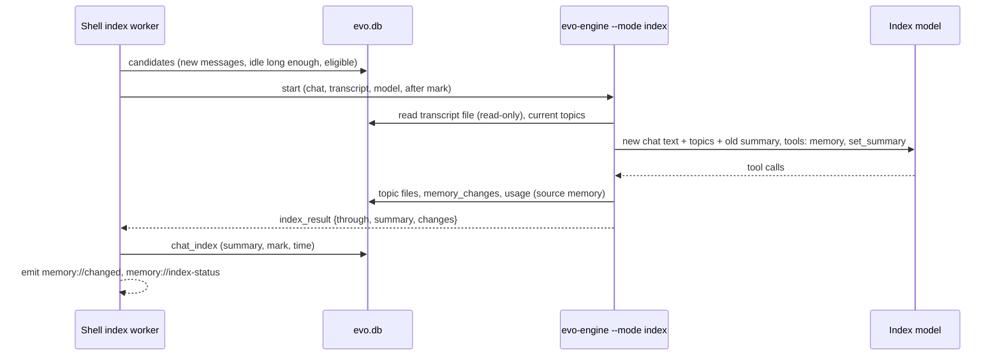

# Memory topics and chat recall — Plan

| | |
| --- | --- |
| Spec | [spec.md](spec.md) |
| Tasks | [tasks.md](tasks.md) |
| Updated | 2026-11-10 |
| ADD sections | [4. Process view](../../architecture/README.md#4-process-view), [5. Building blocks](../../architecture/README.md#5-building-blocks), [7. Data view](../../architecture/README.md#7-data-view), [9. Cross-cutting concepts](../../architecture/README.md#9-cross-cutting-concepts) |
| ADRs | [0016 Memory indexing runs in a short-lived engine process](../../architecture/decisions/0016-memory-indexing-runs-in-a-short-lived-engine-process.md), [0003](../../architecture/decisions/0003-engine-runs-as-a-child-process-per-chat.md), [0007](../../architecture/decisions/0007-one-transcript-file-per-chat.md), [0013](../../architecture/decisions/0013-app-side-agent-tools-run-in-the-rust-shell.md), [0014](../../architecture/decisions/0014-agent-tools-by-layer.md) |

## 1. Context and constraints

What exists (paths relative to the repository root):

- **Memory** is engine-owned: files and indexes in
  `crates/evo-engine/src/memory.rs`, the `memory` tool in
  `crates/evo-engine/src/tools/memory.rs`. The Memory section is added to
  the system prompt when a chat's engine is built and again on every
  resource reload (`crates/evo-engine/src/session.rs`). `memoryEnabled` in
  `settings.json` is read on each call. The Memory panel talks to the active
  chat's engine by RPC (`crates/evo-engine/src/modes.rs`, shapes in
  `crates/evo-engine/src/rpc/protocol.rs`).
- **The past-chat tools exist**: `session_search` and `session_read` are
  shell tools (`apps/desktop/src-tauri/src/agent_tools/app/sessions.rs`)
  over `evo_store::chats::search_chats`, which matches the whole query as
  one piece of text with `LIKE`, newest first. `workspaceOnly: false`
  reaches every workspace, and `session_read` reads any chat by id.
- **A chat's engine starts before the chat has a row.** A new chat is a
  draft in the webview; its engine is started at once
  (`engine_start {chat, cwd}`), and the `chats` row is written with the
  first prompt. So a choice made "before the first message" comes after
  the engine started.
- **There is no "close a chat".** A chat is archived or deleted; engines of
  idle chats beyond four are stopped and start again from the transcript.
- **Chat text reaches `evo.db` in two ways today**: `refresh_search` copies
  every transcript's words into `chat_search`, and the shell logs engine
  stderr lines as they are. Titles and previews hold the first prompt.
- **Usage** rows are written by each engine (`crates/evo-engine/src/usage_log.rs`),
  one chat id per process; `usage_events.source` is limited by a `CHECK`.
- **Models**: the webview gets the models of connected providers from the
  active chat's engine; **Settings → Providers → Default model** is the
  existing picker.
- **The shell has no periodic worker**; the Scheduler's timer is in the
  webview ([ADR 0014](../../architecture/decisions/0014-agent-tools-by-layer.md)
  calls that a gap). tokio's timer is available in the shell.

Constraints:

- [ADR 0007](../../architecture/decisions/0007-one-transcript-file-per-chat.md)
  rejected FTS5: search stays `LIKE` over stored text. Ranking is done in
  Rust over the rows `LIKE` finds.
- The shell never links `evo-engine`; shared code goes to a leaf crate.
- Applied migrations are never edited; a `CHECK` cannot be altered, so a
  new usage source rebuilds the table.
- To verify while building: a resource reload rebuilds the engine's tool
  list and may drop the tools the app configured (T20).

## 2. Architecture check

| Rule | Result | Notes |
| --- | --- | --- |
| The engine owns agent logic; the shell relays and provides native features | ok | Topics, the prompt, the sensitive rules, reset, undo and the index run are engine code. The shell stores chat flags, runs the past-chat tools (app database, [ADR 0014](../../architecture/decisions/0014-agent-tools-by-layer.md)) and decides when an index run starts, which is coordination across chats. |
| Layers point down; library crates stay free of engine/desktop concerns | ok | New shared code goes to `evo-store` (already linked by both). No library crate gains a dependency. |
| Protocol changes update `evo-protocol`, the engine and the desktop together | ok | New RPC commands are added to the engine's command table and `apps/desktop/src/engine/protocol.ts` in the same tasks. `evo-protocol` itself is unchanged: memory results are untyped JSON today and stay so. New engine flags are ignored by older engines. |
| Models come from models.dev; no hardcoded model facts | ok | The index model is one of the models the engine lists; only its provider and id are stored. No `temperature`. |
| Real engine in the app; settings and credentials reload live | ok | Engine-side settings are read on each call or applied by a resource reload; shell-side settings are read on use. No restart of the app. |
| Untrusted input stays untrusted; permissions, sandbox and project trust stay in the path | ok | Past-chat text stays marked untrusted. The index run has two tools and is not given tool results (3.7). `memory` `update` is an edit for the approval mode. |
| Desktop UI structure and `DESIGN.md` | ok | A settings section, a store, changes inside existing features. Components use store selectors; only `stores/engine-store.ts` talks to the engine client. |
| New process kind | deviation, covered | The index run is a second kind of engine process: [ADR 0016](../../architecture/decisions/0016-memory-indexing-runs-in-a-short-lived-engine-process.md), accepted with this plan; the ADD's process and data views name it. |

## 3. Design

### 3.1 Overview

```text
 webview                         shell (Rust)                         engine processes
 ───────                         ────────────                         ────────────────
 composer: Memory / Incognito ─► engine_start {chat, cwd, options} ─► evo-engine --mode rpc
 sidebar, chat header marks        flags from the chat row, else        [--no-memory] [--incognito]
                                   from options                          memory tool: save/update/…
 Settings → Memory ──RPC────────────────────────────────────────────►   settings.json, reset, undo
        │ └─ app settings ──────► app_settings memory.*
        │                          │
 Memory panel ◄─ memory://changed ─┤  index worker (30 s tick)
 Usage page                        │   idle chat with new messages
                                   │        └─ spawn ───────────────► evo-engine --mode index
                                   │                                    reads transcripts/<chat>.db
                                   │   ◄── one result line ──────────   tools: memory, set_summary
                                   │   writes chat_index                writes topics, memory_changes,
                                   │                                    usage (source memory)
 agent in a chat ─ session_search / session_read ─► agent_tools/app/sessions.rs
                                                     evo_store::chats::find_chats (ranked, own project)
```

Three parts. **Chat flags** (`memory_off`, `incognito`) live on the chat row
and reach the engine as start flags. **Topics** are the existing memory
files with an `update` action, more prompt guidance and more switches.
**Recall** is the existing shell tools with ranking, a list by time, a
strict project scope, and chat summaries written by **indexing**, which is
a short-lived engine process the shell starts for idle chats.

### 3.2 Components

| Layer | Path | Responsibility | Requirements |
| --- | --- | --- | --- |
| crate | `crates/evo-store/src/migrations/0011_memory_topics.sql`, `0012_usage_memory_source.sql`, `crates/evo-store/src/lib.rs` | Chat flags, `chat_index`, `memory_changes`; usage source `memory`. | FR-6, FR-19, FR-27, FR-29, FR-30, FR-34 |
| crate | `crates/evo-store/src/chats.rs` | `memory_off`, `incognito`, `scheduled` on `Chat` / `NewChat`; a fork copies `memory_off`; search text and search skip incognito chats; `find_chats` (ranked search and list by time in one project); `index_candidates`; `incognito_ids`. | FR-11, FR-12, FR-13, FR-21, FR-26, FR-30, FR-32, FR-33, NFR-2, NFR-4 |
| crate | `crates/evo-store/src/chat_index.rs` (new) | A chat's summary and "indexed up to" mark. | FR-27, FR-32 |
| crate | `crates/evo-store/src/memory_log.rs` (new) | The list of indexing changes: record, list, mark undone, clear, keep the newest 200. | FR-29 |
| crate | `crates/evo-store/src/transcripts.rs` | Reading a saved transcript as role-labelled messages (moved from the shell), with entry ids and "messages after a mark". | FR-13, FR-27 |
| crate | `crates/evo-store/src/usage.rs`, `logs.rs` | Source `memory`; delete a chat's log entries. | FR-22, FR-34, NFR-4 |
| engine | `crates/evo-engine/src/memory.rs` | Topic `update`, frontmatter `by` and `sensitive`, atomic writes, the per-project personal switch, the sensitive setting, reset, undo, the prompt text, recording indexing changes. | FR-1 – FR-4, FR-7, FR-9, FR-17, FR-18, FR-28, FR-29 |
| engine | `crates/evo-engine/src/tools/memory.rs`, `approval.rs` | `update` action and `sensitive` field; `update` counts as an edit. | FR-3, FR-5, FR-17 |
| engine | `crates/evo-engine/src/args.rs`, `session.rs`, `host.rs` | `--no-memory`, `--incognito`: no Memory section at build and reload, no `memory` tool, usage without a chat id; `--mode index`. | FR-6, FR-20, FR-23 |
| engine | `crates/evo-engine/src/memory_index.rs` (new) | The index run: input from the transcript, the two-tool loop, the result line. | FR-25, FR-27, FR-28, FR-30, FR-31, FR-34 |
| engine | `crates/evo-engine/src/modes.rs`, `rpc/protocol.rs`, `settings.rs`, `usage_log.rs` | RPC `set_memory_settings`, `reset_memory`, `list_memory_changes`, `undo_memory_change`; more fields from `list_memories`; settings keys; usage source. | FR-7, FR-9, FR-10, FR-17, FR-29, FR-34 |
| desktop shell | `apps/desktop/src-tauri/src/engine.rs` | `engine_start` options, flags from the chat row, quiet logging for incognito engines, which chats are in a run. | FR-6, FR-19, FR-20, NFR-4, NFR-5 |
| desktop shell | `apps/desktop/src-tauri/src/db.rs`, `lib.rs`, `mesh.rs` | Ending an incognito chat, cleaning up at exit and at start, nested chats inherit the flags, side effects of `memory.*` settings. | FR-15, FR-22 |
| desktop shell | `apps/desktop/src-tauri/src/agent_tools/app/sessions.rs`, `agent_tools/mod.rs` | `session_search` ranked and by time, project scope, structured results; both tools hidden by setting and by chat flags. | FR-6, FR-11 – FR-16, FR-20, FR-21, FR-32 |
| desktop shell | `apps/desktop/src-tauri/src/memory_index.rs` (new) | The index worker: tick, candidates, one run at a time, timeout, results, status, commands. | FR-24 – FR-26, FR-28, FR-30, FR-33, NFR-5 |
| desktop UI | `apps/desktop/src/stores/session-store.ts`, `engine-store.ts`, `lib/db.ts`, `engine/client.ts`, `engine/protocol.ts` | Flags on a chat and a draft, start options, restart of a draft's engine when a flag changes, ending an incognito chat, reload on `memory://changed`. | FR-6, FR-19, FR-22 |
| desktop UI | `apps/desktop/src/features/chat/chat-composer.tsx` | **Memory** and **Incognito chat** in the composer's menu, locked after the first message; the "memory off" mark. | FR-6, FR-19 |
| desktop UI | `apps/desktop/src/features/shell/sidebar-chats.tsx`, `chat-menu.tsx`, `workspace-header.tsx` | Incognito mark in the sidebar and the chat header; **End chat**. | FR-19, FR-22 |
| desktop UI | `apps/desktop/src/components/ai-elements/tool.tsx`, `tool-kinds.ts` | "Updated memory · name" with added and removed lines, the sensitive mark, "Searched past chats" with chats that open. | FR-5, FR-14, FR-17 |
| desktop UI | `apps/desktop/src/features/memory/memory-panel.tsx` | Topics, who changed one last, **Use personal memory**, paused and "off for this chat" states, indexing changes with undo. | FR-1, FR-7, FR-8, FR-29 |
| desktop UI | `apps/desktop/src/features/settings/sections/memory-settings.tsx` (new), `settings-registry.ts`, `settings-controls.tsx`, `sections/provider-settings.tsx`, `apps/desktop/src/stores/memory-store.ts` (new), `ui-store.ts` | **Settings → Memory**; a shared model picker and number field. | FR-8 – FR-10, FR-15, FR-17, FR-24 – FR-26, FR-33 |
| desktop UI | `apps/desktop/src/features/usage/usage-page.tsx` | "Memory indexing" as a usage source. | FR-34 |

### 3.3 Interfaces

**Agent tool `memory`** (engine). New: `update`, `sensitive`.

```jsonc
{
  "action": "save | update | read | list | delete",
  "scope": "personal | project",
  "name": "kebab-case-name",
  "description": "one line",
  "type": "user | feedback | project | reference",
  "content": "save: the whole topic",
  "old_text": "update: text to replace; must occur exactly once",
  "new_text": "update: its replacement; with no old_text it is added at the end",
  "sensitive": false   // save/update: the change holds a sensitive subject
}
```

`update` result details: `{ "memory": {...}, "action": "updated", "diff": { "removed": ["…"], "added": ["…"] }, "sensitive": false }`.
With `sensitive: true` and the setting off, the tool refuses and names the
setting. `update` is an edit for the approval mode, like `save`.

**Engine flags** (older engines ignore unknown flags):

| Flag | Effect |
| --- | --- |
| `--no-memory` | No Memory section at build or reload; the `memory` tool is not in the tool list. |
| `--incognito` | As `--no-memory`; usage rows carry no chat id. |
| `--mode index` | The index run (below). |

**Index run** (shell → engine, [ADR 0016](../../architecture/decisions/0016-memory-indexing-runs-in-a-short-lived-engine-process.md)):

```text
evo-engine --mode index --session-id <chat> --session-db <transcripts>/<chat>.db
           --provider <id> --model <id> [--index-after <entry id>] [--index-summary-only]
           (working folder: the chat's folder)
```

One line on stdout, then exit:

```jsonc
{ "type": "index_result", "chat": "<id>", "through": "<entry id>",
  "summary": "…" | null, "changes": 2, "skipped": null | "paused" | "nothing_new" }
{ "type": "index_error", "chat": "<id>", "kind": "model_unavailable | failed", "message": "…" }
```

**Engine RPC** (added to the command table and `SUPPORTED_COMMANDS`):

| Command | Params | Result |
| --- | --- | --- |
| `list_memories` | — | as today, plus `chatMemory` (false with `--no-memory`), `usePersonal`, `sensitive`, `total` (topics in every scope); items gain `by` (`chat`, `index`, `person`) and `sensitive` |
| `set_memory_settings` | `{sensitive?, usePersonal?}` | as `list_memories` |
| `reset_memory` | — | `{deleted}` then as `list_memories` |
| `list_memory_changes` | `{limit?}` | `{changes: [{id, at, scope, name, action, chatId, removed, added, undone}]}` for this project and personal |
| `undo_memory_change` | `{change}` (the change's id) | as `list_memory_changes`; an error when the topic changed since |

**Shell tools** (the model sees these schemas):

```jsonc
// session_search
{ "query": "words to look for; leave out to list chats by time",
  "after": "YYYY-MM-DD or YYYY-MM-DDTHH:MM, local time",
  "before": "…",
  "order": "newest | oldest",        // only without a query; default newest
  "limit": 10 }                       // max 30
// session_read — unchanged shape; refuses a chat of another project or an incognito chat
```

`workspaceOnly` is removed; a call that still sends it gets an error naming
the change. Results carry `structuredContent`:
`{ "query": "…" | null, "hits": [{ "id", "title", "date", "summary" | null }] }`.

**Tauri commands and events:**

| Name | Shape |
| --- | --- |
| `engine_start` | `{chat, cwd, options?: {memoryOff?, incognito?}}`; the chat's row wins over `options` |
| `chat_create` | `NewChat` gains `memoryOff`, `incognito`, `scheduled` |
| `chat_delete` | for an incognito chat also removes its nested chats and log entries |
| `memory_index_status` | → `{state: "off" \| "idle" \| "running" \| "stopped", chat?, message?, waiting}` |
| `memory_index_now`, `memory_index_earlier_count`, `memory_index_earlier`, `memory_index_poke` | start runs; count; queue the older chats; look again after a settings or provider change |
| event `memory://index-status` | the status above, on every change |
| event `memory://changed` | `{chat}` after a run changed topics; the webview reloads idle chats' resources |

### 3.4 Data and storage

**`0011_memory_topics.sql`:**

```sql
ALTER TABLE chats ADD COLUMN memory_off INTEGER NOT NULL DEFAULT 0;
ALTER TABLE chats ADD COLUMN incognito  INTEGER NOT NULL DEFAULT 0;
ALTER TABLE chats ADD COLUMN scheduled  INTEGER NOT NULL DEFAULT 0;

CREATE TABLE chat_index (
    chat_id         TEXT PRIMARY KEY NOT NULL REFERENCES chats (id) ON DELETE CASCADE,
    summary         TEXT,
    indexed_through TEXT,              -- transcript entry id
    indexed_at      INTEGER,
    failed_at       INTEGER,
    error           TEXT
) STRICT;

CREATE TABLE memory_changes (
    id        INTEGER PRIMARY KEY,
    at_ms     INTEGER NOT NULL,
    scope     TEXT NOT NULL CHECK (scope IN ('personal', 'project')),
    project   TEXT,                    -- folder slug; NULL for personal
    name      TEXT NOT NULL,
    action    TEXT NOT NULL CHECK (action IN ('added', 'updated', 'deleted')),
    chat_id   TEXT,                    -- not a foreign key: the chat may be deleted
    before_text TEXT,                  -- the topic file before; NULL when added
    after_text  TEXT,                  -- the topic file after; NULL when deleted
    undone_at INTEGER
) STRICT;
```

**`0012_usage_memory_source.sql`** rebuilds `usage_events` with `'memory'`
in the source `CHECK` (new table, copy, drop, rename, indexes again). The
table has no foreign keys in or out.

**Files** (engine-owned, unchanged places): a topic's frontmatter gains
`by: chat | index | person` and `sensitive: true` when set. A write goes to
a temporary file and is renamed into place.

**Settings:** see 3.8.

**In memory:** per engine process in the shell, its flags and whether a run
is in progress; the index worker's queue and status. All of it is rebuilt
from `evo.db` after a restart.

### 3.5 Behaviour

**Chat flags.**

1. In a draft, **Memory** or **Incognito chat** in the composer's menu
   changes the draft's flags and restarts its engine with the matching
   start options (the engine holds no messages yet).
2. The first prompt writes the chat row with the flags. From then on the
   shell takes the flags from the row at every engine start, and the menu
   items are locked.
3. An incognito chat's row has the fixed title "Incognito chat" and no
   preview, so none of its text is in `evo.db`. It cannot be renamed,
   pinned, forked or archived; its menu has **End chat**.
4. A nested chat is created with its parent's flags.

**Ending an incognito chat.** **End chat**, quitting evo, and the next
start after a crash all do the same: stop the engine, delete the chat's row
and its nested chats' rows, their transcript files, document versions and
log entries. At quit this runs after every engine stopped; at start it runs
before the transcript sweep and before any window shows.

**Topic update.** `update` reads the topic's current file, replaces the one
occurrence of `old_text` (or adds `new_text` at the end), writes it through
a rename, rewrites the index and returns the added and removed lines.

**Past-chat search.** The query is split into words (lower-cased, at most
eight). A chat of the asking chat's project is a match when a word is in
its title, summary, preview or search text. Score: 3 per word in the title,
3 per word in the summary, 1 per word in the text; 2 more when every word
is present; 3 more when the whole query appears as one phrase; plus up to 1
for recency (`1 / (1 + age in days / 30)`). Best first, then newest. With
no query the tool lists chats by time. Passages come from the search text
of the chats returned. Incognito chats and the asking chat are never
matched.

**Indexing.**



- **Candidates:** top-level chats that are not incognito, not memory-off,
  have at least one turn, were updated at or after `memory.indexSince`, were
  last updated at least **Index after idle** ago, are not in a run, and
  were updated after they were last indexed. **Index now** drops the idle
  rule; **Index earlier chats** drops the `indexSince` rule.
- **One run at a time**, with a five-minute limit; the worker ticks every
  30 seconds.
- **Input:** the user and assistant text of the entries after the mark, tool
  calls by name only, no tool results, at most 60,000 characters per model
  call and four calls per run; the mark moves with each call. With it: the
  topics of the chat's scopes and the chat's previous summary.
- **Scheduler chats** (`scheduled`) run with `--index-summary-only`: the
  `memory` tool is not offered.
- **Paused memory:** the index process sees it and reports `skipped`; the
  worker then waits for `memory_index_poke`.

**Undo.** A change can be undone while the topic file still equals the
change's `after`; the engine then writes `before` back (or removes an added
topic, or restores a deleted one) and marks the change undone.

**Reset.** The engine deletes every topic file and index in the personal
folder and in every project's folder, and every `memory_changes` row; chat
summaries stay.

### 3.6 Errors and edge cases

- **Index model unusable** (no credentials, model gone): the run ends with
  `model_unavailable`; the worker stops, **Settings → Memory** shows the
  message, and it looks again after `memory_index_poke` (a memory setting
  or the providers changed) or a restart.
- **A run fails or times out** for one chat: `chat_index.failed_at` and
  `error` are set and that chat is tried again after an hour. Topic changes
  already made stay; the mark does not move, so the next run sees the same
  text and is told to update rather than duplicate.
- **A chat is deleted while it is indexed:** the shell stops the index
  process first, then removes the files.
- **A message arrives while the chat is indexed:** nothing waits; the new
  text is after the mark and is indexed on a later run.
- **Undo after the topic changed:** refused with a message that names the
  topic; nothing is written.
- **`update` with text that is absent or occurs twice:** the tool fails and
  says which; the agent reads the topic and tries again.
- **A draft whose flags change while its engine starts:** the newest choice
  wins; the engine is started again.
- **Older engine with a newer app:** it ignores `--no-memory` and
  `--incognito`. The app and the sidecar ship together, and the database
  refuses an older engine after the migration, so this cannot go unnoticed.
- **Chats in a managed worktree** have their own project memory folder, as
  today; **Use personal memory** is stored per folder and so applies to the
  worktree's folder separately.
- **Mail an incognito chat sent to another chat** stays in that chat, like
  the files it changed.
- **Non-ASCII letters:** `LIKE` ignores case only for ASCII, as the sidebar
  search does today.

### 3.7 Security and trust

- **Past-chat text is untrusted** and stays wrapped in the existing
  "untrusted" marks. `session_read` and `session_search` cannot leave the
  asking chat's project, and never return an incognito chat.
- **The index run cannot act on what it reads.** It has two tools, loads no
  plugins, hooks, skills, connectors or project files, and gets no tool
  results, so text from web pages, files and connectors is not in its
  input. Its instructions say to keep only what the person said or
  confirmed. What it writes is still remembered text: untrusted data for
  the chats that read it.
- **Chat text leaves the device only to the index model's provider**, and
  only when automatic indexing is on; the setting says so (FR-24).
- **Sensitive subjects:** the prompt rules follow the setting; a change
  marked `sensitive` is refused by the tool while the setting is off. The
  never-save list (identity numbers, account numbers, passwords, keys,
  tokens) is prompt guidance in every mode, for chats and for indexing.
- **Incognito:** no title, preview, search text or log line holds the
  chat's text; usage rows hold no chat id; the engine's stderr and error
  strings of that chat are not logged.
- **Approval:** `memory` `update` is an edit; the past-chat tools are reads.
  The index run asks nothing: it is started by a setting the person turned
  on, and can only change memory, which every change lists and undoes.
- **Credentials** stay in the engine; the shell passes only a provider id
  and a model id.

### 3.8 Configuration

| Key | Type | Default | Where | Applies |
| --- | --- | --- | --- | --- |
| `memoryEnabled` | boolean | on | `~/.evo/agent/settings.json` | as today; shown as **Pause memory** |
| `memorySensitive` | boolean | off | `~/.evo/agent/settings.json` | read on each call; prompt on the next reload; **Include sensitive subjects** |
| `memoryPersonalOff` | list of folder slugs | empty | `~/.evo/agent/settings.json` | read on each call; prompt on the next reload; **Use personal memory** in the Memory panel |
| `memory.searchPastChats` | boolean | on | app database | on change the shell re-offers tools to running chats; **Search past chats** |
| `memory.autoIndex` | boolean | off | app database | next tick; **Automatic indexing** (needs an index model) |
| `memory.indexModel` | `{provider, modelId}` or none | none | app database | next run; **Index model** |
| `memory.indexIdleMinutes` | number, 1–120 | 5 | app database | next tick; **Index after idle** |
| `memory.indexSince` | time (ms) | set when indexing is first switched on | app database | which chats count as "earlier" |

The first three are edited through the active chat's engine, as the Memory
panel's switch is today, so those controls are disabled until a chat's
engine is ready.

## 4. Alternatives considered

| Option | Why not |
| --- | --- |
| Index inside the chat's own engine | See [ADR 0016](../../architecture/decisions/0016-memory-indexing-runs-in-a-short-lived-engine-process.md): needs the engine running, loads every tool, counts usage as the chat's. |
| FTS5 for ranking | Rejected in [ADR 0007](../../architecture/decisions/0007-one-transcript-file-per-chat.md); word matching and scoring over `LIKE` rows meets FR-11 and NFR-2 without it. |
| An in-memory session for incognito chats (`--no-session`) | An idle engine is stopped and restarted to reload settings; the chat would lose its messages. The transcript file is kept while the chat is open and deleted when it ends. |
| A per-chat memory RPC instead of start flags | The choice must hold after every engine restart; the shell already passes per-chat facts as flags. |
| New past-chat tools in the engine | The tools exist in the shell, where the app database is ([ADR 0014](../../architecture/decisions/0014-agent-tools-by-layer.md)). |
| The list of indexing changes as files beside the topics | Several engines and the index process write it; `evo.db` already handles concurrent writers, ordering and trimming. |
| **Use personal memory** on the workspace row | Project memory is keyed by the chat's folder, not the workspace row; a second key would disagree for worktree chats. |
| One structured answer from the index model instead of tool calls | Structured output differs by provider; tool calls work with every provider the engine supports. |
| The index timer in the webview | Stops with the window's script; the shell sees every engine's events. |

## 5. As-built notes

As of 2026-11-10 (store, engine, shell and UI built; automated tests pass;
tried in the running app on a copy of the data, with a real model for the
chats and the index run):

- **The shell's flag logic is in a file of its own**,
  `apps/desktop/src-tauri/src/chat_flags.rs` (flags, engine arguments, which
  tools a chat is offered, quiet logging, removing incognito chats), with
  one-line hooks in `engine.rs`, `db.rs`, `system.rs`, `mesh.rs` and
  `agent_tools/mod.rs`. Section 3.2 named those files as the home.
- **`undo_memory_change` takes `change`**, not `id`: `id` is the request's
  own field in the RPC envelope.
- **`memory_changes` columns are `before_text` and `after_text`**.
- **The index run reads the chat's earlier summary from `evo.db` itself**;
  only the mark is passed on the command line (`--index-after`).
- **After any failed run the worker waits ten minutes** before the next
  one, on top of the hour a failed chat waits: a model that is down is not
  asked once per waiting chat.
- **A run that fails after reading some parts keeps them**: it reports the
  mark and the summary of the parts read, and the rest is read next time.
- **No shared model picker or number field was extracted**: the Memory
  section has its own, shaped like the ones in Providers and Sandbox.
  `settings-controls.tsx`, `provider-settings.tsx` and
  `sandbox-settings.tsx` are unchanged.
- **A reload kept the app's tools only after a fix** (T20): the engine's
  reload rebuilt the tool list without the tools set by
  `configure_external_tools`. `keep_external_tools` in `session.rs` carries
  them over.
- **Paused memory in the panel**: a notice, with topics still listed and
  editable, replaces the old "Memory is off" screen.
- **`search_speed`** (NFR-2) measured 116 ms over 1,000 chats in a release
  build.

Not yet tried in the running app: the panel while memory is paused (FR-8),
a past-chat search in approval mode "ask" (FR-16), declining a password
(FR-18), the message for an index model that cannot be used (FR-25), an
index run while memory is paused (FR-28), and a message sent to a chat
while it is being indexed (NFR-5).

Known gaps:

- Text an incognito chat left in webview storage (notifications, panel
  state) is not audited; notifications of an incognito chat carry its fixed
  title only.
- One engine test fails before and after this work:
  `external_transport_rejects_invalid_utf8_and_oversized_input` expects an
  oversized frame to end the engine, which commit `51df5ac7` changed.
