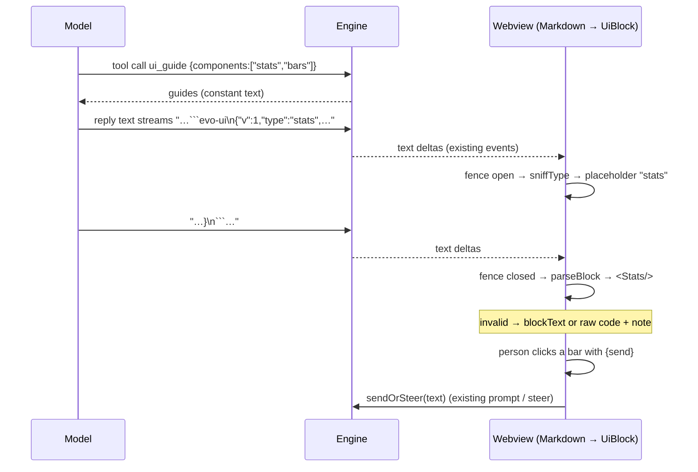

# Rich replies: charts, cards and actions in the agent's answers — Plan

| | |
| --- | --- |
| Spec | [spec.md](spec.md) |
| Tasks | [tasks.md](tasks.md) |
| Updated | 2026-11-18 |
| ADD sections | [5.2 Desktop app](../../architecture/README.md#52-desktop-app) · [6.1 A prompt](../../architecture/README.md#61-a-prompt) · [9 Cross-cutting concepts](../../architecture/README.md#9-cross-cutting-concepts) |
| ADRs | [0014 Agent tools by layer](../../architecture/decisions/0014-agent-tools-by-layer.md) · [0021 Plugin views run in native webviews](../../architecture/decisions/0021-plugin-views-run-in-native-webviews.md) |

This plan covers **stage 1** (spec section 2.3). Stages 2–4 get their own
sections here when their spec requirements are planned; stage 2 (HTML
views replacing `show_widget`) is next, after its spec amendment is
accepted.

## 1. Context and constraints

What exists today:

- **Reply rendering.** `apps/desktop/src/components/markdown.tsx` renders
  Markdown with Streamdown 2 and routes every fenced block (`data-block`) to
  `MarkdownCodeBlock` (Shiki highlighting, copy button).
  `useIsCodeFenceIncomplete()` already tells whether a fence is still open
  while streaming. The same `Markdown` component renders replies
  (`features/chat/chat-turn.tsx`, `features/side-chat/side-chat-panel.tsx`,
  `components/ai-elements/agent-run.tsx`) and non-reply Markdown (Customize,
  Files preview, Memory, release notes).
- **Text forms of a reply.** `features/chat/message-text.ts`
  (`messagePlainText`, copy and quote from the message menu) and
  `lib/plain-text.ts` (`plainText`, one-line previews in the sidebar and
  Scheduler). The engine cuts the turn's `preview` from the raw final text
  (`crates/evo-engine/src/modes.rs`, `TURN_PREVIEW_CHARS`); the shell records
  it (`src-tauri/src/supervisor/turns.rs`) for previews and notifications.
- **Tools and the system prompt.** Built-in tools are registered in
  `crates/evo-engine/src/tools/mod.rs`, classified in the one tool table
  `tools/info.rs` (ADR 0014), and described in the prompt by
  `builtin_tool_snippet` in `crates/evo-engine/src/session.rs`, which also
  merges per-tool `prompt_guidelines` into the guideline list.
- **HTML widgets already exist.** `visualize_read_me` + `show_widget`
  (`tools/visualize.rs`, [office v3 FR-13](../office-v3-parity/spec.md))
  render model-written HTML in a sandboxed iframe
  (`components/widget-frame.tsx`: `sandbox="allow-scripts"`, opaque origin,
  CSP with a CDN allowlist, `sendPrompt`). Its `chart` module teaches the
  model to draw charts with Chart.js from a CDN. Stage 1 leaves it in place
  and tells the model when to use a block instead (FR-11). Stage 2 replaces
  both tools with `evo-html` (spec FR-27, FR-30–FR-36); its plan reuses the
  frame mechanics of `widget-frame.tsx` (opaque origin, postMessage, theme
  sync) without the CDN allowlist and `eval`.
- **Sending from the chat's content.** `widget-frame.tsx` has
  `sendToChat(text)`: `sendPrompt` when idle, `queueMessage(text, [],
  "steer")` during a turn — the composer's behaviour for a typed message.
- **Opening files and links.** `stores/files-store.ts` exports
  `openFile(path, line?)`; links in replies open through the app's link
  handling.
- **Webbridge side panel** (`extensions/evo-webbridge/sidepanel/markdown.js`)
  has its own small DOM-only Markdown renderer; it does not share the
  desktop's React components.
- **No chart or Mermaid library is installed.** Streamdown's Mermaid
  support is a separate package (`@streamdown/mermaid`), not in
  `node_modules`.
- **Theme tokens** live in `apps/desktop/src/index.css`; DESIGN.md allows
  one accent and status colours only as dots.

## 2. Architecture check

| Rule | Result | Notes |
| --- | --- | --- |
| The engine owns agent logic; the shell relays and provides native features | ok | What the agent is told (index, `ui_guide`) lives in the engine. Drawing is presentation and lives in the webview. The shell is untouched. |
| Layers point down; library crates stay free of engine/desktop concerns | ok | All engine changes are in `evo-engine`; no library crate changes. |
| Protocol changes update `evo-protocol`, the engine and the desktop together | n/a | No protocol change. Blocks travel inside the reply text; `ui_guide` is an ordinary tool whose call and result use the existing events. |
| Models come from models.dev; no hardcoded model facts | n/a | No model facts. |
| Real engine in the app; settings and credentials reload live | ok | No settings. A new built-in tool is available to every new or reloaded session. |
| Untrusted input stays untrusted; permissions, sandbox and project trust stay in the path | ok | Blocks are parsed as data and drawn with text-only React components; actions are limited to FR-22 (section 3.7). `ui_guide` only reads constant text. |
| Desktop UI structure and `DESIGN.md` | ok | Block components go in `components/reply-blocks/` (used by more than one feature); they reach the engine only through store actions. Chart colours are added to DESIGN.md and `index.css` as tokens (FR-7). |
| ADD / ADR needed? | no | No new crate, process, protocol plane, store or trust boundary: blocks add no code execution. Stage 2 (HTML views) will need an ADR. |

## 3. Design

### 3.1 Overview

```text
 engine                                        desktop webview
 ──────                                        ───────────────
 system prompt ── index (≤300 tokens) ─┐
 tool ui_guide ── component guides ────┤ model
                                       ▼
 reply text: "…prose…\n```evo-ui\n{json}\n```\n…prose…"
   │                                             │
   ├─ turn preview: blocks → their title         ├─ Markdown(blocks) ─► code fence?
   │  (modes.rs)                                 │     evo-ui  ─► UiBlock ─► parse ─► Stats/Bars/Chart/…
   │                                             │     mermaid ─► MermaidBlock (lazy)
   └─ stored as is, sent back to the model as is │     diff    ─► DiffBlock
                                                 ├─ copy/quote ─► messagePlainText ─► blockText()
                                                 └─ previews  ─► plainText ─► block title
```

The model writes a block as JSON inside an `evo-ui` fence. The engine stores
and replays the reply unchanged; only the turn preview replaces blocks with
their titles. In the webview, the reply's `Markdown` routes `evo-ui` fences to
`UiBlock`, which shows a placeholder while the fence is open, then parses,
validates and draws the component, or falls back to text. One pure module,
`lib/ui-blocks/`, holds the types, the parser, number formatting and the text
rendering, used by the drawing, the copy path and the previews.

### 3.2 Components

| Layer | Path | Responsibility | Requirements |
| --- | --- | --- | --- |
| engine | `crates/evo-engine/src/tools/ui_guide.rs` | The `ui_guide` tool: returns the guide of each named component, lists unknown names. Constant text, no side effects, parallel, replay-safe. | FR-11, FR-12 |
| engine | `crates/evo-engine/src/tools/ui_guide/*.md` | `index.md` (the prompt index) and one guide per component: `stats`, `bars`, `chart`, `table`, `steps`, `callout`, `actions`, plus `actions-on-items` (the `action` object) and `formats`. Each has fields, one example and its rules. | FR-10, FR-11, FR-15–FR-22 |
| engine | `crates/evo-engine/src/tools/mod.rs` | Register `ui_guide` for every session, next to `visualize_read_me`. | FR-11, FR-12 |
| engine | `crates/evo-engine/src/tools/info.rs` | Row `ui_guide`: `Read`, read-only safe, not reserved. | FR-12 |
| engine | `crates/evo-engine/src/session.rs` | `builtin_tool_snippet("ui_guide")` and a new `builtin_tool_guidelines(name)` that feeds the index lines into `prompt_guidelines`. | FR-10, FR-11 |
| engine | `crates/evo-engine/src/ui_blocks.rs` | `preview_text(text)`: replaces each `evo-ui` fence with its `title` (else its `type`) in brackets; used before the turn preview is cut. | FR-4 |
| engine | `crates/evo-engine/src/modes.rs` | Call `ui_blocks::preview_text` on the final text before `TURN_PREVIEW_CHARS`. | FR-4 |
| desktop UI | `apps/desktop/src/lib/ui-blocks/types.ts` | TypeScript types of the format and each stage-1 component (section 3.3). | FR-1, FR-15–FR-22 |
| desktop UI | `apps/desktop/src/lib/ui-blocks/parse.ts` | `parseBlock(source)`: size check, JSON parse, `v` check, per-type validation (required fields, limits, unknown fields dropped), `sniffType(partial)` for the placeholder. Returns `{ok, block}` or `{ok:false, reason, text?}`. | FR-1, FR-2, FR-3, FR-14, NFR-4 |
| desktop UI | `apps/desktop/src/lib/ui-blocks/format.ts` | `formatValue(value, format)` with `Intl.NumberFormat` / `Intl.DateTimeFormat` in the person's locale; currency from the ISO code; one formatter per field. | FR-6 |
| desktop UI | `apps/desktop/src/lib/ui-blocks/text.ts` | `blockText(block)` per component (section 3.3) and `replaceBlocks(markdown, mode)` for `"text"` (copy) and `"title"` (previews). | FR-4, FR-14 |
| desktop UI | `apps/desktop/src/lib/ui-blocks/fixtures.ts` | One valid and several invalid blocks per component, shared by the tests. | all stage 1 |
| desktop UI | `apps/desktop/src/components/reply-blocks/ui-block.tsx` | The dispatcher: placeholder while the fence is open, then the component, or the fallback (text rendering or raw code with "Couldn't draw this block"). Wraps each block with its `title`, `source` and an accessible name. | FR-2, FR-3, FR-8, NFR-3 |
| desktop UI | `apps/desktop/src/components/reply-blocks/{stats,bars,table,steps,callout,actions}.tsx` | The stage-1 components, styled with theme tokens. `table` sorts by header (numbers as numbers) and scrolls inside its block. | FR-7, FR-8, FR-15, FR-16, FR-18–FR-21 |
| desktop UI | `apps/desktop/src/components/reply-blocks/chart.tsx` | Line, bar and area charts drawn as SVG by hand (axes with rounded ticks, hover tooltip, legend, "Show data" table), loaded with `React.lazy` so it costs nothing until the first chart. | FR-7, FR-17, NFR-2, NFR-3 |
| desktop UI | `apps/desktop/src/components/reply-blocks/block-action.ts` | `runBlockAction(action, chat)`: `send` → the shared send helper; `open` → a path inside the chat's working folder via `openFile`, or an `https` link via the app's link handling; anything else → a note. | FR-22, NFR-1 |
| desktop UI | `apps/desktop/src/components/reply-blocks/{mermaid-block,diff-block}.tsx` | Mermaid fences drawn with `@streamdown/mermaid` (lazy, `securityLevel: "strict"`, theme per app theme, source toggle, parse error → source + note); diff fences with a gutter mark per added/removed line on top of Shiki's `diff` colours. | FR-9 |
| desktop UI | `apps/desktop/src/components/markdown.tsx` | New prop `blocks` (off by default): routes `evo-ui` to `UiBlock`, `mermaid` and `diff` to their blocks. Other fences keep `MarkdownCodeBlock`. | FR-1, FR-9 |
| desktop UI | `apps/desktop/src/features/chat/chat-turn.tsx`, `features/side-chat/side-chat-panel.tsx` | Pass `blocks` for the agent's reply text. `agent-run.tsx` (a subagent's own run) does not: a report is for the parent agent. | FR-13, FR-28 |
| desktop UI | `apps/desktop/src/stores/engine-store.ts`, `components/widget-frame.tsx` | Move `sendToChat` from the widget frame into the store as `sendOrSteer(text)`; the widget and `send` actions both use it. | FR-22 |
| desktop UI | `apps/desktop/src/features/chat/message-text.ts`, `lib/plain-text.ts` | Replace `evo-ui` fences with `blockText` (copy, quote) or the block's title (previews); a truncated, unclosed `evo-ui` fence at the end of a preview becomes its title. | FR-4 |
| desktop UI | `apps/desktop/src/index.css`, `DESIGN.md` | Chart tokens `--chart-1` (the accent) to `--chart-4` (greys) and `--chart-rest`, light and dark; DESIGN.md "Data visualisation" section. | FR-7 |
| Webbridge | `extensions/evo-webbridge/sidepanel/ui-blocks.js`, `sidepanel/markdown.js` | A DOM-only port of `blockText` for the stage-1 components; `markdown.js` shows an `evo-ui` fence as that text in a `<pre>`, or the block's title when the port cannot read it. | FR-28 |
| docs | `apps/desktop/README.md`, `docs/features/rich-replies/assets/eval.md` | UI map entry for reply blocks; the 40-question eval for SC-4. | SC-4 |

### 3.3 Interfaces

**The block format (the contract the model writes).** A fenced block with
the info string `evo-ui` and one JSON object:

```ts
// lib/ui-blocks/types.ts
type Format =
  | "number" | "compact" | "percent" | "bytes" | "duration" | "date"
  | { currency: string };                       // ISO 4217, e.g. "USD"

type Action = { send: string } | { open: string }; // FR-22

interface BlockBase { v: 1; type: string; title?: string; source?: string }

interface StatsBlock extends BlockBase {          // FR-15, 1–8 tiles
  type: "stats";
  items: { label: string; value: number | string; format?: Format;
           delta?: number; deltaFormat?: Format; hint?: string }[];
}
interface BarsBlock extends BlockBase {           // FR-16, ≤ 50 items
  type: "bars"; format?: Format; max?: number;
  items: { label: string; value: number; action?: Action }[];
}
interface ChartBlock extends BlockBase {          // FR-17, ≤ 6 series, ≤ 1,000 points
  type: "chart"; kind: "line" | "bar" | "area"; stacked?: boolean;
  x: (string | number)[]; format?: Format;
  series: { name: string; values: (number | null)[] }[];
}
interface TableBlock extends BlockBase {          // FR-18, ≤ 500 rows, ≤ 12 columns
  type: "table";
  columns: { key: string; label: string; format?: Format; align?: "left" | "right" }[];
  rows: (Record<string, string | number | null> & { action?: Action })[];
}
interface StepsBlock extends BlockBase {          // FR-19
  type: "steps";
  items: { title: string; detail?: string;
           status?: "done" | "current" | "todo" | "failed" | "skipped" }[];
}
interface CalloutBlock extends BlockBase {        // FR-20
  type: "callout"; tone: "info" | "success" | "warning" | "error"; text: string;
}
interface ActionsBlock extends BlockBase {        // FR-21, 1–4 buttons
  type: "actions"; items: { label: string; action: Action; primary?: boolean }[];
}
```

Example:

````text
```evo-ui
{"v":1,"type":"bars","title":"Cost per day","source":"Usage, 10–16 Nov",
 "format":{"currency":"USD"},
 "items":[{"label":"10 Nov","value":168.89,"action":{"send":"Show details for 10 Nov"}},
          {"label":"11 Nov","value":1004.12}]}
```
````

Validation rules (FR-3, FR-14, NFR-4): the body is at most 32 KB before
parsing; `v` greater than 1 is "newer"; a missing required field or a
wrong type fails the block; a list over its limit fails the block (shown as
truncated text); unknown fields are dropped; a single bad item (a `bars`
item without a number) drops that item, not the block, and the block
notes how many were dropped. Fields are only ever added within `v: 1`.

**Text rendering (`blockText`).** Title on the first line when present,
then: `stats` → `label: value (delta)` per tile; `bars` → `label: value`;
`chart` → the "Show data" table as tab-separated rows (x, then one column
per series); `table` → header and rows tab-separated; `steps` → `1. [done]
title — detail`; `callout` → `Warning: text`; `actions` → the labels in
brackets; then `Source: …`. Values use `formatValue`.

**Tool `ui_guide`** (what the model sees):

```json
{
  "name": "ui_guide",
  "description": "Read how to write Evo UI blocks (evo-ui fences) before using a component: its fields, an example and its rules. Read-only.",
  "parameters": {
    "type": "object",
    "properties": {
      "components": {
        "type": "array",
        "items": { "type": "string" },
        "description": "Components to read: stats, bars, chart, table, steps, callout, actions, formats"
      }
    },
    "required": ["components"]
  }
}
```

The result is the guides of the named components in request order, each
once, then `Unknown: …` for names it does not know; with no known name it
lists the known ones. `details` is `{ "components": [...] }`.

**The index** (in the system prompt through `prompt_guidelines`, at most
300 tokens, checked by a test with the engine's token estimate):

```text
- When a reply gives three or more related values (per day, file, crate, model) from a command
  you ran, a file or the person, or a sequence of steps or a diagram, show them in a UI block:
  a fenced block ```evo-ui holding one JSON object
  {"v":1,"type":...}. Evo draws it; the reply stays text. Not a Markdown table or a
  "- name: number" list, even in advice. Components: stats (number tiles), bars (a ranked
  list), chart (line/bar/area), table (sortable), steps (a sequence with status), callout (a
  note), actions (buttons that send a message or open a file or link). Diagrams: a ```mermaid
  fence. Diffs: a ```diff fence.
- Call ui_guide with the components you need before you write them.
- No block for a single number, a yes/no answer or plain prose.
- Every number comes from a tool result or the person; never estimate one. Give raw numbers
  with a format and name the source; for a rough count, say there how it was counted. Keep
  one or two sentences of interpretation outside the block; do not repeat its data in prose.
- For data these components can show, use an evo-ui block, not show_widget.
```evo-ui holding
  one JSON object
  {"v":1,"type":...}. Evo draws it; the reply stays text. Components: stats (number tiles),
  bars (a ranked list), chart (line/bar/area), table (sortable), steps (a sequence with
  status), callout (a note), actions (buttons that send a message or open a file or link).
  Diagrams: a ```mermaid fence. Diffs: a ```diff fence.
- Call ui_guide with the components you need before you write them.
- No block for a single number, a yes/no answer or plain prose.
- Every number comes from a tool result or the person; never estimate one. Give raw numbers
  with a format and name the source. Keep one or two sentences of interpretation outside
  the block and do not repeat its data in prose.
- For data these components can show, use an evo-ui block, not show_widget.
```

**Engine preview.** `ui_blocks::preview_text(&str) -> String`: each
complete `evo-ui` fence becomes `[<title or type>]`; an unclosed one at the
end becomes `[<type>]` or is dropped. The turn record's `preview` field is
unchanged in shape.

**Older clients and engines.** An older desktop shows `evo-ui` fences as
JSON code (today's behaviour). An older engine never offers `ui_guide`, so
its model does not write blocks. No version handshake is needed.

### 3.4 Data and storage

n/a — blocks are part of the reply text, stored where replies are stored
today (the session JSONL and the turn record). No table, migration or file
is added. A table's sort order is component state and is lost on reopen
(FR-5).

### 3.5 Behaviour



- **Streaming.** The smooth-text reveal (`useSmoothText`) keeps working: the
  block appears once the revealed text closes its fence.
  `useIsCodeFenceIncomplete()` drives the placeholder. `sniffType` reads
  `"type":"…"` from the partial body with a regex, no JSON parse.
- **Parsing cost.** `parseBlock` is memoised on the fence's source string,
  so re-renders while later text streams do not re-parse closed blocks.
- **Replay.** Reopening a chat renders the stored text through the same
  path; `ui_guide` calls replay as safe reads.
- **Theme.** Components read CSS variables, so a theme switch restyles
  them; charts read the variables at render and re-render on the app's
  theme change.
- **Subagents.** A report goes back to the parent as text (FR-13). The
  subagent run view (`agent-run.tsx`) renders without `blocks`, so the
  person sees the JSON the parent received.

### 3.6 Errors and edge cases

| Case | The person sees | The agent sees |
| --- | --- | --- |
| Invalid JSON, unknown `type`, `v` too new | Text rendering if the type is known and enough parsed; else raw code + "Couldn't draw this block" | Nothing (its text is unchanged) |
| Over a size limit | Text rendering truncated, "Too large to draw: showing the first N rows" | Nothing |
| Some items invalid | The block without them, "2 items could not be shown" | Nothing |
| Mermaid parse error | Source + "Couldn't draw this diagram" | Nothing |
| `open` outside the project, missing file, non-`https` link | Nothing opens; a toast says why | Nothing |
| `send` during a turn | Message queued as steer, as typed | The text as the person's message |
| Chat closed or engine restarting when `send` is clicked | The same failure a typed message shows | — |
| `ui_guide` with only unknown names | — | The list of known components |
| Very narrow pane | Tiles wrap, tables and charts scroll inside their block | — |

### 3.7 Security and trust

- **Blocks are untrusted data.** The model may have read injected text, so a
  block is treated like any tool output: parsed with `JSON.parse`, never
  evaluated; rendered by React components as text nodes; no
  `dangerouslySetInnerHTML`; no `style` or class names from the block.
  `callout.text` goes through Streamdown with the existing link hardening
  and no raw HTML.
- **No network.** Stage-1 components fetch nothing (no images, no remote
  fonts). Mermaid runs with `securityLevel: "strict"` (its own sanitising,
  no click handlers, no HTML labels).
- **Actions need a click and do only two things.** `send` sends the shown
  text as the person's own message, visible in the transcript; the button's
  full text shows on hover so the label cannot hide what is sent. `open`
  accepts a relative or absolute path that resolves inside the chat's
  working folder (normalised, `..` resolved, compared by prefix) or an
  `https:` URL; anything else is refused. No action runs a tool or a
  command in stage 1.
- **The guide tool** returns constant text compiled into the engine; it
  takes no paths and reads nothing.
- **Size limits** are checked before parsing, so a huge block cannot stall
  the webview.

### 3.8 Configuration

n/a — no setting (spec section 2.2). Locale comes from the system (the
`Intl` default), as dates in the app already do.

## 4. Alternatives considered

| Option | Why not |
| --- | --- |
| A tool call per block (`show_block {…}`) instead of a fence | Breaks the reply into tool rows, costs a round trip per block, and the block cannot sit between two paragraphs of the answer. Fences stream inline and need no new event. |
| Use `show_widget` HTML for all charts and cards | The model writes hundreds of lines of HTML per chart, slow and costly; the style drifts from DESIGN.md; it loads scripts from CDNs; copy and previews get no text. Kept for free-form visuals. |
| A chart library (Recharts, Chart.js, ECharts) | 50–200 KB for three chart kinds, and theming to one accent plus greys fights their defaults. A hand-drawn SVG chart is a few hundred lines, fully themable and lazy-loaded. Revisit in stage 2 if pie/scatter make it worthwhile. |
| One fence per component (` ```stats `, ` ```chart `) | Names clash with real languages and other tools' conventions; several parsers; harder to version. |
| Text rendering in the engine (so every client gets it) | Copy, quote and previews happen in the webview, which already has the parser; the engine needs only the preview title. The Webbridge port is small. |
| Draw blocks in every `Markdown` (Customize, Files, Memory) | Spec: only the agent's replies are drawn; a skill or file that documents the format must show it as code. |

## 5. As-built notes

- 2026-11-18, phase 1 (T1–T6):
  - Size: a body over 32 KB is still parsed, up to 512 KB
    (`MAX_PARSE_BYTES`), and shown as its truncated text with a note, so
    FR-14's "text rendering, truncated" holds; only a body over 512 KB is
    not parsed and shows as code.
  - A table row is held as `{ cells, action }` after parsing (the format the
    model writes is unchanged), so a column named `action` cannot clash
    with a row's action.
  - `lib/ui-blocks/text.ts` also exports `findBlocks`, `blockTextOf` and
    `blockTitleOf`, used by `replaceBlocks` and meant for the copy path and
    the Webbridge port.
  - `percent` takes a percentage (25 → 25%), not a ratio; the `formats`
    guide (T8) must say so.
  - A block without `v` is invalid (shown as code), as FR-1 requires.
- 2026-11-19, phases 3–4 (desktop):
  - Chart colours are `--block-viz-1`…`--block-viz-4` and `--block-viz-rest`
    (Tailwind `bg-block-viz-1`), not `--chart-*`: the Usage page already
    owns `--viz-*` (a chromatic palette, one hue per model) and shadcn's
    `--chart-*` exist; reply blocks keep DESIGN.md's accent-plus-greys rule.
  - Components are grouped in fewer files: `frame.tsx` (surface, status
    dot), `simple-blocks.tsx` (stats, bars, steps, callout, actions),
    `inline-text.tsx` (the callout's inline Markdown), `table.tsx`,
    `chart.tsx`, `mermaid-block.tsx`, `ui-block.tsx`. Diff marks need no
    component: `markdown.tsx` gives each `diff` line the `added`/`removed`
    variant `CodeBlockLine` already has (its gutter `+`/`−`).
  - Mermaid uses the `mermaid` package (11.17) directly, imported on the
    first diagram, instead of `@streamdown/mermaid`, so its theme follows
    the app's and its strict mode is set here.
  - `open` targets are resolved by a pure `lib/ui-blocks/open-target.ts`
    (tested); `block-action.ts` only dispatches. A refused target shows a
    toast ("Couldn't open that"), not an OS notification.
  - "Copy", "Copy message as Markdown", "Quote in composer" and the reply's
    Copy button all use the block text (`replyMarkdown`), so no copy path
    carries `evo-ui` JSON.
  - The Webbridge port is kept in step by `lib/ui-blocks/webbridge-port.test.ts`,
    which imports the extension's module and compares it with the desktop's
    text for every fixture.
  - `ui_guide` calls show as a compact transcript row ("Read the block
    guide · stats, bars"), in the `visual` kind beside `visualize_read_me`.
- 2026-11-19, phase 2 (engine):
  - Guides: no separate `actions-on-items` file; the `action` rules are in
    `actions.md` and the `bars` and `table` guides point to it. A
    `common.md` (fence, `v`, `type`, `title`, `source`, the FR-11 rules,
    the format names) heads every answer with a known guide.
  - `ui_guide` trims and lowercases names, accepts a single string, lists
    unknown names once in their own spelling, and `details.components`
    names the guides it returned.
  - The index (238 tokens by `context_breakdown::tokens`, now `pub(crate)`)
    is fed through a new `builtin_tool_guidelines`; tool rules come before
    the core rules, as the prompt already ordered them.
  - `ui_blocks::preview_text` uses a block's string `title` whenever its
    JSON parses, even if the desktop would refuse the block; only the seven
    known types become `[type]`, anything else `[block]`.
  - The bundled `evo-creator/references/design.md` is a copy of DESIGN.md
    and was refreshed with the "Data visualisation" section.
  - The index's first rule is directive ("When a reply compares or lists
    three or more related values …, show them in a UI block"), not "You can
    put UI blocks", and says a block replaces a Markdown table or a list of
    numbers. With the permissive wording a real run (copilot,
    claude-sonnet-5.5) answered a four-value question in prose and an
    eleven-row one with a Markdown table, without calling `ui_guide`; with
    this wording five data questions out of five called `ui_guide` and
    answered with a block. "from a command you ran" was added after the
    model kept writing Markdown tables for numbers it got from `bash`
    (results in `assets/eval.md`). A third wording (index v3, 280 tokens)
    names the wrong forms ("Not a Markdown table or a `- name: number`
    list, even in advice") and lets a rough count into a block with its
    method in `source`, since "never estimate" kept a measured but
    approximate count out of one; copilot's set A went from 15/20 to 16/20
    (A5's question change counts for one of those).
  - A `table` accepts `columns` given as names (`["File","Lines"]`, each its
    own key and label), the shape one model wrote in the eval; the guide
    still teaches `{key, label}`. The Webbridge port reads it the same way.
  - The engine's print mode (`-p`) overflows the Windows main thread's stack
    in a debug build as soon as a tool runs, so the eval runs through
    `--mode rpc`, as the app does. The overflow is not specific to this
    feature (any tool call triggers it).
  - Verification ran the desktop UI in Chromium on the Vite dev server with
    a copy of `scripts/readme-shots/mock-tauri.js` that also answers the
    shell-hosted engine commands (`engine_ensure`, `engine_attach`, …),
    which the repository's mock no longer covers.
