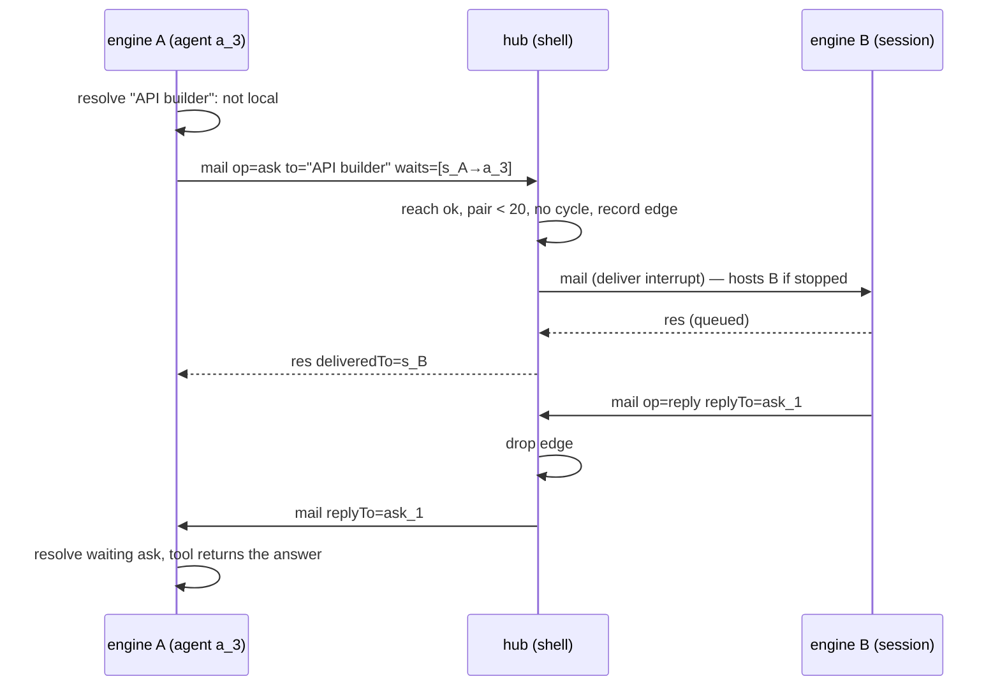

# Nested sessions: roles, limits and mail across engines — Plan

| | |
| --- | --- |
| Spec | [spec.md](spec.md) |
| Tasks | [tasks.md](tasks.md) |
| Updated | 2026-11-11 |
| ADD sections | [4. Process view](../../architecture/README.md#4-process-view), [6. Runtime view](../../architecture/README.md#6-runtime-view), [9. Cross-cutting concepts](../../architecture/README.md#9-cross-cutting-concepts) |
| ADRs | [0003 Engine per chat](../../architecture/decisions/0003-engine-runs-as-a-child-process-per-chat.md), [0010 Engine enforces approval mode](../../architecture/decisions/0010-engine-enforces-approval-mode.md), [0014 Agent tools by layer](../../architecture/decisions/0014-agent-tools-by-layer.md), [0018 The shell hosts engines](../../architecture/decisions/0018-the-shell-hosts-engines-windows-attach.md), [0019 OS write restriction for read-only agents](../../architecture/decisions/0019-read-only-agents-run-under-an-os-write-restriction.md) |

## 1. Context and constraints

What exists (verified in code on 2026-11-11):

- **Session tools live in the hub.** `crates/evo-mesh/src/hub.rs` defines
  `start_session`, `message_session` and `list_sessions` (`session_tools`),
  answers them from `Hub::on_line` (`external_tool_request` →
  `on_tool_call`), and starts sessions through `call_start` →
  `start_session` → `MailStore::create_session`.
  - `SessionSpec` has `{title, prompt, fork, worktree}` only.
  - The running limit is the constant `MAX_RUNNING_CHILDREN = 8`, checked in
    `start_refusal` under `start_gate`.
  - Auto-start is an `AtomicBool` set by the Tauri command `mesh_configure`
    (`apps/desktop/src-tauri/src/mesh.rs`).
- **Chat rows.** `apps/desktop/src-tauri/src/mesh.rs::session_row` creates
  the child's row. A fresh child copies the parent's `provider`/`model`,
  memory flags and `worktree_path`. The shell links `evo-store`, `evo-mesh`,
  `evo-worktrees`, `evo-mcp` and `evo-plugins`, but **not** `evo-engine`, so it
  cannot load agent types.
- **Agent types load in the engine.**
  - `crates/evo-engine/src/agents.rs` has `AgentType` (`tools`, `model`,
    `thinking`, `read_only`, `worktree`, `max_turns`, `prompt`, `source`),
    `dirs(cwd)` (`.evo/agents`, `~/.evo/agent/agents`) and `load(cwd)` (adds
    plugin types).
  - `crates/evo-engine/src/settings.rs` has `skill_dirs` (alias `skills`). Its
    resolution is in `resource_dirs.rs` (`project_resource_dirs`,
    `ResourceKind::{Skills, Prompts, Extensions}`).
- **Subagents.** `crates/evo-engine/src/tools/agent.rs`:
  - `MAX_RUNNING = 4` is a per-session `tokio::sync::Semaphore`.
  - A worktree child gets `crate::tools::builtin_tools_in(&cwd)` as
    replacements, plus its own mesh tools.
  - A read-only type gets `crate::read_only::guard` as a `ChildToolGuard`
    (`create_child_guarded`).
  - External tools are refused to children (`rpc/external_tools.rs`,
    `is_child_execution()`).
- **Mesh tools inside one engine.** `crates/evo-engine/src/tools/mesh.rs`:
  - `reachable` lists the parent, the children and (with `mail.siblings`,
    agents only) the siblings, all from the local router.
  - `deliver` refuses a session node of another engine with "runs in another
    engine".
  - `DEFAULT_ASK_SECS`/`MAX_ASK_SECS` are 600/1800.
  - The router in `crates/evo-engine/src/mesh.rs` has `would_deadlock`,
    `try_wait` and `count_mail` (`MAX_PAIR_MAIL = 20`).
  - Session mail that arrives from the hub is applied by the engine's mail
    handler (same file): a running receiver is steered, an idle one gets the
    mail as its next run plus a wake request, and `Deliver::Queue` is a
    follow-up.
- **Worktrees.** `crates/evo-worktrees/src/lib.rs` `Worktrees::create(cwd,
  location)` names the branch `BRANCH_PREFIX` (`evo/worktree-`) + a generated
  name.
- **Hooks.** `crates/evo-hooks/src/lib.rs` `EVENTS` has no subagent event.
  `crates/evo-engine/src/hooks.rs::run(event, target, input)` runs one event.
- **Sandbox.**
  - `crates/evo-tools/src/sandbox.rs` is a process-wide policy (timeouts,
    output, env, denied globs). It has no OS mechanism.
  - Every shell command starts in `OsExecutionEnv::exec`
    (`crates/evo-tools/src/os_env.rs`). On Windows it is spawned
    `CREATE_SUSPENDED` and put in a job (`shell_jobs::start`); on POSIX it gets
    `process_group(0)`.
  - The desktop passes the saved **Settings → Sandbox** JSON as
    `--sandbox-config` (`apps/desktop/src-tauri/src/engine.rs`,
    `sandbox_defaults`/`sandbox_config`).
- **Shell tools** classify each tool `Read | Edit | Command | Control`
  (`apps/desktop/src-tauri/src/agent_tools/mod.rs`, gate in `gate.rs`). The
  engine's tool facts table is `crates/evo-engine/src/tools/info.rs`
  (`read_only_safe`).
- **Migrations** end at `0012_usage_memory_source.sql`.

Constraints:

- Rust 1.89 MSRV (workspace `rust-version`).
- OS restriction without administrator rights (NFR-5).
- Models only from the catalog (NFR-3).
- The engine protocol stays additive: older engines and windows keep working
  (NFR-1).

Dependency on [shell-hosted engines](../shell-hosted-engines/spec.md)
(ADR 0018):

- Mail across engines (FR-6 – FR-8) reuses the hub's existing delivery,
  which starts a stopped receiver through `Effect::Host`.
- Today a window answers that request. Mail therefore works now while the
  main window lives, and with no window at all once the shell hosts engines.
- Nothing in this plan waits for that feature. Its phases come last so the
  independent work lands first.

## 2. Architecture check

| Rule | Result | Notes |
| --- | --- | --- |
| The engine owns agent logic; the shell relays and provides native features | ok | The engine resolves agent types, models and thinking, and applies roles. The hub (shell) stores, routes and enforces reach and limits, as it already does for session tools. |
| Layers point down; library crates stay free of engine/desktop concerns | ok | `evo-mesh` gets plain data types (`SessionRole`, mail ops) and no engine knowledge. `evo-tools` gets the write policy and the helper entry point; the engine binary only calls it. |
| Protocol changes update `evo-protocol`, the engine and the desktop together | ok | New mesh ops and an RPC command `set_limits`, announced in `ready` capabilities, with the hub, the engine and `src/engine/protocol.ts` changed together. |
| Models come from models.dev; no hardcoded model facts | ok | `model` is checked against `evo_runtime` catalogs and configured providers; `thinking` is clamped with the model's levels. |
| Real engine in the app; settings and credentials reload live | ok | Limits apply live (FR-5) through `mesh_configure` and `set_limits`. |
| Untrusted input stays untrusted; permissions, sandbox and project trust stay in the path | ok | The model cannot supply a resolved role; access is never widened (FR-4); project `agentDirs` follow project trust; the OS layer sits behind the checker (ADR 0019). |
| Desktop UI structure and `DESIGN.md` | ok | Card, header, Settings → Sandbox and Customize → Agents change inside their features, through stores. |
| A new persistent store or a trust boundary needs an ADR | deviation, covered | The OS write restriction is a new trust boundary: ADR 0019. ADD §9 ("Permissions and sandbox") is edited when 0019 is accepted (T40). No new store: one column on `chats`. |
| Spec changes of other features go spec first | ok | Mesh FR-27/FR-32 and subagents FR-3/FR-7/FR-15/FR-18 are restated, and T21/T22/T29/T30 (subagents) and T22 (mesh) are pointed here in the last phase (T36 – T39). |

## 3. Design

### 3.1 Overview

```text
 parent engine                       shell (hub)                     child engine
 ─────────────                       ───────────                     ────────────
 start_session{agentType,model,      SessionSpec{.., role, branch}
   thinking,branch,…}                 → limit (settable)
   │ engine resolves the role         → MailStore::create_session
   │ (agents::load, catalog, FR-4)       chats.role (0013), model,
   └──► external_tool_request ───────►   worktree (branch)            --role-file → instructions,
                                      Effect::Host ─────────────────►   tools, access, thinking
                                                                        read-only → guard + OS policy
 send_message/ask/reply to a node
 of another engine
   └──► mesh mail op (stdout) ──────► route: reach, pair limit,
                                      wait-for graph, store as
                                      session mail ─────────────────► <mail …> chip / ask table
```

The parent engine turns `agentType`/`model`/`thinking` into a resolved
**role**. The hub stores it with the chat and starts the session as today.
The child engine applies the role at every start.

Mail to a node outside the engine leaves as a mesh mail envelope. The hub
routes it with the same rules the local router uses and delivers it as
durable session mail.

Read-only roles and read-only subagents run shell commands through a small
**helper** (`evo-engine --sandbox-exec`). The helper restricts itself with the
platform mechanism, then starts the shell.

### 3.2 Components

| Layer | Path | Responsibility | Requirements |
| --- | --- | --- | --- |
| crate | `crates/evo-mesh/src/wire.rs` | `SessionRole`; `MailBody` gains `kind`, `ask`, `reply_to`, `waits`; mail op names | FR-1, FR-6, FR-8 |
| crate | `crates/evo-mesh/src/hub.rs` | `SessionSpec.role`/`.branch`; schema of `start_session`; settable `max_children`; `route_mail` (reach incl. siblings, pair counter, cross-engine wait graph); `peers` command | FR-1 – FR-3, FR-5 – FR-9 |
| engine | `crates/evo-engine/src/session_roles.rs` (new) | Resolve `agentType`/`model`/`thinking` into a role on `start_session`; strip model-supplied `role`; cap access (FR-4); apply `--role-file` at start | FR-1, FR-2, FR-4, NFR-3, NFR-4 |
| engine | `crates/evo-engine/src/rpc/external_tools.rs` | Call `session_roles::enrich` for `start_session` before the request goes out | FR-1, FR-2 |
| engine | `crates/evo-engine/src/args.rs`, `src/session.rs` | `--role-file`; role instructions in the system prompt, tool narrowing, initial thinking; read-only guard as the first `before_tool_call` link | FR-1, FR-13 |
| engine | `crates/evo-engine/src/tools/agent.rs` | Settable running limit (slots instead of a fixed semaphore); `branch` on `isolation`; read-only children get restricted shell tools; fire `SubagentStop` | FR-5, FR-9, FR-10, FR-12 |
| engine | `crates/evo-engine/src/tools/mesh.rs`, `src/mesh.rs` | Forward unknown targets to the hub; remote ask table; reply routing; `list_nodes` merges peers; capability `mesh.crossEngineMail` | FR-6 – FR-8 |
| engine | `crates/evo-engine/src/agents.rs`, `settings.rs`, `resource_dirs.rs`, `customize.rs` | `agentDirs` setting, `ResourceKind::Agents`, load order, `source` on each type and in `list_customizations` | FR-11 |
| engine | `crates/evo-engine/src/hooks.rs`, `crates/evo-hooks/src/lib.rs` | `SubagentStop` event (non-blocking, output dropped) | FR-10 |
| engine | `crates/evo-engine/src/tools/mod.rs` | `builtin_tools_in(cwd, policy)`; no `lsp` for read-only | FR-12, FR-13 |
| engine | `crates/evo-engine/src/bin/evo-engine.rs` | Dispatch `--sandbox-exec` and `--sandbox-probe` to `evo_tools::sandbox` before anything else | FR-12, FR-14 |
| crate | `crates/evo-tools/src/sandbox.rs`, `src/sandbox/` (new: `windows.rs`, `macos.rs`, `linux.rs`) | `WritePolicy`, `Availability`, `helper_main`, `probe_main` | FR-12, FR-14, NFR-5, NFR-6 |
| crate | `crates/evo-tools/src/os_env.rs` | `OsExecutionEnv::with_write_policy`; `exec` wraps the program in the helper; fail closed | FR-12, FR-14 |
| crate | `crates/evo-worktrees/src/lib.rs` | `create_named(cwd, location, branch)`: `evo/<branch>`, validated before anything is created; managed record keeps the branch | FR-9 |
| crate | `crates/evo-store/src/migrations/0013_chat_roles.sql`, `src/chats.rs` | `chats.role` column; `NewChat.role`, `Chat.role` | FR-1, NFR-1, NFR-4 |
| desktop shell | `apps/desktop/src-tauri/src/mesh.rs` | `session_row` uses the role's provider/model and stores the role; `mesh_configure` takes `maxNestedSessions`; create named worktree | FR-1, FR-2, FR-5, FR-9 |
| desktop shell | `apps/desktop/src-tauri/src/engine.rs` | Write `transcripts/<chat>.role.json` from `chats.role` and pass `--role-file`; limits in `sandbox_defaults`; send `set_limits` on change; `sandbox_protection` command (runs `--sandbox-probe` once) | FR-1, FR-5, FR-14 |
| desktop shell | `apps/desktop/src-tauri/src/agent_tools/mod.rs`, `src/mcp.rs` | Refuse non-`Read` app tools and connector tools without `readOnlyHint` to a chat whose role is read-only | FR-13 |
| desktop UI | `apps/desktop/src/components/ai-elements/session-proposal.tsx` | Card shows type, model, thinking, branch | FR-3 |
| desktop UI | `apps/desktop/src/features/shell/workspace-header.tsx` | Child header shows the role's name and source | FR-3, NFR-4 |
| desktop UI | `apps/desktop/src/features/settings/sections/sandbox-settings.tsx` | Two limit inputs; protection status and its gaps | FR-5, FR-14 |
| desktop UI | `apps/desktop/src/features/customize/customize-page.tsx` | Agents rows show their source | FR-11 |
| desktop UI | `apps/desktop/src/features/customize/hooks-section.tsx` | `SubagentStop` in the event list | FR-10 |
| desktop UI | `apps/desktop/src/engine/protocol.ts`, `src/stores/engine-store.ts` | Types for the new card payload and `set_limits`; nothing else (the engine and hub do the work) | FR-3, FR-5 |

### 3.3 Interfaces

#### `start_session` (hub schema, additive)

```jsonc
{
  "title": "…", "prompt": "…", "context": "fresh|fork", "worktree": true,
  "agentType": "reviewer",          // a name the agent tool takes
  "model": "provider/model-id",     // a catalog id; default: type's, else parent's
  "thinking": "low",                // a level; clamped to the model
  "branch": "api-auth"              // with worktree: branch evo/api-auth
}
```

The parent engine adds `role` before the request leaves it, and drops any
`role` the model wrote:

```jsonc
"role": {
  "name": "reviewer",               // null when only model/thinking were given
  "source": "project|projectDir|user|userDir|plugin|builtin",
  "sourcePath": ".evo/agents/reviewer.md",   // display only
  "instructions": "…",              // the type's body
  "tools": ["read", "bash"],        // null: the parent's
  "access": "read-only|full",       // already capped by the parent's access (FR-4)
  "provider": "acme", "model": "acme-small", "thinking": "low"
}
```

- **Refusals.** The engine refuses an unknown type, an unknown model, a model
  whose provider has no credentials, and a `branch` without `worktree`. Each
  refusal is returned as a tool error that names what is available.
- **Older engine.** The hub refuses a call that has `agentType`, `model` or
  `thinking` but no `role`, with "this engine cannot start sessions with a
  role". Without the new fields the call behaves exactly as today (NFR-1).
- **Proposal and start payloads** gain:
  `role: {name, source, model, thinking, access}` (no instructions) and
  `branch`. `session-proposal.tsx` renders them.

#### Role at engine start

- `engine_start` reads `chats.role`. When it is set, it writes it to
  `<agent dir>/transcripts/<chat>.role.json` and passes
  `--role-file <path>`.
- The database is the source of truth; the file is rewritten at every start.
  A file is used instead of a command-line JSON argument because of Windows'
  command-line length limit.
- The engine:
  1. appends `<role name="…">instructions</role>` to the system prompt;
  2. narrows tools to `tools` (the mesh tools stay, as for subagent types);
  3. sets thinking at the session's first start only (the person may change
     it later);
  4. with `access: read-only`, puts `read_only::guard` first in the
     `before_tool_call` chain (`session.rs`), builds shell tools with
     `WritePolicy::ReadOnly`, and drops `lsp`.

`maxTurns` is ignored for sessions.

#### Limits

- The app setting `sandbox` (Settings → Sandbox) gains
  `maxNestedSessions` (1–24, default 8) and `maxRunningSubagents` (1–8,
  default 4).
- The shell applies them three ways:
  - `mesh_configure { autoStartSessions, maxNestedSessions }` →
    `Hub::set_max_children`;
  - new engines get them in `--sandbox-config` (`SandboxConfig` gains
    `max_running_subagents`);
  - running engines get the new RPC command
    `{"type":"set_limits","maxRunningSubagents":6}`. An engine without it
    answers "unknown command"; the shell ignores that, and the engine picks
    the limit up at its next start.
- Lowering a limit never stops running work.

#### Mail across engines

The engine emits a mesh envelope (`evo_mesh::wire::Envelope`, kind `mail`)
on stdout:

```jsonc
{ "kind": "mail", "op": "send|ask|reply|cancel_ask", "id": "m_…",
  "from": "s_A/a_3", "to": "parent|s_B|<title>",
  "body": {
    "text": "<mail id=… from=… kind=…>…</mail>",   // rendered by the sender, as today
    "deliver": "interrupt",
    "title": "API builder",
    "kind": "message|ask|reply",
    "ask": { "id": "ask_…", "timeoutMs": 600000 },   // op ask
    "replyTo": "ask_…",                              // op reply
    "waits": [["s_A", "s_A/a_3"]]                    // local wait edges that end at `from`
  } }
```

The hub answers with `res` (`corr` = id):

- success: `{ "deliveredTo": "s_B", "title": "…" }`;
- refusal: `error {code, message, reachable?}`, with codes
  `not_found` (not reachable; lists who is), `would_deadlock`, the pair-limit
  code the router already uses, and `unsupported` (the receiver's engine lacks
  `mesh.crossEngineMail`).

`list_nodes` asks the hub `{kind:"cmd", op:"peers"}` → `res {nodes:[{id,
title, state}]}` and adds those nodes to the local ones.

Hub routing (`Hub::route_mail`):

- **Reach.** The sending chat's parent, its children, and its siblings
  (`children_of(parent_of(chat))` minus itself), never another root tree.
  This changes mesh FR-27 for sessions. A title must match exactly one
  reachable session.
- **Pair limit.** A counter per directed pair of chats, reset when the
  sender's chat starts a run (`agent_start`), limit `MAX_PAIR_MAIL` (20,
  moved to `evo-mesh` and re-exported to the engine).
- **Wait-for graph.** The hub keeps the open remote asks
  (`ask id → (from node, to session)`) and the local edges each ask carries
  in `waits`. Before an ask is recorded, it refuses one whose target can
  reach the asker through remote asks plus reported local edges
  (`would_deadlock`). `reply`, `cancel_ask` and a receiver run's end remove
  the edge.
- **Delivery** is `post()` with `Deliver::Interrupt`: durable, at least once,
  a stopped receiver hosted through `Effect::Host`. The receiver's engine
  handles it as today.
- **Receiving an ask.** The receiver records `askId → from` in a remote-ask
  table so that `reply` checks the asker and routes the answer back. When the
  receiver's run ends with an unanswered remote ask, the engine sends its
  final text as the reply (mesh FR-29).
- **Receiving a reply.** A `replyTo` mail that matches a waiting `ask` call
  resolves it and is not shown as a message. One with no waiting call (the
  asker restarted or timed out) is delivered as a normal mail chip.

#### `SubagentStop` hook

It runs after a subagent's run ends, in the parent's engine. It never blocks,
and its output is dropped. Its input has the common fields every event gets
from `hooks::run`, plus:

```jsonc
{ "agent_id": "a_…", "agent_type": "explore", "description": "…",
  "status": "finished|failed|cancelled|stopped",
  "report": "first 2,000 characters",
  "worktree": { "path": "…", "branch": "evo/…" } | null }
```

#### Write policy and helper (`evo-tools`)

```rust
pub enum WritePolicy { Unrestricted, ReadOnly { scratch: PathBuf } }
pub struct Availability { pub available: bool, pub mechanism: &'static str,
                          pub reason: Option<String>, pub gaps: Vec<&'static str> }
pub fn availability() -> &'static Availability;   // cached, probes once per process
pub fn helper_main(args: Vec<OsString>) -> !;     // evo-engine --sandbox-exec --scratch <dir> -- <program> <args…>
pub fn probe_main() -> !;                          // evo-engine --sandbox-probe: prints Availability as JSON
impl OsExecutionEnv { pub fn with_write_policy(self, policy: WritePolicy, launcher: PathBuf) -> Self }
```

`exec` with `ReadOnly` runs `<launcher> --sandbox-exec --scratch <dir> --
<shell> <args>` with the same pipes, job and process group as today. The
launcher is the engine's own executable. When `availability()` says no, it
fails with "This computer cannot keep read-only agents from writing:
{reason}" (FR-14).

The helper sets `TMP`, `TEMP` and `TMPDIR` to the scratch folder and sets
`GIT_OPTIONAL_LOCKS=0`. Then, per platform:

- **Windows.** Give the scratch folder a low mandatory label
  (`SetNamedSecurityInfoW`, `LABEL_SECURITY_INFORMATION`). Lower the helper's
  own token to low integrity (`SetTokenInformation(TokenIntegrityLevel)`,
  allowed without privileges because it only lowers). Spawn the shell, which
  inherits the token, the stdio and the job, then wait and pass the exit code
  on.
  - This needs only additional features of the existing `windows-sys`
    dependency (`Win32_Security`, `Win32_Security_Authorization`,
    `Win32_System_Threading`).
  - Phase 0 confirms it. If lowering the helper's own token fails, the
    fallback is `CreateProcessAsUserW` with a duplicated low-IL token, which
    only the helper does, so the async piping in `os_env.rs` stays as it is.
- **macOS.** `exec /usr/bin/sandbox-exec -p <profile> <shell> <args>`, with
  this profile:

  ```text
  (version 1)(allow default)(deny file-write*)
  (allow file-write* (subpath "<scratch>") (literal "/dev/null") (literal "/dev/tty"))
  ```
- **Linux.** A `landlock` ruleset: read and execute everywhere, write, make and
  remove only under scratch and `/dev/null`, at the best ABI available.
  `restrict_self`, then `exec`. A new dependency, `landlock` (MIT OR
  Apache-2.0, 0.4.7, `rust-version` 1.71), on Linux only. If no ABI is available, the
  helper is never run: `availability()` is false.

#### Settings → Sandbox protection status

Tauri command `sandbox_protection() -> Availability`. The shell runs the
staged engine with `--sandbox-probe` once per app start and caches the result.
The probe actually tries a forbidden write.

### 3.4 Data and storage

- **`0013_chat_roles.sql`:** `ALTER TABLE chats ADD COLUMN role TEXT;` holds
  JSON `SessionRole`. `NULL` means no role, which is every existing row.
  `Chat`/`NewChat`/`ChatPatch` gain `role`.
  - The [shell-hosted engines](../shell-hosted-engines/plan.md) plan adds
    no migration, so `0013` is free. A migration that lands first elsewhere
    moves this file to the next number before it is applied anywhere.
- **Role file:** `<agent dir>/transcripts/<chat>.role.json` is a copy of
  `chats.role` written at engine start. It is removed with the chat's
  transcript.
- **Scratch folders** are per agent: `<agent dir>/scratch/<chat>/<agent id or
  "session">/`, removed when the subagent is dropped or the chat is deleted.
  Leftovers are swept at engine start.
- **In memory, in the hub:** `max_children`, the pair counters, open remote
  asks and their wait edges. They are lost on app restart, and a pending ask
  then times out on its asker's side.
- **In memory, in the engine:** the remote-ask table and the `Slots` limit.

### 3.5 Behaviour

Start with a role:

1. The model calls `start_session {agentType, model, …}`.
2. `session_roles::enrich` resolves the type with `agents::load(cwd)`, the
   model with the runtime catalogs and providers, and the thinking level with
   the model. It applies FR-4 and adds `role`.
3. The hub validates the call and records a proposal, or starts at once.
4. `create_session` writes the row with the role's provider, model and role,
   and creates the worktree on `evo/<branch>`.
5. `Effect::Host` → the engine starts with `--role-file` → the brief is sent.

Cross-engine ask:



Read-only subagent: the guard runs first, as today. If it allows a shell
command, the command runs through the helper. A write that the guard misread
fails with the OS's "access denied", which the agent sees as normal command
output.

### 3.6 Errors and edge cases

| Case | What happens |
| --- | --- |
| Type file edited or removed after start | The stored role is used; nothing is re-read. |
| Model's credentials removed later | The child fails like any chat without credentials; no fallback. |
| Limit lowered below the running count | Running sessions and agents continue; new starts are refused until under the limit. |
| `branch` exists or is invalid | `create_named` refuses before `git worktree add`; the start fails and nothing is created. |
| Ask to an archived or closed sibling | Delivered as mail. Archived chats are not woken (hub rule), so the asker times out. |
| Asker engine restarted while waiting | The reply arrives as a normal mail chip. |
| Receiver engine lacks the capability | `unsupported`, with "update evo"; nothing is stored. |
| Protection unavailable | Read-only agents' shell commands are refused (FR-14); `full` agents are unaffected. |
| Helper cannot start (exe moved, AV block) | Treated as unavailable for that call; refused, logged. |

### 3.7 Security and trust

- **Roles are trusted data built by the engine.** The model supplies only a
  type name and a model id. The engine strips any `role` from the arguments,
  and the hub accepts `role` only inside an `external_tool_request` from an
  engine. Instructions come from agent files that already load for subagents.
  Project `agentDirs` follow the same project-trust gate as project skill
  folders (`project_resource_dirs`).
- **No widening.** A role's access is capped by the parent's (FR-4). The
  approval mode comes from the shell at start (`--approval-mode`), and an
  agent cannot change it. A read-only role cannot gain write tools through
  `tools`, because the guard runs on every call.
- **Mail stays untrusted text.**
  - It reaches the model only as `<mail>` chips (mesh FR-28), never as the
    person's message.
  - Reach (never across root trees) and the pair limit are enforced in the
    hub, not in tool descriptions (NFR-2).
  - Deadlock checks fail closed: an ask with malformed `waits` is refused.
- **OS restriction.**
  - It applies only to commands of read-only agents.
  - The checker still runs first and keeps refusing the known brokers that
    write on a command's behalf (container clients, `wsl`, `git push`,
    credential helpers).
  - Gaps are listed in **Settings → Sandbox**: brokers, Linux file metadata
    before Landlock ABI 3/5, and in-process engine tools.
  - The helper never raises a privilege. It only lowers its own.
- **Read-only sessions in the shell.** App tools of class `Edit`, `Command`
  or `Control`, and connector tools without `readOnlyHint: true`, are
  refused before any approval prompt, with a message naming the role.

### 3.8 Configuration

| Key | Type | Default | Where | Applies |
| --- | --- | --- | --- | --- |
| `sandbox.maxNestedSessions` | integer 1–24 | 8 | app setting `sandbox` (Settings → Sandbox) | at once (hub) |
| `sandbox.maxRunningSubagents` | integer 1–8 | 4 | app setting `sandbox` | at once (`set_limits`), and at engine start |
| `agentDirs` (alias `agents`) | list of folders | none | engine settings (user `settings.json`, project `.evo/settings.json`) | next agent-type load (types are loaded per call) |

Kept subagents stay at 16. Nesting stays one level.

## 4. Alternatives considered

| Option | Why not |
| --- | --- |
| Resolve agent types in the hub or shell | The shell does not link `evo-engine`; a second loader would drift from `agents.rs` and the engine's model catalog. |
| Let the child engine resolve its own type | Its folder may be a worktree without the parent's uncommitted type files, and it cannot enforce FR-4 against the parent. |
| Pass the role as a JSON command-line argument | Windows' command-line length limit; a file written from the database avoids it. |
| Windows: `CreateProcessAsUserW` from `os_env.rs` | It would replace tokio's spawn, piping and job handling for every command. A helper that lowers itself keeps one spawn path. It stays the fallback if Phase 0 shows self-lowering fails. |
| Topics or a shared channel for siblings | Out of scope (spec 2.2); point-to-point mail covers FR-6. |
| Engines talking to each other directly | Bypasses the hub's durability, reach and limits. |
| A fixed `tokio::Semaphore` resized with `add_permits`/`forget_permits` | Shrinking cannot take permits back from running agents. A small counted-slots type with `Notify` is simpler. |

## 5. As-built notes

### Phase 0 — Windows spike (2026-11-11)

Run on Windows 11 (build 26200), a standard user without administrator
rights, Git for Windows 2.54, Windows PowerShell 5.1. A throwaway helper
(not in the repository) labelled a scratch folder low
(`S:(ML;OICI;NW;;;LW)`), pointed `TEMP`/`TMP` there, set
`GIT_OPTIONAL_LOCKS=0`, then started the command three ways.

| Command | Low integrity, helper lowers itself | Low integrity, `CreateProcessAsUserW` | Write-restricted token (RESTRICTED SID) |
| --- | --- | --- | --- |
| PowerShell: `Get-ChildItem`, read a file, temp file | works | works | fails: the CLR does not start (`0x80070005`) |
| PowerShell: write to the workspace, write to HKCU | refused ("Access … is denied") | refused | — |
| `cmd /c` write to the workspace | refused ("Access is denied.") | — | — |
| `git.exe status`, `git log` (native, not MSYS) | works | — | — |
| Git Bash (MSYS2), any command | fails at start: `NtCreateDirectoryObject(\BaseNamedObjects\msys-2.0S5-…)` returns `0xC0000022` | same | fails at start: `NtSetInformationToken (TokenDefaultDacl)` |

Timings (three runs each, `total_ms` from helper start to exit):

| Command | Unrestricted | Low, self-lowered | Low, `CreateProcessAsUserW` |
| --- | --- | --- | --- |
| `powershell -NoProfile -Command 'x'` | 379–395 ms | 406–429 ms | 408–413 ms |
| `git.exe log --oneline -1` | 51–53 ms | 54–57 ms | — |

Labelling the folder and lowering the token take about 3 ms. The added
start cost is 3–35 ms, inside NFR-5's 100 ms.

Findings:

- **The mechanism works for native Windows programs.** Lowering the
  helper's own token is enough: no `CreateProcessAsUserW` and no raw spawn
  are needed. A low process can read the workspace, the home folder and the
  repository, and cannot write files there or keys in HKCU. Writes to the
  scratch folder work.
- **Git Bash cannot run at low integrity.** The MSYS2 runtime creates its
  shared namespace under `\BaseNamedObjects`, which needs medium integrity.
  When any normal Git Bash already runs, the namespace exists with a medium
  label. Lowering that label would let low processes plant objects that the
  person's own Git Bash later opens, so it is not an option. A private copy
  of the MSYS2 runtime (its own namespace, created low by the helper) might
  work, but it was not tried.
- **A write-restricted token is not an alternative.** It breaks both
  PowerShell and MSYS2.
- **Gaps to list in Settings → Sandbox**, besides those in ADR 0019:
  - `%USERPROFILE%\AppData\LocalLow` and other low-labelled folders stay
    writable. A test write there succeeded.
  - The low process can still use the network.

**Chosen for Windows:**

- The helper lowers its own token, then starts the shell. It sets `TEMP`,
  `TMP` and `GIT_OPTIONAL_LOCKS=0`.
- A read-only agent's `powershell` runs restricted.
- Its `bash` is refused before it starts (FR-14, fail closed), with
  "`bash` is not available to read-only agents on Windows; use
  `powershell`". The owner chose this on 2026-11-11 (spec 6.2).
- The private MSYS2 runtime was tried briefly and dropped.
  - Hard links to Git's `usr/bin` are refused: Windows wants write access to
    the files in Program Files.
  - A copy is 93 MB to keep in step with every Git update.
- macOS (T2) and Linux (T3) were not run: this computer has neither, and no
  WSL distribution.

### Phase 1 — as built (2026-11-11)

- `ChatPatch` has no `role`. The role is written once, when the chat is
  created, or with `chats::set_role` after a fork's copy is made, and never
  changed later.
- The proposal and start answers carry the whole resolved role, instructions
  included, not only a summary. A card's **Start** after an app restart,
  when the hub no longer knows the proposal, sends it back, so the session
  still starts with its role. The card and the header show only the summary.
- The hub takes a `role` only from an engine whose `ready` announces
  `mesh.sessionRoles`. Any other `role` was written by the model and is
  refused.
- The role's thinking level is applied by the shell, not the engine: it
  passes `--thinking` with `--role-file` while the chat has no turns.
  Later starts leave the level to the person.
- `find_model` moved to `session_roles.rs`, and the `agent` tool uses it
  from there.
- Tool narrowing uses the engine's `--tools` allow-list, so it covers
  built-in and extension tools. External tools that the desktop configures
  later (`configure_external_tools`) are not narrowed yet; that is left to
  Phase 5 (T27), together with the shell gate.

### Phases 2 and 3 — as built (2026-11-11)

- **Limits.**
  - The hub's limit (`Hub::set_max_children`, 1–24) is read from
    Settings → Sandbox when the hub is made, before any window pushes it,
    and later through `mesh_configure { maxNestedSessions }`.
  - The engine's limit is a process-wide value (`set_running_limit`, 1–8),
    set from `--sandbox-config` at start and by `set_limits` later. A counted
    `Slots` type per session replaces the fixed semaphore.
  - The webview sends both on `sandbox://changed`. Before shell-hosted
    engines land, an engine no window holds gets the new value at its next
    start.
- **Agent folders.**
  - Each type records its folder in `AgentType::origin`, and
    Customize → Agents shows it ("Project · agentDirs", "Personal ·
    agentDirs").
  - A trusted project is one whose trust decision is not "no", the same
    rule as skills.
  - The project's own `.evo/agents` loads whatever the trust decision, as it
    did before this feature.
- **Branch names.**
  - `evo/<name>` is recorded in the worktree's git folder (`evo-branch`), so
    removal deletes exactly that branch.
  - Worktrees are still recognised by their folder, not their branch.
- **`SubagentStop`.**
  - It fires from `announce` with the agent type as its matcher, in the
    background.
  - The statuses are `finished`, `failed` and `cancelled`.
  - An agent lost when its engine exited is reported at the next start
    without a hook run, so `stopped` is never sent today.

### Run in the app (2026-11-11)

The debug build ran with a separate identifier on a copy of the agent data.
Model turns used the person's default model.

- **The card (T12).** An agent asked for `agentType: reviewer`,
  `worktree: true`, `branch: review-readme`. The card read "Proposed
  session · in its own worktree (evo/review-readme)" and "Runs as reviewer ·
  … · thinking low · read-only".
- **Start.** **Start session** made the child chat with the stored role
  (source `project`, `.evo/agents/reviewer.md`) and wrote
  `<chat>.role.json`. The child's composer showed thinking **Low**, and the
  branch `evo/review-readme` existed.
- **Fixed in the header.** The run showed two problems, now fixed:
  - The role chip squeezed the session's title to one letter. The chip now
    shows only the type's name, with an eye for read-only, and gives way
    first; the details are in its tooltip.
  - The worktree chip showed the folder's name. It now shows the branch,
    from `worktree_list`, and passes it to the review dialog.
- **Customize → Agents (T17).** A type from the user's `agentDirs` showed as
  "Personal · agentDirs".
- **Limits (T15).** **Sessions running at once** set to 2 in
  Settings → Sandbox applied to the hub at once: of three starts, two ran
  and the third was refused ("the limit is 2").
- **Not yet built.** A read-only session is not yet enforced as read-only:
  only its instructions say so. That is Phase 5 (T27, T28).

### OS write restriction dropped (2026-11-11)

The owner decided against an operating-system write restriction (ADR 0020
supersedes 0019).

- FR-12, FR-14, NFR-5 and NFR-6 are dropped, and so are the tasks of
  Phases 0 and 4.
- The parts of section 3 about `WritePolicy`, the `--sandbox-exec` helper,
  `--sandbox-probe`, `landlock` and the per-platform mechanisms describe
  nothing that will be built. Read them as history.
- The Windows spike above stays as the record of why.
- FR-13 (read-only sessions) is built with the command checker and the
  shell gate only.

### Phase 5 — as built (2026-11-11)

A read-only session is guarded in three places.

- **Engine.** `session_roles::before_tool_call` is the first link of the
  session's chain: a call it refuses reaches no hook and no approval prompt.
  - Engine tools go through `read_only::guard`, as for read-only subagents.
  - `lsp` is refused and excluded at start.
  - Tools the app registered (`approval::is_external`) are left to the app.
  - Anything else, such as an extension's tool, is refused as unknown.
- **What the shell offers.** For a chat whose stored role is read-only,
  `agent_tools_definitions` offers only registry tools of class `Read`, and
  the connectors provider offers only tools whose server sets
  `readOnlyHint`. The pool now passes that hint on (`readOnly` in
  `chat_tools`).
- **When a tool is called.** A registry tool that is not `Read` is refused
  before it runs or asks, and a connector tool without the hint is refused
  by the provider.
- **Role tool lists.** Any role's tool list (not only a read-only one) now
  also narrows the app tools the engine registers (`allows_external` in
  `rpc_configure_external_tools`).

### Phase 6 — as built (2026-11-11)

What was built differs from section 3.3 as follows.

- **`modes.rs` has two changes the plan did not name.**
  - The RPC loop links its session to the hub, so the router's outbox of
    mail ops reaches stdout whatever the client subscribed to.
  - An incoming `res` goes to `router().on_answer` instead of being answered
    back.
- **`MailBody` gains `fromNode` and `toNode`.** They keep node addresses
  (subagents, replies to an agent) in the stored mail without a migration.
  Old bodies parse and are written as before.
- **The hub answers the sender once the mail is stored,** not when the
  receiver takes it: a stopped receiver may take long to be hosted.
- **Title errors.** A title that several reachable sessions share is
  `bad_request`, an unknown one `not_found`. Both carry the `reachable`
  list.
- **Capability.** A receiver whose engine is ready without
  `mesh.crossEngineMail` gets `unsupported`. A stopped receiver is assumed
  to have it, since the app starts its own engine build.
- **The sender is checked.** An envelope whose `from` is not a node of the
  sending engine is `forbidden`. `waits` that name another engine's nodes
  are refused (`bad_request`).
- **The pair limit** counts `send` and `ask`, not `reply`.
- **Timeouts:** 15 s for the hub to route a mail op, 3 s for `peers`.
- **Not handled:** an engine that switches to another session is not linked
  again, so its mail stays local after the switch.
- **Not run yet:** T34, the run in the app. With no window, a stopped
  receiver is hosted only once shell-hosted engines land.

### T34 — run in the app (2026-11-11)

The debug build ran with a separate identifier on a copy of the agent data,
with the person's default model.

| Step | Result |
| --- | --- |
| A sends to its sibling B by title | B was woken (`<mail-arrived>`) and took in the content |
| B asks its parent mid-turn | The parent was woken, answered with `reply` and the right `askId`; B's `ask` returned "answered: Blue" in the same turn |
| A subagent of the parent mails B | Delivered across engines; B was woken |
| B's engine crashed, then A mails it | The shell logged "restarting the engine to deliver mail"; B came up and answered |
| Mail waiting when the app quits | Delivered after the app started again (FR-24 path), and B answered |

Found:

- **Wrong `title` attribute.** Across engines, the `title` attribute inside
  the `<mail …>` text is the sender's node address (`s_…`), not its title.
  The sending engine renders the text and does not know its own session's
  title. The chip and the wake text show the right title, because the hub
  fills it. Fixed the same day: the hub sets the attribute in the opening
  tag to the chat's title when a session itself sends
  (`with_sender_title`, test `route_mail_puts_the_sending_sessions_title_in_its_mail`).
  A subagent's own title (its description) is kept.
- **No restart after `stopEngine`.** An engine the app stopped with
  `stopEngine` (status `idle`, as around a worktree's Apply) is not hosted
  for new mail. The window's `onHost` restarts only `exited` and `error`
  engines, so the mail waits until the chat is resumed or opened. That is
  the window hosting that [shell-hosted engines](../shell-hosted-engines/spec.md)
  replaces. Mail that waited was delivered as soon as the engine came back.
